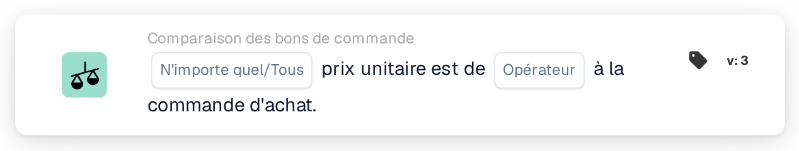
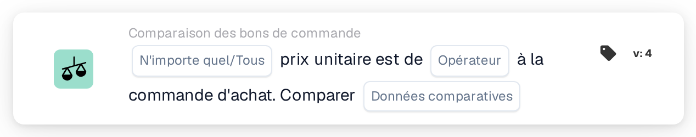
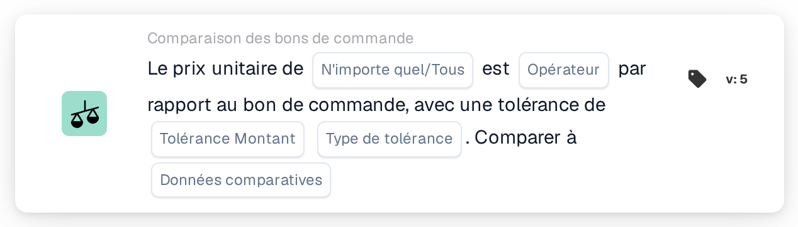

# Tout/tout le prix unitaire est

<figure><figcaption>
Version 2
</figcaption></figure>

<figure><figcaption>
Version 3
</figcaption></figure>

<figure><figcaption>
Version 4
</figcaption></figure>

<figure><figcaption>
Version 5
</figcaption></figure>

## **Objectif :**

Cette carte de workflow est utilisée pour comparer le prix unitaire d'un document avec le prix unitaire d'un bon de commande, garantissant ainsi que les prix s'alignent dans les niveaux de tolérance définis. La comparaison peut déclencher des actions si le prix unitaire ne répond pas aux attentes. **Version 4** ajoute plus de flexibilité en permettant aux utilisateurs de choisir différentes entités à comparer, offrant ainsi un niveau de contrôle plus approfondi sur les processus de tarification et d'approvisionnement.

## **Composants de la carte :**

1. **Tous/Tous :**
   * **Descriptif** : Définit si la condition s'applique à tout ou partie des instances où le prix unitaire est comparé.
   * **Possibilités** :
     * **Any** : La condition est remplie si un prix unitaire répond à la condition de comparaison spécifiée.
     * **Tous** : La condition n'est remplie que si tous les prix unitaires répondent à la condition de comparaison spécifiée.
2. **Opérateur :**
   * **Descriptif** : Définit la condition de comparaison du prix unitaire avec la valeur spécifiée.
   * **Possibilités** :
     * **Égal à (=)** : Vérifie si le prix unitaire correspond à la valeur spécifiée.
     * **Pas égal à (≠)** : garantit que le prix unitaire est différent de la valeur spécifiée.
     * **Supérieur à (>)** : Vérifie si le prix unitaire est supérieur à la valeur spécifiée.
     * **Supérieur ou égal à (≥)** : Vérifie si le prix unitaire est supérieur ou égal à la valeur spécifiée.
     * **Inférieur à (<)** : Vérifie si le prix unitaire est inférieur à la valeur spécifiée.
     * **Inférieur ou égal à (≤)** : Vérifie si le prix unitaire est inférieur ou égal à la valeur spécifiée.

## **Composants supplémentaires dans la version 4 :**

**Type de comparaison :**

* **Descriptif** : Permet aux utilisateurs de choisir quelles entités seront comparées en plus du prix unitaire.
* **Possibilités** :
  * **Bon de commande au document** : Compare le prix unitaire du bon de commande avec le prix unitaire du document.
  * **Reçu dans le document** : Compare le montant côté réception dérivé du bon de commande rapproché avec le montant côté document.
  * **Bon de commande à reçu** : Compare le côté bon de commande avec le montant dérivé côté reçu.

## **Fonctionnalité :**

* **Évaluation de la condition :** Le système compare le prix unitaire dans le document au prix unitaire dans le bon de commande (ou une autre entité sélectionnée, dans la version 4) en fonction de l'opérateur sélectionné. Si la comparaison est vraie, le flux de travail se déroule selon les étapes suivantes, soit en déclenchant l'approbation, soit en arrêtant le processus.
* **Exécution d'action :**
  * **État réel** : Si la condition est évaluée comme vraie (par exemple, le prix unitaire dans le document est supérieur à la valeur spécifiée), le flux de travail poursuivra l'action réelle (par exemple, approbation, traitement du document).
  * **Fausse condition** : Si la condition est évaluée comme fausse (par exemple, le prix unitaire dans le document ne correspond pas à la comparaison), le flux de travail ne se poursuivra pas.

## **Installation et configuration :**

* **Configuration de la version 3 :** Les utilisateurs configurent la carte en sélectionnant le prix unitaire dans le document, en choisissant l'opérateur approprié pour définir comment le prix unitaire sera comparé à la valeur spécifiée et en définissant la valeur à comparer. De plus, les utilisateurs choisissent si la condition s'applique à une ou à toutes les instances de comparaison de prix unitaires.
* **Configuration de la version 4 :** Dans la version 4, les utilisateurs ont la possibilité supplémentaire de sélectionner le type de comparaison. Cela leur permet de définir les entités à comparer, telles que Bon de commande à documenter, Reçu à documenter ou Bon de commande à reçu. Cela améliore la flexibilité de la carte pour comparer les prix unitaires dans des scénarios plus complexes.

## **Exemple de scénario :**

*   **Version 3 Exemple :**

    Une facture indique un prix unitaire de 50 $. Le bon de commande connexe a un prix unitaire de 45 $. La carte compare les deux prix unitaires à l'aide de l'opérateur « Supérieur à ». Étant donné que le prix unitaire dans le document (50 $) est supérieur au prix unitaire dans le bon de commande (45 $), le flux de travail déclenchera la véritable condition (par exemple, envoyer le document pour révision).
* **Version 4 Exemple :**\
  Une facture indique un prix unitaire de 50 $ et le bon de commande connexe autorise un prix unitaire de 45 $. De plus, la quantité reçue est de 60 unités. La fiche compare la quantité reçue au prix unitaire du document à l'aide de l'opérateur « Supérieur à ». Étant donné que la quantité reçue (60) est supérieure au prix unitaire (50 $), le flux de travail déclenche la condition réelle et le document est marqué pour un examen plus approfondi.

## **Conclusion :**

La version 3 de la fiche de workflow « Comparaison des prix unitaires » est conçue pour garantir que les prix unitaires dans les documents s'alignent sur ceux des bons de commande, déclenchant des actions basées sur des conditions définies. La version 4 étend cette fonctionnalité en introduisant des options de comparaison plus complexes, telles que la comparaison des bons de commande aux documents, des quantités reçues aux documents et des bons de commande aux quantités reçues. Cette flexibilité supplémentaire permet aux organisations de gérer des scénarios de tarification et d’approvisionnement plus sophistiqués, améliorant ainsi le contrôle et la précision de leurs flux de travail.

## Version 5 et sens de comparaison

La version 5 inclut Any/All, l'opérateur, le montant de tolérance, le type de tolérance et la sélection côté comparaison. Les versions plus récentes offrent des comparaisons dans les deux sens du document, du bon de commande et des données reçues. Le côté de référence détermine la base d'un pourcentage de tolérance. Voir [Versions de comparaison PO](../../cards-overview/po-comparison-versions-guide.md) pour les six options, la migration des cartes enregistrées et des exemples de tests.
