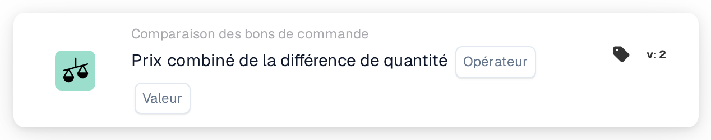
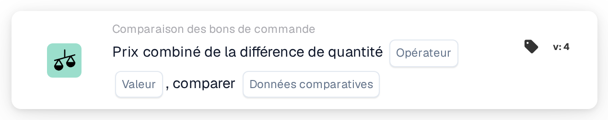

# Prix combiné de la différence de quantité

<figure><figcaption>
Version 2
</figcaption></figure>

<figure><figcaption>
Version 3
</figcaption></figure>

<figure><figcaption>
Version 4
</figcaption></figure>

## **Objectif** :

Cette carte de workflow évalue le prix combiné d'une différence de quantité, en le comparant à une valeur spécifiée. Il permet d'automatiser les actions basées sur les écarts de prix et de quantité entre les documents associés, améliorant ainsi les flux de travail d'approvisionnement et de réception. La **Version 4** étend cette fonctionnalité en permettant des comparaisons entre différentes entités telles que le bon de commande, les quantités reçues et le document lui-même, ajoutant plus de flexibilité et de contrôle au flux de travail.

## **Composants de la Carte** :

1. **Opérateur** :
   * **Descriptif :** La condition de comparaison du prix combiné avec une valeur spécifiée.
   * **Options :**
     * **Égal à (=)** : Vérifie si le prix combiné correspond à la valeur spécifiée.
     * **Pas égal à (≠)** : garantit que le prix combiné est différent de la valeur spécifiée.
     * **Supérieur à (>)** : Vérifie si le prix combiné est supérieur à la valeur spécifiée.
     * **Supérieur ou égal à (≥)** : Vérifie si le prix combiné est supérieur ou égal à la valeur spécifiée.
     * **Inférieur à (<)** : Vérifie si le prix combiné est inférieur à la valeur spécifiée.
     * **Inférieur ou égal à (≤)** : Vérifie si le prix combiné est inférieur ou égal à la valeur spécifiée
2. **Valeur** :
   * **Descriptif :** Spécifie la valeur à laquelle le prix combiné de la valeur de quantité sera comparé.
   * **Détail :** La valeur doit être une valeur numérique.

## **Composants supplémentaires dans la version 4** :

* **Type de comparaison** : Sélectionne les entités à comparer. Les options incluent :
  * **Bon de commande au document** : Compare les quantités et les prix entre le bon de commande et le document associé.
  * **Reçu dans le document** : Compare les quantités reçues aux quantités contenues dans le document.
  * **Bon de commande à reçu** : Compare les quantités du bon de commande aux quantités reçues.

## **Fonctionnalité** :

* **Évaluation de la condition** : calcule le prix combiné en multipliant la différence de quantité par le prix unitaire et le compare à la valeur spécifiée à l'aide de l'opérateur sélectionné.\
  **Version 4** ajoute la possibilité de comparer des entités supplémentaires en fonction de la configuration de l'utilisateur, telles qu'un bon de commande à recevoir ou un bon de commande à documenter.
* **Exécution d'action** : selon que le prix combiné répond ou non à la condition spécifiée, le flux de travail continuera avec des conditions vraies ou fausses pour déclencher des actions ou arrêter le flux de travail. **Version 4** permet également une exécution d'action plus dynamique, où le type de condition (par exemple, bon de commande à recevoir) influence l'étape suivante.

## **Installation et configuration** :

* **Version 3** : Les utilisateurs configurent la carte en sélectionnant les champs du document pour la différence de quantité et le prix unitaire. L'opérateur est ensuite choisi pour définir comment le prix combiné sera comparé à la valeur spécifiée. Enfin, les utilisateurs définissent la condition de continuation (vrai ou faux), qui dicte l'étape suivante du flux de travail.
* **Version 4** : En plus de la configuration dans **Version 3**, les utilisateurs disposent d'une option supplémentaire pour configurer le **Type de comparaison**. Ceci définit quelles entités seront comparées, telles que **Bon de commande au document**, **Reçu au document** ou **Bon de commande à reçu**.

## **Exemple de scénario** :

* Une facture indique 50 unités d’un produit à 100 $ chacune, pour un total de 5 000 $. Le bon de commande connexe autorisait un achat de 4 500 $ pour 45 unités. La différence de quantité est de 5 unités et le prix combiné de la différence est de 500 $. La carte compare la quantité commandée (45 unités) à la quantité reçue (50 unités) et vérifie si le prix combiné est supérieur à 400 $ (la valeur spécifiée). À l'aide de l'opérateur **Supérieur à (>)**, la carte identifie l'écart et le signale pour examen par l'équipe financière.

## **Conclusion** :

**Version 3** de la fiche de workflow « Prix combiné de la différence de quantité » offre une approche simple pour comparer les écarts de quantité et déclencher des actions en fonction des seuils de prix.\
**Version 4** étend cette fonctionnalité en permettant des comparaisons entre différentes entités (bon de commande, reçu, document), offrant plus de flexibilité et de contrôle sur le flux de travail. Les organisations peuvent désormais automatiser des scénarios plus complexes et exercer un contrôle plus strict sur leurs processus d'approvisionnement et de réception.

Voir [direction de comparaison, base de tolérance et versions de carte enregistrée](../../cards-overview/po-comparison-versions-guide.md) avant de modifier les côtés de comparaison.
