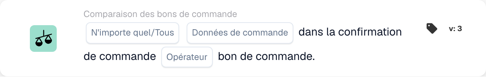
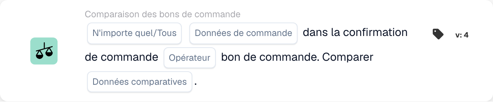

# Comparer la confirmation de commande avec le bon de commande

<figure><figcaption>
Champs de la carte dans la version affichée. Les champs ne sont pas encore renseignés.
</figcaption></figure>

<figure><figcaption>
Champs de la carte dans la version affichée. Les champs ne sont pas encore renseignés.
</figcaption></figure>

## Objectif :

Cette carte DocBits est conçue pour comparer un champ de données de commande spécifique, tel que la quantité, la remise ou le prix unitaire, entre une confirmation de commande et un bon de commande. En permettant une comparaison ciblée d'un champ à la fois, il garantit la précision dans la validation des points de données clés, maintenant ainsi l'exactitude des commandes. La **Version 4** étend cette fonctionnalité en permettant des comparaisons entre différentes entités telles que le bon de commande, les quantités reçues et le document lui-même, ajoutant plus de flexibilité et de contrôle au flux de travail.

## Composants de la carte :

1. **Tous/Tous**
   * **Descriptif :** Détermine si la condition s'applique à une ou à toutes les lignes de la confirmation de commande.\
     **Options :**
     * **Any** : La comparaison se déclenchera si la valeur du champ sélectionné dans n'importe quelle ligne de la confirmation de commande correspond à la valeur correspondante dans le bon de commande.
     * **Tous** : La comparaison ne se déclenchera que si la valeur du champ sélectionné dans toutes les lignes de la confirmation de commande correspond à la valeur correspondante dans le bon de commande.
2. **Champ de données de commande**
   * **Descriptif** : Spécifie le champ de données à comparer entre la confirmation de commande et le bon de commande.
   * **Détail** : Les utilisateurs peuvent sélectionner l'un des champs suivants à des fins de comparaison :
     * **Quantité** : Compare la quantité commandée avec la quantité confirmée.
     * **Remise** : Valide que la remise dans la confirmation correspond au bon de commande.
     * **Prix unitaire** : garantit que le prix unitaire dans la confirmation correspond au bon de commande.
3. **Opérateur**
   * **Descriptif** : Définit la condition appliquée à la comparaison du champ de données sélectionné.
   * **Possibilités** :
     * **Égal à (=)** : Confirme que la valeur correspond au bon de commande.
     * **Pas égal à (≠)** : garantit que la valeur est différente de celle du bon de commande.
     * **Plus grand que (>)** : Vérifie que la valeur dépasse la valeur du bon de commande.
     * **Supérieur ou égal à (≥)** : Confirme que la valeur est égale ou supérieure à la valeur du bon de commande.
     * **Less Than (<)** : Vérifie que la valeur est inférieure à la valeur du bon de commande.
     * **Moins ou égal à (≤)** : Confirme que la valeur est inférieure ou égale à la valeur du bon de commande.

## **Composants supplémentaires dans la version 4** :

* **Type de comparaison** : Sélectionne les entités à comparer. Les options incluent :
  * **Bon de commande vers document** : Compare les données du bon de commande avec le document associé.
  * **Reçu dans le document** : Compare les données reçues (par exemple, les quantités reçues) avec le document.
  * **Bon de commande à reçu** : Compare les données du bon de commande avec les quantités reçues.

## Fonctionnalité :

* **Comparaison de champs** : Le système compare le champ de données de commande sélectionné (Prix unitaire, Remise ou Quantité) de la confirmation de commande à la valeur correspondante dans le bon de commande.
* **Exécution d'action** : en fonction du résultat de la comparaison et de l'état de l'opérateur, la carte peut déclencher des actions de suivi, telles que des notifications ou des alertes.

## Exemple de scénario :

* Une confirmation de commande précise un **prix unitaire** de 50 $, tandis que le bon de commande indique 45 $. À l'aide de l'opérateur « Supérieur à », la carte signale l'écart, permettant à l'équipe d'approvisionnement d'y remédier avant le traitement.

## Conclusion :

Cette carte simplifie la validation des champs de données de commande individuels, garantissant le respect des conditions du bon de commande. En isolant un champ à la fois à des fins de comparaison, il prend en charge les examens ciblés et la prévention des erreurs dans le traitement des commandes.

Voir [direction de comparaison, base de tolérance et versions de carte enregistrée](../../cards-overview/po-comparison-versions-guide.md) avant de modifier les côtés de comparaison.
