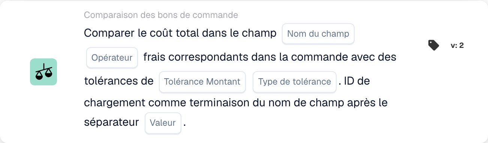

# Comparer les frais totaux

<figure><figcaption>
Champs de la carte dans la version affichée. Les champs ne sont pas encore renseignés.
</figcaption></figure>

## **Objectif :**

Cette carte de workflow compare le total des frais d'un champ de document aux frais correspondants d'un bon de commande. La carte aide à garantir que les frais du document sont alignés sur ceux du bon de commande, en tenant compte des niveaux de tolérance spécifiés. La comparaison peut déclencher des actions en cas d'écarts, comme signaler les écarts pour examen ou ajuster les frais en conséquence.

## **Composants de la carte :**

1. **Nom du champ :**
   * **Descriptif** : spécifie le champ de document qui contient les valeurs du total des frais à comparer aux frais du bon de commande.
   * **Détail** : la valeur de ce champ représente le total des frais appliqués dans le document (par ex. une facture) et sera comparée aux frais du bon de commande.
2. **Opérateur :**
   * **Descriptif** : définit la condition qui sera appliquée à la comparaison entre le total des frais du document et les frais du bon de commande.
   * **Possibilités** :
     * **Égal à (=)** : vérifie si le total des frais du document correspond aux frais du bon de commande.
     * **Pas égal à (≠)** : s'assure que le total des frais du document diffère des frais du bon de commande.
     * **Supérieur à (>)** : vérifie si le total des frais du document est supérieur aux frais du bon de commande.
     * **Supérieur ou égal à (≥)** : vérifie si le total des frais du document est supérieur ou égal aux frais du bon de commande.
     * **Inférieur à (<)** : vérifie si le total des frais du document est inférieur aux frais du bon de commande.
     * **Inférieur ou égal à (≤)** : vérifie si le total des frais du document est inférieur ou égal aux frais du bon de commande.
3. **Montant de tolérance**
   * **Descriptif** : spécifie le seuil de tolérance pour comparer le total des frais.
   * **Détail** : cette valeur numérique représente l'écart autorisé sur les frais entre le document et le bon de commande.
4. **Type de tolérance :**
   * **Descriptif** : spécifie le type de tolérance qui sera appliqué.
   * **Possibilités** :
     * **Percentage** : la tolérance est appliquée en pourcentage des frais du bon de commande.
     * **Valeur** : la tolérance est appliquée sous forme de montant numérique fixe.
5. **Séparateur :**
   * **Descriptif** : spécifie le séparateur utilisé pour distinguer le Charge ID à la fin du nom du champ.
   * **Détail** : le séparateur sépare le champ de frais de l'identifiant unique Charge ID qui servira à relier les frais du document aux frais correspondants du bon de commande.

## **Fonctionnalité :**

* **Évaluation de la condition :** le système compare le total des frais du champ de document aux frais correspondants du bon de commande en fonction de l'opérateur et de la tolérance. La tolérance est appliquée pour déterminer si l'écart entre les deux frais se situe dans une plage acceptable.
* **Exécution de l'action :**
  * **Condition vraie** : si les frais correspondent (en tenant compte de la tolérance) et que la condition est vraie, le workflow se poursuit avec l'action définie, comme l'approbation du document ou un traitement complémentaire.
  * **Condition fausse** : si la condition est fausse (c.-à-d. que les frais ne correspondent pas dans la tolérance), le workflow ne se poursuit pas.

## **Mise en place et configuration :**

* Les utilisateurs commencent par sélectionner le champ de document qui contient la valeur du total des frais. Ils sélectionnent ensuite l'opérateur pour définir comment les frais seront comparés à ceux du bon de commande. Puis, ils définissent le montant et le type de tolérance (pourcentage ou absolu). Enfin, ils spécifient le séparateur et le Charge ID qui serviront à la comparaison.

## **Scénario d'exemple :**

Une facture indique des frais de 500 $ dans le champ « total charges ». Les frais correspondants du bon de commande sont de 480 $, et la tolérance est fixée à 20 $ (tolérance absolue). La carte compare les frais du document aux frais du bon de commande :

* Le total des frais du document se situe dans la tolérance de 20 $ du bon de commande, et le workflow se poursuit sans problème.
* Si les frais dépassent la tolérance, le workflow signale l'écart pour examen.

## **Conclusion :**

La carte de workflow « Compare Total Charges » garantit que les frais des documents sont alignés sur ceux des bons de commande, en tenant compte des niveaux de tolérance spécifiés. Cela aide les organisations à automatiser le processus de vérification, à identifier les écarts en amont et à mieux maîtriser les processus liés aux frais.
