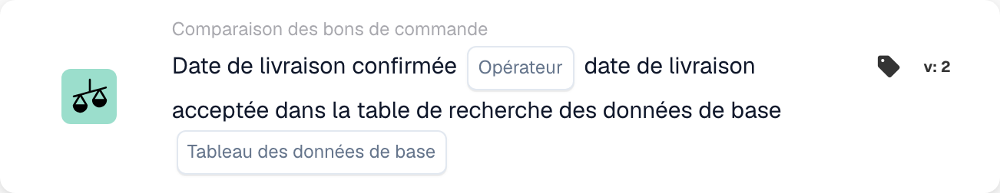

# Date de livraison confirmée

<figure><figcaption>
Champs de la carte dans la version affichée. Les champs ne sont pas encore renseignés.
</figcaption></figure>

## **Objectif**

Cette carte de workflow est conçue pour vérifier que les dates de livraison confirmées sur les factures ou les documents d'expédition sont alignées sur les dates de livraison acceptées définies dans une table de données de référence. En comparant ces dates, elle aide à garantir le respect des calendriers de livraison convenus et améliore la fiabilité de la chaîne d'approvisionnement.

## **Composants de la carte**

1. **Opérateur**
   * **Descriptif :** définit la condition de comparaison de la date de livraison confirmée à la date de livraison acceptée.
   * **Possibilités :**
     * **Is :** confirme que la date de livraison correspond à la date de livraison acceptée dans les données de référence.
     * **N'est-ce pas :** s'assure que la date de livraison ne correspond pas à la date de livraison acceptée dans les données de référence.
2. **Recherche dans la table de données principales**
   * **Descriptif :** spécifie la table de référence contenant les dates de livraison acceptées pour la comparaison.
   * **Détail :** la table est définie par le paramètre **Tableau des données de base** et peut inclure des métadonnées supplémentaires telles que des numéros de commande ou des régions de livraison.

## **Fonctionnalité**

* **Comparaison de dates :** le système compare la date de livraison confirmée de la facture ou du document d'expédition à la date de livraison acceptée dans la table de données de référence spécifiée.
* **Exécution de l'action :** selon le résultat de la comparaison, la carte peut déclencher des actions de suivi telles que des notifications.

## **Mise en place et configuration**

* Pour configurer cette carte, les utilisateurs sélectionnent le champ représentant la date de livraison confirmée dans le document et spécifient la table de données de référence contenant les dates de livraison acceptées. Un opérateur est ensuite choisi pour définir comment les deux dates doivent être comparées (par ex. **Is** ou **N'est-ce pas**).

## **Scénario d'exemple**

* Une facture indique une date de livraison confirmée du 10 juin, tandis que la table de données de référence spécifie une date de livraison acceptée du 15 juin. À l'aide de l'opérateur **N'est-ce pas**, la carte signale l'écart pour examen, permettant à l'équipe logistique d'en étudier la cause et d'ajuster les calendriers en conséquence.

## **Conclusion**

La carte de workflow **« Date de livraison confirmée par rapport à la date de livraison acceptée »** aide les organisations à respecter les calendriers de livraison convenus en automatisant la comparaison des dates de livraison confirmées et acceptées. Cette approche proactive de la gestion des livraisons améliore l'efficacité opérationnelle, réduit les retards et favorise une meilleure collaboration tout au long de la chaîne d'approvisionnement.
