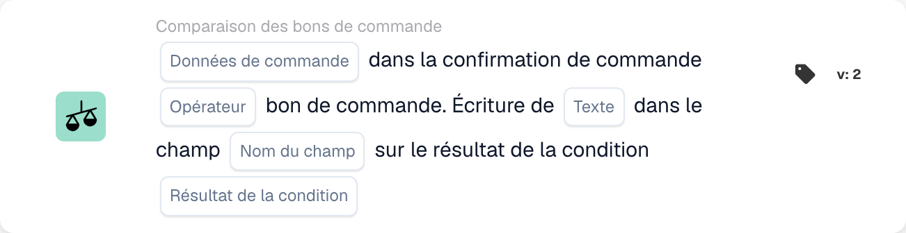

# Données de commande dans la confirmation de commande

<figure><figcaption>
Champs de la carte dans la version affichée. Les champs ne sont pas encore renseignés.
</figcaption></figure>

## **Objectif**

Cette carte de workflow est conçue pour comparer des champs spécifiques — **Prix unitaire**, **Remise** ou **Quantité** — entre une confirmation de commande et un bon de commande. Elle garantit la cohérence et la conformité aux conditions convenues. Selon le résultat de la comparaison, la carte permet aux utilisateurs d'écrire un texte spécifié dans un champ choisi lorsque la condition est évaluée comme **vraie** ou **fausse**, rationalisant le traitement des documents et réduisant l'intervention manuelle.

## **Composants de la carte**

1. **Données de commande**
   * **Descriptif :** spécifie le champ à comparer entre la confirmation de commande et le bon de commande.
   * **Possibilités :**
     * **Prix unitaire** : compare le prix unitaire dans les deux documents.
     * **Remise** : compare le pourcentage ou la valeur de la remise.
     * **Quantité** : compare la quantité commandée.
2. **Opérateur**
   * **Descriptif :** définit la condition appliquée lors de la comparaison.
   * **Possibilités :**
     * **Est égal à (=) :** vérifie si la valeur du champ sélectionné correspond entre la confirmation de commande et le bon de commande.
     * **Différent (≠) :** s'assure que la valeur du champ sélectionné diffère entre les deux documents.
3. **Texte**
   * **Descriptif :** spécifie le texte à écrire dans le champ cible lors de l'évaluation de la condition.
   * **Détail :** ce texte peut inclure des notes personnalisées, des mises à jour de statut ou des valeurs prédéfinies.
4. **Nom du champ**
   * **Descriptif :** spécifie le champ dans lequel le texte sera écrit.
   * **Détail :** le champ cible est sélectionné parmi les champs modifiables disponibles dans le système.
5. **Résultat de condition**
   * **Descriptif :** détermine quand le texte doit être écrit, en fonction du résultat de la comparaison.
   * **Possibilités :**
     * **True :** écrit le texte si la condition de comparaison est satisfaite.
     * **False :** écrit le texte si la condition de comparaison n'est pas satisfaite.

## **Fonctionnalité**

* **Évaluation de la comparaison :** le système compare le champ sélectionné entre la confirmation de commande et le bon de commande à l'aide de l'opérateur spécifié.
* **Exécution de l'action :** si la condition est évaluée comme **vraie** ou **fausse**, le texte spécifié est écrit dans le champ désigné.

## **Mise en place et configuration**

* Pour configurer cette carte, les utilisateurs sélectionnent d'abord le champ à comparer — **Prix unitaire**, **Remise** ou **Quantité**. Ils choisissent ensuite un opérateur pour définir la condition de comparaison, comme **equals** ou **pas égal**. Les utilisateurs spécifient le texte à écrire dans un champ cible et indiquent quand cette action doit se produire, en fonction du résultat de la condition (**true** ou **false**).

## **Scénario d'exemple**

* Une confirmation de commande indique un prix unitaire de 50 $ pour un produit, tandis que le bon de commande spécifie un prix de 45 $. À l'aide de l'opérateur **Pas égal à (≠)**, la carte identifie l'écart et écrit le texte « Price Mismatch » dans un champ désigné lorsque la condition est évaluée comme **vraie**.

## **Conclusion**

La carte de workflow « \[Unit Price/Discount/Quantity] in Order Confirmation » offre une solution pratique pour garantir la cohérence des documents. En signalant automatiquement les écarts et en écrivant le texte pertinent dans des champs spécifiés, elle améliore l'efficacité et réduit les erreurs dans les processus de gestion des commandes.
