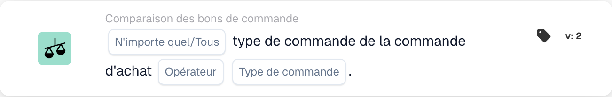

# Type de bon de commande

<figure><figcaption>
Champs de la carte dans la version affichée. Les champs ne sont pas encore renseignés.
</figcaption></figure>

## **Objectif** :

Cette carte DocBits permet de vérifier le type de commande d'un bon de commande, en garantissant qu'il correspond aux critères spécifiés.

## **Fonctionnalité** :

* **Comparaison du type de commande** : cette carte compare le type de commande du bon de commande à une valeur spécifiée, permettant aux utilisateurs de vérifier si le type de commande satisfait certaines conditions.
* **Sélection Tout/Tous** : les utilisateurs peuvent choisir d'appliquer la comparaison à **any** (au moins un type de commande sélectionné correspond) ou à **all** (tous les types de commande sélectionnés correspondent).
* **Opérateur** : les utilisateurs peuvent définir des conditions pour comparer le type de commande du bon de commande. Les opérateurs disponibles incluent :
  * **Égal à (=)** : confirme que le type de commande du bon de commande correspond au type spécifié.
  * **Pas égal (≠)** : s'assure que le type de commande du bon de commande ne correspond pas au type spécifié.

## **Utilisation** :

Cette carte est particulièrement utile aux équipes d'approvisionnement, aux planificateurs de stock et aux responsables des opérations qui doivent catégoriser et hiérarchiser les commandes avec précision. En garantissant que les types de commande correspondent aux classifications prévues, les utilisateurs peuvent rationaliser le traitement des commandes, optimiser l'allocation des ressources et respecter les accords de niveau de service.

## **Scénario d'exemple** :

* Un bon de commande est catégorisé comme « IGR ». Le système utilise l'opérateur « Equals » pour vérifier que ce type de commande correspond à la classification prévue pour le traitement.

En utilisant la carte « Compare with Purchase Order: Order Type », les organisations peuvent automatiser la validation des types de commande, garantissant la cohérence des priorités de traitement et réduisant les erreurs de classification manuelle.
