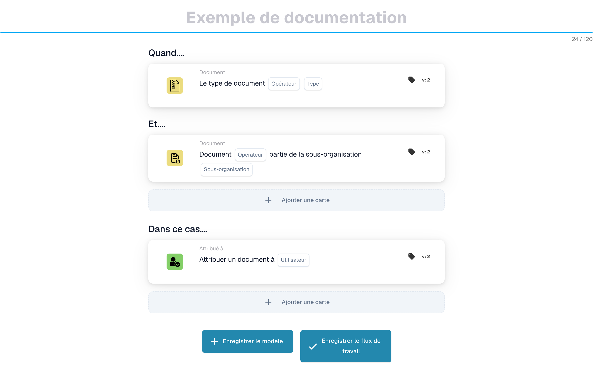
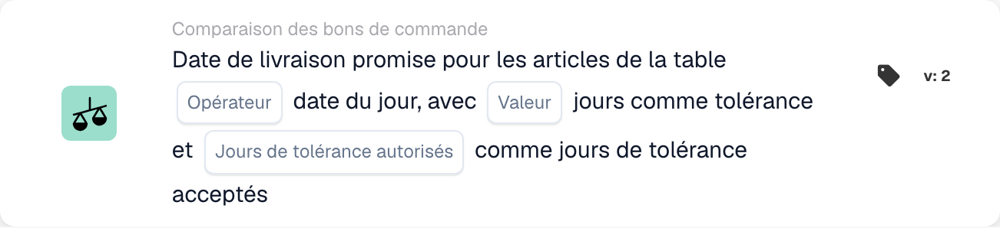
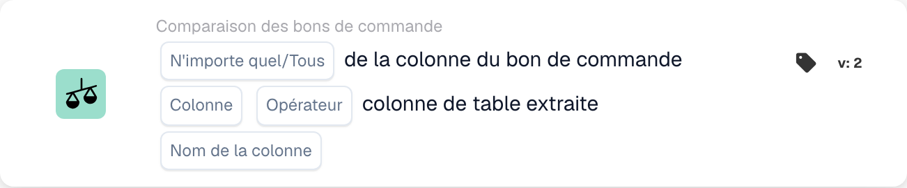
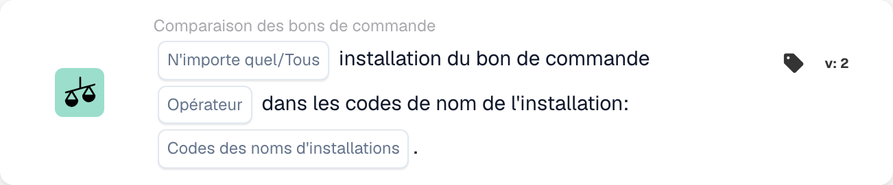
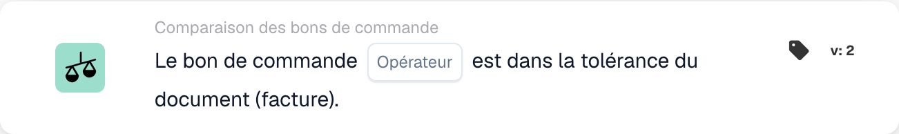
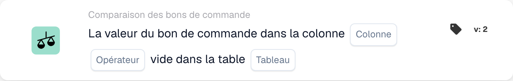
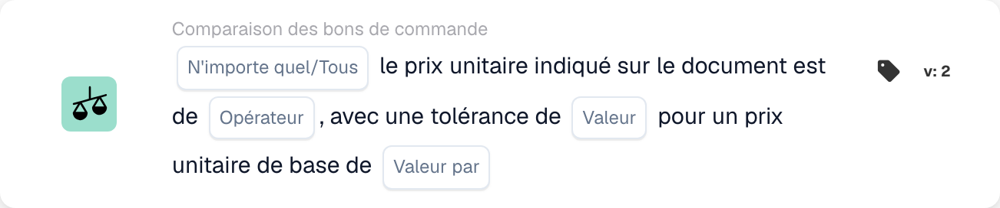
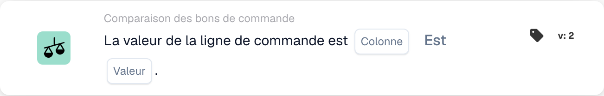

# Cartes de correspondance de bon de commande - Guide complet

## Cartes de correspondance de bon de commande (PO) - Guide complet

**Statut :** Couvre 15 cartes de comparaison de PO avec des calculs détaillés

***

Les cartes de comparaison de bons de commande sur cette page vont dans le groupe **Et** du Workflow Builder — elles comparent les données de facture avec le bon de commande correspondant avant l'exécution des actions Then :

<figure><figcaption><p>Exemple non enregistré avec les cartes Quand, Et et Alors. Renseignez tous les champs avant exécution.</p></figcaption></figure>

***

### 📌 Informations sur la version

**Carte la plus évoluée :** CONDITION\_DOC\_TO\_PO\_UNIT\_PRICE (5 versions, v5 la plus récente) **Autres cartes complexes :** CONDITION\_OC\_TO\_PO\_ITEMS (v4), CONDITION\_LESS\_THAN\_TOLERANCE\_AS\_VALUE\_OF\_ORDERED\_QUANTITY (v4)

**Modèles de touches :**

* **v2 → v3+:** Ajout de paramètres de tolérance pour une correspondance flexible
* **v3 → v4:** Ajout des paramètres du mode comparaison
* **v4 → v5:** Tolérance améliorée avec plusieurs unités (%, EUR, $, etc.)

📖 [Historique complet des versions](../../release.md) | [Versions et comportement des cartes](../../cards-overview/card-versions-guide.md)

***

### Comprendre la correspondance des bons de commande

Lorsque vous recevez une facture, elle doit correspondre au bon de commande (PO) passé précédemment. Les cartes de correspondance de bon de commande vérifient automatiquement si les données de la facture correspondent aux données du bon de commande.

**Vue d'ensemble :**

```
PO Placed     Invoice Arrives     PO Matching     Decision
(€100)    →   (€103)          →   (Check if       → Approve/Reject
Qty: 100      Qty: 100            within tolerance)
```

***

## 1. Correspondance complète du bon de commande

### Objectif

Vérifie si la facture entière correspond parfaitement au bon de commande ou dans les limites de tolérance

### Quand utiliser

* Avant d'approuver une facture
* Comme contrôle de qualité préliminaire
* Pour identifier les problèmes le plus tôt possible

### Comment ça marche

Le système compare :

* Quantités facturées vs quantités de bons de commande
* Prix des factures vs prix des bons de commande
* Articles de facture vs articles de bon de commande
* Total de la facture par rapport au total du bon de commande

### Résultat

* **TRUE** (Correspondance complète) : tout correspond, continuez
* **FALSE** (Incompatibilité) : quelque chose ne correspond pas, doit être révisé

### Exemple

```
PO:
- Item ABC: Qty 100, Unit Price €50 = €5000
- Item XYZ: Qty 50, Unit Price €20 = €1000
- Total: €6000

Invoice:
- Item ABC: Qty 100, Unit Price €50 = €5000
- Item XYZ: Qty 50, Unit Price €20 = €1000
- Total: €6000

Result: ✅ FULL MATCH
```

***

## 2. Comparaison des prix unitaires (document vs bon de commande)

### Objectif

Compare le prix unitaire sur la facture avec le prix unitaire sur le bon de commande

### Paramètres

* **Tolérance de prix unitaire** : Autoriser l'écart jusqu'à ce montant
* **Type de tolérance** : Pourcentage (%) ou Absolu (€/$)
* **Opérateur** : Est égal à, Est supérieur à, Est inférieur à, etc.

### Comment ça marche (tolérance en pourcentage)

**Formule :**

```
Variance % = |(Invoice Price - PO Price)| / PO Price × 100

Check: Is Variance % ≤ Tolerance %?
```

**Exemple étape par étape :**

```
Step 1: Get prices
  PO Unit Price: €100.00
  Invoice Unit Price: €103.00

Step 2: Calculate difference
  Difference = |€103.00 - €100.00| = €3.00

Step 3: Calculate percentage
  Percentage = (€3.00 / €100.00) × 100 = 3%

Step 4: Check tolerance (5% allowed)
  Is 3% ≤ 5%? YES ✅

Result: PASS - Within tolerance
```

### Exemples concrets

#### Exemple 1 : petite augmentation (acceptée)

```
PO Price: €50.00
Invoice Price: €51.50
Tolerance: ±3%

Calculation:
  Variance = |(€51.50 - €50.00)| / €50.00 × 100
  Variance = €1.50 / €50.00 × 100 = 3%

Is 3% ≤ 3%? YES ✅ ACCEPT
```

#### Exemple 2 : augmentation importante (rejetée)

```
PO Price: €50.00
Invoice Price: €55.00
Tolerance: ±3%

Calculation:
  Variance = |(€55.00 - €50.00)| / €50.00 × 100
  Variance = €5.00 / €50.00 × 100 = 10%

Is 10% ≤ 3%? NO ❌ REJECT - NEEDS REVIEW
```

#### Exemple 3 : Remise (également vérifiée)

```
PO Price: €100.00
Invoice Price: €97.00
Tolerance: ±5%

Calculation:
  Variance = |(€97.00 - €100.00)| / €100.00 × 100
  Variance = €3.00 / €100.00 × 100 = 3%

Is 3% ≤ 5%? YES ✅ ACCEPT (Discount is within tolerance)
```

#### Exemple 4 : Tolérance de valeur absolue

```
PO Price: €10.00
Invoice Price: €10.50
Tolerance: ±€1.00 (absolute, not %)

Calculation:
  Variance = |€10.50 - €10.00| = €0.50

Is €0.50 ≤ €1.00? YES ✅ ACCEPT
```

### Que faire des résultats

**Si RÉUSSITE ✅:**

* Passer à la vérification suivante
* Ou approuver la facture
* Ou procéder à l'exportation

**Si ÉCHEC ❌ :**

* Indicateur pour révision manuelle
* Demander des explications au fournisseur
* Contacter l'équipe d'approvisionnement
* Approuver avec note si acceptable

***

## 3. Comparaison des quantités

### Objectif

Vérifie si la quantité commandée correspond à la quantité facturée

### Paramètres

* **Tolérance** : montant ou % pouvant différer
* **Opérateur** : Égal à, Supérieur à, Inférieur à
* **Type de quantité** : Commandé, Reçu, Ouvert

### Exemple de calcul

**Pourcentage de tolérance :**

```
Formula:
  Quantity Variance % = |(Invoice Qty - PO Qty)| / PO Qty × 100

Example:
  PO Quantity: 100 units
  Invoice Quantity: 103 units
  Tolerance: ±5%

  Variance = |(103 - 100)| / 100 × 100
  Variance = 3 / 100 × 100 = 3%

  Is 3% ≤ 5%? YES ✅ ACCEPT
```

**Tolérance absolue :**

```
Formula:
  Quantity Variance = |Invoice Qty - PO Qty|

Example:
  PO Quantity: 100 units
  Invoice Quantity: 102 units
  Tolerance: ±5 units

  Variance = |102 - 100| = 2 units

  Is 2 units ≤ 5 units? YES ✅ ACCEPT
```

### Scénarios du monde réel

#### Surlivraison (plus que commandé)

```
Ordered: 100 units
Invoiced: 110 units
Tolerance: ±5%

Variance = |(110-100)|/100 × 100 = 10%

Is 10% ≤ 5%? NO ❌

Decision: Contact supplier - more delivered than ordered
Possible reason: Error by supplier, partial shipment already received
```

#### Sous-livraison (moins que commandé)

```
Ordered: 100 units
Invoiced: 95 units
Tolerance: ±5%

Variance = |(95-100)|/100 × 100 = 5%

Is 5% ≤ 5%? YES ✅

Decision: Accept - within tolerance
Possible reason: Partial shipment, rest to follow
```

***

## 4. Prix combiné de la différence de quantité

### Objectif

Lorsque la quantité diffère, calcule si la différence de prix totale est acceptable

### Pourquoi c'est important

```
Scenario: You ordered 100 units but received 110
- Quantity is 10% over (bad)
- BUT: You're only charged for 10% extra
- Combined effect might be acceptable
```

### Calcul

**Formule :**

```
Combined Variance = Quantity Variance × Price Variance

If both are within tolerance, combined is usually acceptable
```

**Exemple :**

```
PO:
- Unit Price: €100
- Quantity: 100
- Total: €10,000

Invoice:
- Unit Price: €102 (2% higher)
- Quantity: 105 (5% higher)
- Total: €10,710

Analysis:
- Price variance: 2% ✅
- Quantity variance: 5% ✅
- Combined effect: 1.02 × 1.05 = 1.071 = 7.1% total increase

Is combined variance acceptable? Usually YES ✅
```

***

## 5. Comparaison des numéros d'article et des numéros d'article du fournisseur

### Objectif

Vérifie si les éléments de la facture correspondent aux éléments du bon de commande

### Comment ça marche

**Correspondance exacte (le plus simple) :**

```
PO Item ID: ABC-123
Invoice Item ID: ABC-123
Result: ✅ MATCH
```

**Numéro d'article du fournisseur (plus courant) :**

```
PO Item: ABC-123 (Our internal code)
Supplier Item: SUPP-456 (Their code for same item)
System matches these as same item
Result: ✅ MATCH
```

### Scénario : Et si cela ne correspond pas ?

```
PO Item: ABC-123 (Copper Wire, 2mm)
Invoice Item: ABC-124 (Steel Wire, 2mm)

Result: ❌ NO MATCH

Actions:
1. Is this a substitution? Check with procurement
2. Is this an error? Contact supplier
3. Is the description similar? Verify manually
```

***

## 6. Vérification du type de commande

### Objectif

Vérifie que le type de bon de commande est correct

### Types de commandes

* **Commande standard** : Achat régulier
* **Commande urgente** : Urgent, peut avoir une prime
* **Contrat-cadre** : Contrat à long terme
* **Commande globale** : Contrat à durée indéterminée
* **Consignement** : Vous ne payez qu'après utilisation

### Exemple de vérification

```
PO Order Type: Standard Order
Invoice Order Type: Standard Order
Result: ✅ MATCH

If mismatch: Could affect terms, payment, pricing
```

***

## 7. Vérification de la date de livraison

### Objectif

Vérifie si la date de livraison correspond à la date promise sur le bon de commande

### Calcul

**Retard de livraison :**

```
Formula:
  Days Late = Invoice Delivery Date - PO Promised Date

Example:
  PO Promised: 2025-10-15
  Actual Delivery: 2025-10-22
  Days Late = 7 days

If tolerance is ±3 days:
  Is 7 ≤ 3? NO ❌ LATE
```

**Livraison anticipée :**

```
Formula:
  Days Early = PO Promised Date - Invoice Delivery Date

Example:
  PO Promised: 2025-10-15
  Actual Delivery: 2025-10-10
  Days Early = 5 days

Early delivery is usually OK ✅
Unless you need it at specific time
```

### Paramètres de tolérance

```
±3 days: Allow 3 days late or early
±5 days: Allow up to 5 days variance
0 days: Must match exactly
```

***

## 8. Vérification des frais (taxes, expédition, etc.)

### Objectif

Vérifie si les frais supplémentaires (taxes, expédition, manutention) correspondent au bon de commande

### Frais communs

```
- Shipping: €50
- Handling: €10
- Packaging: €5
- Insurance: €15
- Taxes: €300
```

### Calcul

**Exemple : Vérification des frais d'expédition**

```
PO Shipping: €50.00
Invoice Shipping: €51.00
Tolerance: ±3%

Variance = |€51.00 - €50.00| / €50.00 × 100 = 2%

Is 2% ≤ 3%? YES ✅ ACCEPT
```

**Exemple : Charges multiples**

```
PO Total Charges:
  - Shipping: €50
  - Taxes: €300
  - Handling: €10
  Total: €360

Invoice Total Charges:
  - Shipping: €50
  - Taxes: €312 (11% tax)
  - Handling: €10
  Total: €372

Difference: €12
Check if within tolerance ✅ or ❌
```

***

## 9. Vérification fiscale

### Objectif

Vérifie que les montants des taxes sont calculés correctement

### Calcul

**Formule :**

```
Tax Amount = Subtotal × Tax Rate

Example:
  Subtotal: €1000
  Tax Rate: 19%
  Expected Tax: €1000 × 0.19 = €190

Invoice Tax: €190
Match? YES ✅
```

**Problèmes courants :**

```
1. Tax rate changed (region-based)
2. Tax applied to wrong amount (before/after discounts)
3. Multiple tax rates (some items 7%, others 19%)
4. Tax exempt items (0% tax)
```

**Exemple : Fiscalité multi-taux**

```
Item A: €100 @ 19% tax = €119
Item B: €100 @ 7% tax = €107
Item C: €100 @ 0% tax = €100
Total: €326

Invoice shows €325 (€1 error)

Check: Within tolerance or needs attention?
```

***

## 10. Correspondance installation/centre de coûts

### Objectif

S'assure que la facture concerne le bon établissement/centre de coûts

### Exemple

```
PO is for:
- Facility: Berlin Plant
- Cost Center: CC-2025

Invoice should have:
- Facility: Berlin Plant ✅
- Cost Center: CC-2025 ✅

If different facility: May need different approval
```

***

## 11. Validation du statut du fournisseur

### Objectif

Vérifie si le fournisseur est toujours approuvé/actif

### Types de statut

```
✅ ACTIVE: Approved, can do business
⚠️ ON HOLD: Temporarily blocked
❌ INACTIVE: No longer doing business
⚠️ CONDITIONAL: Only for specific items
```

### Exemple de vérification

```
Supplier: ABC Corp
Status in Database: ACTIVE
Status when creating PO: ACTIVE
Status when invoice arrives: INACTIVE

Alert: Supplier status changed! Investigate why.
```

***

## Quelle tolérance dois-je utiliser ?

### Tolérances strictes (risque moindre, travail manuel accru)

```
Use for:
- High-value items
- Items where exactness matters
- Regulated industries

Settings:
- Unit Price: ±1%
- Quantity: ±1%
- Delivery Date: ±1 day
- Charges: ±1%
```

### Tolérances modérées (équilibrées)

```
Use for:
- Most business transactions
- Standard items
- Normal purchasing

Settings:
- Unit Price: ±3-5%
- Quantity: ±3-5%
- Delivery Date: ±3 days
- Charges: ±5%
```

### Tolérances lâches (risque plus élevé, moins de travail manuel)

```
Use for:
- Low-value items
- Bulk purchases
- Supplier agreements with flexibility

Settings:
- Unit Price: ±10%
- Quantity: ±10%
- Delivery Date: ±7 days
- Charges: ±10%
```

***

## Exemple de workflow de correspondance de bons de commande

```
Invoice Arrives
    ↓
Condition: "Is amount > €5000?" → YES
    ↓
Check: Full Match? → NO (10% price difference)
    ↓
Check: Unit Price within 5%? → NO (12% difference)
    ↓
Check: Quantity within 5%? → YES (2% difference)
    ↓
Decision: FAIL - Price variance too high
    ↓
Flag for: Manual review / Buyer approval
    ↓
Wait for: Buyer comment
    ↓
If Approved: Continue to Export
If Rejected: Return to Supplier
```

***

## Dépannage de la correspondance des bons de commande

### "Bon de commande introuvable"

```
Cause: Invoice PO number doesn't exist in system
Fix:
1. Verify PO number spelling
2. Check if PO was created
3. Verify PO is in correct organization
4. Ask supplier for PO reference
```

### "Les éléments ne correspondent pas"

```
Cause: Invoice items are different from PO items
Possible Reasons:
1. Substitution approved by procurement
2. Different item numbers for same item
3. Error by supplier
Fix: Contact procurement or supplier
```

### "Prix supérieur au bon de commande"

```
Cause: Invoice price > PO price
Possible Reasons:
1. Price increase approved
2. Supplier error
3. Currency difference
4. Additional services included
Fix: Verify with procurement
```

### "Date de livraison erronée"

```
Cause: Invoice dated after promised delivery
Possible Reasons:
1. Shipment was delayed
2. Receiving date different from invoice date
3. Partial shipment
Fix: Check shipping documents or contact supplier
```

***

## Tableau récapitulatif

| Carte           | Ce qu'il vérifie        | Calcul principal     | Tolérance commune |
| -------------- | --------------------- | -------------------- | ---------------- |
| Match complet     | Tout            | Tous les chèques           | Varie           |
| Prix unitaire     | Prix par unité        | % ou € de différence    | ±3-5%            |
| Quantité       | Montant commandé        | % ou unité de différence | ±3-5%            |
| Prix combiné | Total avec changement de quantité | Quantité × Prix          | ±5-10%           |
| Identifiant de l'article        | Bons articles           | Correspondance de chaîne         | Exact            |
| Type de commande     | Type d'achat      | Correspondance de chaîne         | Exact            |
| Date de livraison  | Quand arrivé          | Différence de jour       | ±3 jours          |
| Frais        | Frais supplémentaires            | % ou € de différence    | ±5%              |
| Taxe            | Montant de la taxe            | Calcul du % de taxe    | ±1%              |
| Installation       | Centre de coûts           | Correspondance de chaîne         | Exact            |
| Fournisseur       | Approuvé ?             | Vérification de l'état         | Actif uniquement      |

***

## Documentation connexe

* Voir le guide « Validation des factures » pour le flux de travail complet
* Voir « Paramètres de tolérance » pour les valeurs recommandées par secteur d'activité.
* Voir « Gestion des exceptions » pour savoir quoi faire en cas d'échec.
* Contactez votre équipe d'approvisionnement pour connaître les politiques de tolérance spécifiques

<!-- workflow-card-example-condition_promised_delivery_date_to_current-20261021 -->

### Date de livraison promise par rapport à la date de référence

<figure><figcaption><p>Champs de la carte dans la version affichée. Les champs ne sont pas encore renseignés.</p></figcaption></figure>

`CONDITION_PROMISED_DELIVERY_DATE_TO_CURRENT` · version 2

Supposons une date de référence de `2026-10-21` et une date de livraison de ligne promise de `2026-10-23`. Sélectionnez la comparaison au plus tard et la tolérance du jour zéro. La date future satisfait cette comparaison ; `2026-10-20` ne le fait pas. Configurez délibérément les options Any/All et Accept-Tolérance-Day et testez une date manquante séparément.

<!-- workflow-card-example-condition_po_extracted_table_column-20261021 -->

### Colonne de bon de commande par rapport à une colonne extraite

<figure><figcaption><p>Champs de la carte dans la version affichée. Les champs ne sont pas encore renseignés.</p></figcaption></figure>

`CONDITION_PO_EXTRACTED_TABLE_COLUMN` · version 2

Comparez la colonne d'article de bon de commande correspondante avec la colonne extraite `article_number`, en utilisant l'égalité et Tout. Les valeurs correspondantes `DEMO-A` réussissent ; une valeur extraite `DEMO-B` échoue. Sélectionnez une table de recherche uniquement lorsqu'un remplacement documenté de l'ID par la valeur est nécessaire ; vérifiez ce mappage avant de comparer.

<!-- workflow-card-example-condition_check_facility_in_po-20261021 -->

### Facilités de bon de commande autorisées

<figure><figcaption><p>Champs de la carte dans la version affichée. Les champs ne sont pas encore renseignés.</p></figcaption></figure>

`CONDITION_CHECK_FACILITY_IN_PO` · version 2

Sélectionnez Tout, la comparaison est-dans et le code d'installation configuré `DEMO-NORTH`. Les lignes de commande correspondantes dans cette installation passent ; une ligne dans `DEMO-SOUTH` échoue. Utilisez les codes d'établissement à partir des données du bon de commande plutôt que de supposer qu'une étiquette d'affichage est son code.

<!-- workflow-card-example-condition_purchase_order_full_match-20261021 -->

### Correspondance complète du bon de commande

<figure><figcaption><p>Champs de la carte dans la version affichée. Les champs ne sont pas encore renseignés.</p></figcaption></figure>

`CONDITION_PURCHASE_ORDER_FULL_MATCH` · version 2

Utilisez une facture de démonstration et un bon de commande parfaitement assortis avec la quantité `2` et le prix unitaire `100` des deux côtés, et des tolérances de quantité/prix configurées. Sélectionnez la condition de correspondance complète : elle réussit. Testez ensuite un prix en dehors de la tolérance configurée. Des données de comparaison manquantes ou un bon de commande absent ne constituent pas une correspondance complète réussie. Un bon de livraison comporte une comparaison de quantité uniquement ; ne présumez pas que les règles sur le prix facturé s’y appliquent.

<!-- workflow-card-example-condition_po_update_empty_column_check-20261021 -->

### Colonne de base de données de bons de commande vide

<figure><figcaption><p>Champs de la carte dans la version affichée. Les champs ne sont pas encore renseignés.</p></figcaption></figure>

`CONDITION_PO_UPDATE_EMPTY_COLUMN_CHECK` · version 2

Sélectionnez une table et une colonne de bons de commande valides proposées par la carte et l'opérateur est vide. Pour un enregistrement de bon de commande correspondant existant avec une valeur vide, la condition est réussie ; une valeur renseignée échoue. Vérifiez d’abord la référence du bon de commande et le mappage table/colonne. La valeur booléenne `false` est toujours une valeur booléenne actuelle ; un enregistrement de bon de commande manquant est une erreur de données distincte.

<!-- workflow-card-example-condition_compare_unit_price_percent_per-20261021 -->

### Tolérance en pourcentage par base de prix

<figure><figcaption><p>Champs de la carte dans la version affichée. Les champs ne sont pas encore renseignés.</p></figcaption></figure>

`CONDITION_COMPARE_UNIT_PRICE_PERCENT_PER` · version 2

Exemple : le prix unitaire du bon de commande `200`, le prix de base `100` et la tolérance configurée `1` produisent un taux effectif de `(200 / 100) * (1 / 100) = 0.02` ou `2%`. La bande de comparaison est `196–204`. L'égalité dans la tolérance accepte un prix de document de `203` et rejette `210`. Ne présumez pas que cette carte équivaut à une tolérance fixe de 1 %.

<!-- workflow-card-example-condition_compare_po_line_value-20261021 -->

### Valeur de la ligne de bon de commande par rapport à une référence

<figure><figcaption><p>Champs de la carte dans la version affichée. Les champs ne sont pas encore renseignés.</p></figcaption></figure>

`CONDITION_COMPARE_PO_LINE_VALUE` · version 2

Sélectionnez la colonne PO correspondante `item_number`, l'égalité et la valeur `DEMO-A`. Une ligne avec `DEMO-A` passe ; `DEMO-B` échoue. Utilisez uniquement les opérateurs pris en charge pour le type de données sélectionné et testez séparément les données de ligne correspondante manquantes.
