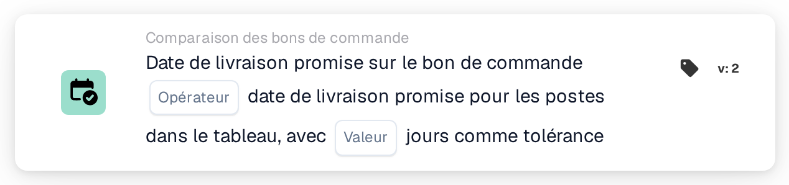
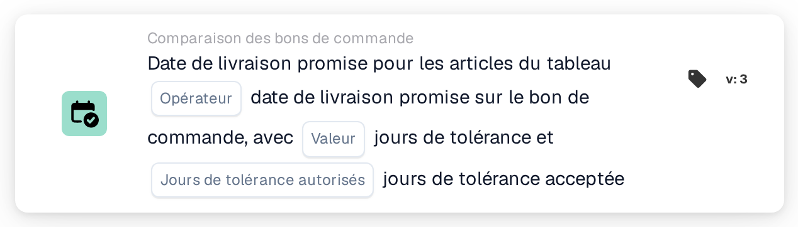

# Date de livraison promise sur le bon de commande

<figure><figcaption>
Version 2
</figcaption></figure>

<figure><figcaption>
Version 3
</figcaption></figure>

<figure><figcaption>
Version 4
</figcaption></figure>

Le calcul de la fenêtre de tolérance, avec des exemples tels que « aujourd'hui ou demain », est expliqué sur la page [Date Tolerances](../date-tolerances.md).

## **Objectif**

Cette carte DocBits est conçue pour faciliter la comparaison précise des dates de livraison promises sur les bons de commande avec les dates de livraison spécifiées pour les lignes d'un tableau. En intégrant une valeur de tolérance, la carte assure une flexibilité dans le suivi des délais de livraison, contribuant à préserver l'exactitude de la planification des stocks et la satisfaction client.

## **Composants de la carte**

1. **Opérateur**
   * **Descriptif :** définit la condition appliquée pour comparer les dates de livraison.
   * **Possibilités :**
     * **Est égal à (=) :** vérifie si la date de livraison promise de la ligne correspond à la date de livraison du bon de commande.
     * **Différent (≠) :** s'assure que la date de livraison promise de la ligne ne correspond pas à la date du bon de commande.
     * **Supérieur à (>) :** vérifie si la date de livraison promise de la ligne est postérieure à la date de livraison du bon de commande.
     * **Supérieur ou égal à (≥) :** vérifie si la date de livraison promise de la ligne est égale ou postérieure à la date de livraison du bon de commande.
     * **Less Than (<) :** confirme si la date de livraison promise de la ligne est antérieure à la date de livraison du bon de commande.
     * **Inférieur ou égal à (≤) :** vérifie si la date de livraison promise de la ligne est égale ou antérieure à la date de livraison du bon de commande.
2. **Valeur**
   * **Descriptif :** spécifie une marge d'erreur admissible dans la comparaison de la date de livraison.
   * **Détail :** les utilisateurs définissent le nombre de jours dont la date de livraison de la ligne peut différer de la date de livraison promise.

## **Fonctionnalité**

* **Évaluation de la condition :**\
  La carte calcule l'écart entre la date de livraison promise du bon de commande et les dates de livraison des lignes du tableau. L'opérateur sélectionné est ensuite appliqué pour déterminer si la condition est satisfaite.
* **Exécution de l'action :**
  * **Condition vraie :** si l'écart de date de livraison se situe dans la plage de tolérance et correspond à la condition définie par l'opérateur, le workflow se poursuit.
  * **Condition fausse :** si la condition n'est pas remplie, le workflow ne se poursuit pas.

## **Mise en place et configuration**

* L'opérateur est sélectionné pour définir la condition de comparaison souhaitée, comme égal à, supérieur à ou inférieur à. Enfin, les utilisateurs spécifient une valeur de tolérance en jours, qui autorise de légères variations dans la comparaison sans déclencher d'alertes.

## **Scénario d'exemple**

* Un bon de commande spécifie une date de livraison promise du 1er décembre. Une ligne du tableau a une date de livraison promise du 3 décembre. Avec une valeur de tolérance fixée à 2 jours et l'opérateur **Equals (≥)** sélectionné, la carte considère la date de livraison comme étant dans la plage acceptable. Aucune alerte n'est déclenchée, garantissant que les écarts mineurs sont tolérés sans perturber les opérations.

## **Conclusion**

La carte « Promised Delivery Date Comparison » aide à rationaliser les opérations de la chaîne d'approvisionnement en permettant un suivi précis des délais de livraison. Grâce à sa capacité à intégrer des tolérances et des opérateurs de comparaison flexibles, elle garantit le respect des attentes de livraison tout en évitant les alertes inutiles pour les écarts mineurs. Cela améliore la gestion des fournisseurs et l'efficacité globale du workflow.
