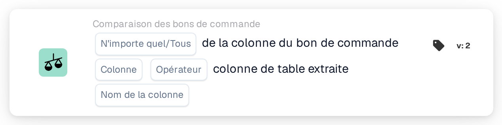
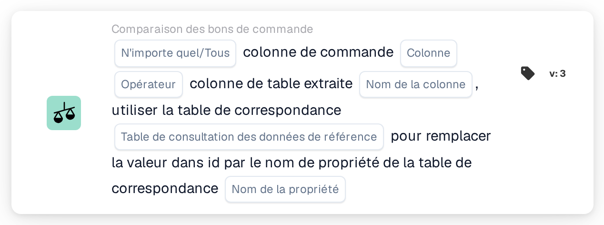

# Colonne du bon de commande et colonne du tableau extrait

<figure><figcaption>
Version 2
</figcaption></figure>

<figure><figcaption>
Version 3
</figcaption></figure>

## Objectif :

Cette carte de workflow compare une colonne des lignes de bon de commande rapprochées à une colonne du tableau des postes extrait du document. Pour chaque ligne du document que le rapprochement de bon de commande a associée à une ligne de bon de commande, la valeur de la colonne de bon de commande sélectionnée est comparée à la valeur de la colonne de tableau sélectionnée pour cette ligne. Les résultats individuels sont ensuite regroupés, selon le réglage **N'importe quel/Tous**, en l'unique résultat de la carte.

La version 3 peut en outre convertir la valeur du bon de commande au moyen d'une table de consultation des données de référence avant la comparaison, ce qui est utile lorsque le bon de commande et le document utilisent des codes différents pour une même chose, par exemple des codes d'unité différents.

Le rapprochement de bon de commande devrait s'exécuter avant cette carte. Sans bon de commande rapproché, la carte signale des données manquantes.

## Composants de la carte :

1. **N'importe quel/Tous**
   * **Description :** la manière dont les comparaisons des différentes lignes sont regroupées en le résultat de la carte.
   * **Options :**
     * **N'importe quel :** au moins une ligne comparée satisfait la condition.
     * **Tous :** chaque ligne comparée satisfait la condition. Si aucune valeur n'est définie, la carte utilise **Tous**.
2. **Colonne**
   * **Description :** la colonne de la ligne de bon de commande dont la valeur est comparée.
   * **Détail :** la valeur est lue dans la ligne de bon de commande rapprochée de la ligne du document.
3. **Opérateur**
   * **Description :** la manière dont la valeur du bon de commande est comparée à la valeur du document. La valeur du bon de commande se trouve à gauche de la comparaison ; **Supérieur à** signifie donc que la valeur du bon de commande est supérieure à celle du document.
   * **Options :**
     * **Est**
     * **Pas égaux**
     * **Supérieur à**
     * **Plus grand ou égal**
     * **Inférieur à**
     * **Inférieur ou égal**
4. **Nom de la colonne**
   * **Description :** la colonne du tableau extrait du document qui est comparée à la colonne du bon de commande.
   * **Détail :** la carte utilise le premier tableau extrait du document.
5. **Table de consultation des données de référence (version 3 uniquement)**
   * **Description :** une table de consultation facultative utilisée pour convertir la valeur du bon de commande avant la comparaison.
   * **Détail :** la valeur du bon de commande, convertie en majuscules, est recherchée dans la propriété **codevalue** de la table de consultation. Si un enregistrement est trouvé et qu'il possède une valeur pour le **Nom de la propriété** sélectionné, la valeur du bon de commande est remplacée par la valeur nettoyée de cette propriété. Si aucun enregistrement ou aucune valeur n'est trouvé, la valeur du bon de commande en majuscules est utilisée. La valeur du document n'est pas convertie.
6. **Nom de la propriété (version 3 uniquement)**
   * **Description :** la propriété de l'enregistrement de la table de consultation dont la valeur remplace la valeur du bon de commande.
   * **Détail :** **Table de consultation des données de référence** et **Nom de la propriété** peuvent tous deux être laissés vides ; la carte compare alors les valeurs sans conversion. Si un seul des deux est défini, la carte signale des données manquantes.

## Fonctionnalité :

* **Évaluation de la condition :** pour chaque ligne de bon de commande rapprochée, la carte trouve la ligne du tableau du document (ou, en version 3, les lignes) qui lui est associée et compare les deux valeurs avec l'opérateur sélectionné.
  * Si les deux valeurs sont des nombres, elles sont comparées en tant que nombres.
  * Sinon, elles sont comparées en tant que texte. Avec **Est**, les différences de majuscules et de minuscules ne comptent pas. En version 3, les deux valeurs sont converties en majuscules avant la comparaison ; une valeur issue de la table de consultation est utilisée telle qu'elle y est enregistrée. Les opérateurs de type **Supérieur** et **Inférieur** comparent le texte selon le simple ordre des caractères ; ils sont donc surtout utiles pour les colonnes numériques.
* **Exécution de l'action :**
  * **Condition vraie :**\
    Avec **Tous**, chaque ligne comparée satisfait l'opérateur ; avec **N'importe quel**, au moins une le satisfait. Le workflow se poursuit.
  * **Condition fausse :**\
    Si le résultat regroupé n'est pas satisfait, le workflow s'arrête sur une condition non satisfaite.
* **Données manquantes :** la carte n'évalue pas la condition et signale des données manquantes dans le journal du workflow lorsque :
  * le document n'a pas de bon de commande rapproché, ou les données d'un bon de commande rapproché ne sont pas disponibles,
  * le document n'a pas de tableau extrait,
  * la colonne de bon de commande d'une ligne comparée est vide (une valeur numérique de 0 compte également comme vide),
  * la colonne de tableau d'une ligne comparée est vide ou absente,
  * aucune ligne n'a pu être comparée,
  * une saisie obligatoire n'est pas définie (en version 3, également lorsqu'une seule des deux saisies de consultation est définie).

## Mise en place et configuration :

* La carte peut être ajoutée comme condition And après le rapprochement de bon de commande, depuis la catégorie **Comparaison des bons de commande**. Ensuite, **N'importe quel/Tous**, la **Colonne** du bon de commande, l'**Opérateur** et le **Nom de la colonne** du tableau du document peuvent être sélectionnés. En version 3, une **Table de consultation des données de référence** et un **Nom de la propriété** pourraient être ajoutés lorsque le bon de commande utilise d'autres codes que le document.
* Pour vérifier une configuration, **Tester la carte** dans le menu de la carte du Workflow Builder peut être utilisé sur un document existant. Le journal de la carte liste chaque comparaison avec les deux valeurs et son résultat.

## Conclusion :

La carte de workflow « Purchase Order Column and Extracted Table Column » vérifie une colonne de postes par rapport au bon de commande rapproché, ligne par ligne. Elle peut être utilisée pour toute colonne présente des deux côtés, et la version 3 couvre aussi les cas où les deux côtés utilisent des codes différents pour une même valeur.
