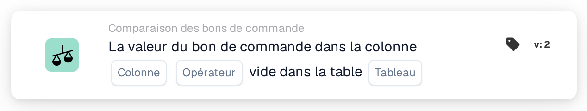

# Colonne du bon de commande vide

<figure><figcaption>
Version 2
</figcaption></figure>

## Objectif :

Cette carte de workflow vérifie si une colonne des données du bon de commande est vide. Elle examine directement le bon de commande enregistré, ses lignes ou ses frais répartis, et peut servir, par exemple, à retenir les documents dont le bon de commande ne contient pas des informations sur lesquelles reposent les étapes ultérieures.

## Composants de la carte :

1. **Colonne**
   * **Description :** la colonne du bon de commande qui est vérifiée.
   * **Détail :** la liste contient les colonnes de l'en-tête du bon de commande, des lignes du bon de commande et des frais répartis, par exemple **ID du fournisseur**, **Prix unitaire**, **Qté** ou **Type d'accusation**. La colonne devrait appartenir à la table sélectionnée dans **Tableau**.
2. **Opérateur**
   * **Description :** indique si la colonne devrait être vide ou non.
   * **Options :**
     * **Est :** la condition est remplie si la colonne est vide dans au moins un enregistrement vérifié.
     * **N'est pas :** la condition est remplie si la colonne contient une valeur dans chaque enregistrement vérifié.
3. **Tableau**
   * **Description :** la table du bon de commande dans laquelle la colonne est lue.
   * **Options :**
     * **Numéro de commande :** l'en-tête du bon de commande (un seul enregistrement).
     * **Ligne de commande d'achat :** toutes les lignes du bon de commande.
     * **Charge distribuée sur bon de commande :** tous les frais répartis du bon de commande.

## Fonctionnalité :

* **Bon de commande utilisé :** si l'exécution du workflow porte son propre bon de commande, c'est ce bon de commande qui est vérifié. Sinon, la carte utilise le bon de commande de la première ligne de document rapprochée ou, si aucune ligne n'est rapprochée, le premier bon de commande chargé pour le document.
* **Évaluation de la condition :** la carte lit tous les enregistrements de la table sélectionnée qui appartiennent au bon de commande et vérifie la colonne sélectionnée dans chacun d'eux. Une colonne est considérée comme vide si elle n'a pas de valeur, contient un texte vide ou une valeur numérique de 0. Une valeur oui/non est toujours considérée comme renseignée, même lorsqu'elle vaut « non ».
* **Colonne absente de la table :** si la colonne sélectionnée n'existe pas dans la table sélectionnée, la carte ne signale pas d'erreur. Avec **Est**, la condition est considérée comme remplie ; avec **N'est pas**, comme non remplie.
* **Exécution de l'action :**
  * **Condition vraie :**\
    Avec **Est**, la colonne est vide dans au moins un enregistrement ; avec **N'est pas**, elle contient une valeur dans chaque enregistrement. Le workflow se poursuit.
  * **Condition fausse :**\
    Sinon, le workflow s'arrête sur une condition non satisfaite.
* **Données manquantes :** la carte n'évalue pas la condition et signale des données manquantes dans le journal du workflow lorsqu'aucun bon de commande n'est disponible (ni issu de l'exécution du workflow, ni rapproché du document), lorsque **Colonne** ou **Tableau** n'est pas défini, ou lorsqu'aucun enregistrement de la table sélectionnée n'existe pour le bon de commande.

## Mise en place et configuration :

* La carte peut être ajoutée comme condition And depuis la catégorie **Comparaison des bons de commande**. Ensuite, la **Colonne**, l'opérateur et le **Tableau** peuvent être sélectionnés. Choisir une colonne qui appartient à la table sélectionnée évite le résultat silencieux décrit ci-dessus.
* **Tester la carte** dans le menu de la carte du Workflow Builder peut être utilisé pour essayer la carte sur un document existant.

## Conclusion :

La carte de workflow « Purchase Order Column Empty » vérifie l'exhaustivité des données du bon de commande lui-même. Elle permet d'arrêter tôt les documents lorsque le bon de commande ne contient pas une valeur dont dépendent l'approbation, l'export ou d'autres étapes du workflow.
