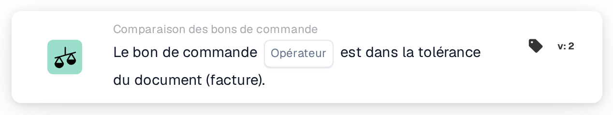

# Correspondance complète avec le bon de commande

<figure><figcaption>
Version 2
</figcaption></figure>

## Objectif :

Cette carte de workflow vérifie si le bon de commande rapproché concorde avec le document dans les tolérances, dans son ensemble. La quantité, le prix unitaire et les frais annexes de chaque ligne rapprochée sont vérifiés en une seule étape ; une seule carte peut ainsi décider si un document peut être traité sans contrôle manuel.

Le rapprochement de bon de commande devrait s'exécuter avant cette carte. Sans bon de commande rapproché, la carte signale des données manquantes.

## Composants de la carte :

1. **Opérateur**
   * **Description :** indique si le bon de commande devrait correspondre entièrement au document ou non.
   * **Options :**
     * **Est :** la condition est remplie si chaque vérification est dans la tolérance.
     * **N'est pas :** la condition est remplie si au moins une vérification est hors tolérance.

## Fonctionnalité :

* **Évaluation de la condition :** la carte parcourt chaque ligne de bon de commande rapprochée (sous-lignes comprises) et utilise les données de comparaison que le rapprochement de bon de commande a enregistrées pour elle :
  * **Quantité :** la quantité du document est comparée à la quantité du bon de commande, dans la tolérance de quantité de la ligne.
  * **Prix unitaire :** le prix unitaire du document est comparé au prix unitaire du bon de commande, dans la tolérance de prix unitaire de la ligne. Lorsque la ligne ne comporte pas de prix unitaire dans ses données de comparaison mais uniquement dans ses informations générales de rapprochement, la carte utilise la tolérance de prix unitaire configurée pour le type de document au lieu de la tolérance enregistrée sur la ligne ; une tolérance en pourcentage est alors calculée à partir du prix du bon de commande.
  * **Frais annexes :** pour chaque frais annexe de la ligne, le taux, le prix unitaire et le montant du frais sont chacun comparés au bon de commande, dans leurs tolérances respectives.
  * Pour les bons de livraison, qui ne comportent pas de prix, seule la quantité est comparée.
* Toutes les vérifications de toutes les lignes sont regroupées : le bon de commande ne correspond entièrement que si chaque vérification, sans exception, est dans la tolérance.
* **Exécution de l'action :**
  * **Condition vraie :**\
    Avec **Est**, chaque vérification est dans la tolérance ; avec **N'est pas**, au moins une ne l'est pas. Le workflow se poursuit.
  * **Condition fausse :**\
    Sinon, le workflow s'arrête sur une condition non satisfaite.
* **Données manquantes :** la carte n'évalue pas la condition et signale des données manquantes dans le journal du workflow lorsque le document n'a pas de bon de commande rapproché, ou lorsqu'il manque à une ligne rapprochée une partie des données nécessaires à ses vérifications, par exemple une quantité, un prix unitaire, une valeur de frais annexe ou la tolérance de l'une d'elles (y compris une tolérance de prix unitaire absente ou inutilisable sur le type de document, lorsque celle-ci est nécessaire). Une tolérance manquante n'est pas traitée comme une tolérance de 0. Cela vaut aussi avec **N'est pas** : des données manquantes sont signalées comme des données manquantes, et non comme une non-correspondance.

## Mise en place et configuration :

* La carte peut être ajoutée comme condition And après le rapprochement de bon de commande, depuis la catégorie **Comparaison des bons de commande**. Ensuite, l'opérateur (**Est** ou **N'est pas**) peut être sélectionné. Les tolérances elles-mêmes ne sont pas définies sur la carte ; elles proviennent du rapprochement de bon de commande et des paramètres du type de document.
* **Tester la carte** dans le menu de la carte du Workflow Builder peut être utilisé pour essayer la carte sur un document existant. Le journal de la carte liste chaque comparaison de quantité, de prix unitaire et de frais avec les valeurs du document et du bon de commande.

## Conclusion :

La carte de workflow « Purchase Order Full Match » résume en une seule condition la comparaison d'un document avec son bon de commande. Les documents qui concordent avec leur bon de commande sur chaque ligne peuvent passer automatiquement, tandis que tout écart hors tolérance est signalé comme une condition non satisfaite et toute donnée de comparaison manquante comme une donnée manquante, jamais comme une correspondance.
