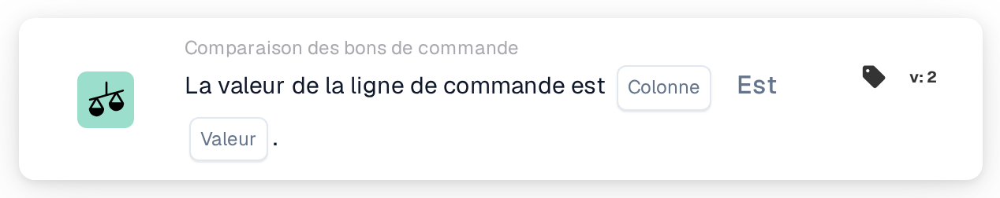

# Valeur de ligne du bon de commande

<figure><figcaption>
Version 2
</figcaption></figure>

## Objectif :

Cette carte de workflow compare une colonne des lignes de bon de commande rapprochées à une valeur fixe. Elle peut servir à vérifier une propriété des lignes commandées qui n'est pas imprimée sur le document, par exemple un statut, un code d'unité ou une méthode de livraison, et à traiter le document en conséquence.

Le rapprochement de bon de commande devrait s'exécuter avant cette carte. Sans bon de commande rapproché, la carte signale des données manquantes.

## Composants de la carte :

1. **Colonne**
   * **Description :** la colonne de la ligne de bon de commande dont la valeur est comparée.
2. **Opérateur**
   * **Description :** la manière dont la valeur de la ligne de bon de commande est comparée à la valeur indiquée sur la carte. La valeur par défaut est **Est**.
   * **Options :**
     * **Est :** la valeur de la ligne est égale à la valeur. Pour du texte, les majuscules et les minuscules ne sont pas prises en compte.
     * **Pas égaux :** la valeur de la ligne diffère de la valeur. Pour du texte, les majuscules et les minuscules sont prises en compte.
     * **Supérieur à**, **Plus grand ou égal**, **Inférieur à**, **Inférieur ou égal :** surtout utiles pour les colonnes numériques.
     * **Contient :** la valeur de la ligne correspond exactement à l'une des entrées de **Valeur**, majuscules comprises. Les correspondances partielles ne sont pas prises en compte.
     * **Ne contient pas :** la valeur de la ligne ne correspond à aucune des entrées de **Valeur** (comparaison tout aussi exacte).
3. **Valeur**
   * **Description :** la valeur à laquelle la valeur de la ligne de bon de commande est comparée.
   * **Détail :** avec **Contient** et **Ne contient pas**, plusieurs entrées peuvent être saisies, séparées par des virgules. Avec les opérateurs de type **Supérieur** et **Inférieur**, une liste de valeurs n'est pas prise en charge.

## Fonctionnalité :

* **Évaluation de la condition :** pour chaque ligne de bon de commande rapprochée (sous-lignes comprises), la carte lit la valeur de la colonne sélectionnée et la compare à **Valeur** avec l'opérateur. Si les deux sont des nombres, elles sont comparées en tant que nombres, sinon en tant que texte.
* Chaque ligne comparée doit satisfaire la condition ; cette carte ne dispose pas d'option **N'importe quel/Tous**.
* **Exécution de l'action :**
  * **Condition vraie :**\
    Si chaque ligne comparée satisfait la condition, le workflow se poursuit.
  * **Condition fausse :**\
    Si au moins une ligne ne la satisfait pas, le workflow s'arrête sur une condition non satisfaite.
* **Données manquantes :** la carte n'évalue pas la condition et signale des données manquantes dans le journal du workflow lorsque **Colonne** ou **Valeur** n'est pas défini, lorsque le document n'a pas de bon de commande rapproché ou que ses données ne sont pas disponibles, lorsque la colonne sélectionnée d'une ligne rapprochée est vide (une valeur numérique de 0 compte également comme vide), ou lorsqu'aucune ligne n'a pu être comparée.
* **Erreur de configuration :** si **Valeur** contient une virgule et que l'un des opérateurs de type **Supérieur** ou **Inférieur** est sélectionné, la carte s'arrête sur une erreur de configuration.

## Mise en place et configuration :

* La carte peut être ajoutée comme condition And après le rapprochement de bon de commande, depuis la catégorie **Comparaison des bons de commande**. Ensuite, la **Colonne** de la ligne de bon de commande, l'opérateur et la **Valeur** peuvent être définis. Pour une vérification par rapport à plusieurs valeurs autorisées, **Contient** avec une liste séparée par des virgules pourrait être utilisé.
* **Tester la carte** dans le menu de la carte du Workflow Builder peut être utilisé pour essayer la carte sur un document existant. Le journal de la carte liste chaque valeur de ligne comparée avec l'opérateur et la valeur utilisée.

## Conclusion :

La carte de workflow « Purchase Order Line Value » intègre les données des lignes de bon de commande au workflow sous la forme d'une condition simple. Elle permet à un workflow de réagir à la manière dont les marchandises ont été commandées, même lorsque cette information ne figure pas sur le document lui-même.
