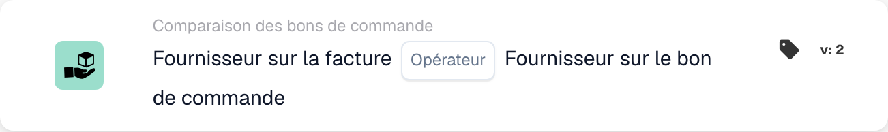

# Fournisseur sur facture

<figure><figcaption>
Champs de la carte dans la version affichée. Les champs ne sont pas encore renseignés.
</figcaption></figure>

## **Objectif**

Cette carte DocBits permet une comparaison détaillée, en comparant le fournisseur de la facture à celui de la confirmation de commande. Il convient de s'assurer que le fournisseur qui a émis la facture est le même que celui de la confirmation de commande.

## **Fonctionnalité :**

* **Fournisseur sur facture Fournisseur sur bon de commande :** cette carte vérifie si le fournisseur de la facture est le même que celui de la confirmation de commande ou non.
* **Valeur de l'opérateur :** les utilisateurs peuvent définir des conditions spécifiques telles que : le fournisseur qui a émis la facture est-il le même que celui du BC ou non. Les opérateurs disponibles incluent :
  * **Is (=) :** vérifie si le fournisseur de la facture correspond au fournisseur de la confirmation de commande.
  * **N'est-ce pas (≠) :** s'assure que le fournisseur qui a émis la facture est le même que celui de la confirmation de commande.

## **Utilisation :**

Cette carte est utile pour garantir que l'ensemble du processus est traité avec le même fournisseur et que tout concorde. Cela permet, en cas d'écarts, d'attirer l'attention sur la vérification de ces écarts et de ne pas payer la facture à un fournisseur incorrect qui n'a rien à voir avec la commande et la confirmation de commande.

## **Scénario d'exemple :**

* Une commande est passée, puis la confirmation de commande arrive et la facture est ensuite émise. L'ensemble du processus de commande est réalisé avec un seul fournisseur. Si ce n'est pas le cas, la carte peut immédiatement déterminer qu'il existe des écarts entre les fournisseurs et garantit ainsi qu'aucun paiement incorrect n'est effectué et que la facture n'est honorée qu'avec le fournisseur qui était également impliqué dans l'ensemble du processus.

En utilisant la carte « Supplier on Invoice … Supplier on Purchase Order », les entreprises peuvent automatiser la vérification des fournisseurs qui émettent des factures et des confirmations de commande associées.
