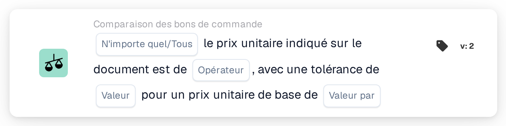

# Tolérance de prix unitaire par prix de base

<figure><figcaption>
Version 2
</figcaption></figure>

## Objectif :

Cette carte de workflow compare les prix unitaires du document aux prix unitaires des lignes de bon de commande rapprochées, à l'aide d'une tolérance en pourcentage qui augmente avec le prix du bon de commande. La tolérance est saisie sous forme de pourcentage par prix unitaire de base ; les articles plus chers bénéficient ainsi d'une tolérance en pourcentage plus large que les articles moins chers.

Pour une tolérance fixe, la carte **Any / All Unit Price is** peut être utilisée.

Le rapprochement de bon de commande devrait s'exécuter avant cette carte. Sans bon de commande rapproché, la carte signale des données manquantes.

## Composants de la carte :

1. **N'importe quel/Tous**
   * **Description :** la manière dont les comparaisons des différentes lignes sont regroupées en le résultat de la carte.
   * **Options :**
     * **N'importe quel :** au moins une ligne satisfait la comparaison.
     * **Tous :** chaque ligne comparée satisfait la comparaison. Si aucune valeur n'est définie, la carte utilise **Tous**.
2. **Opérateur**
   * **Description :** la manière dont le prix unitaire du document est comparé au prix unitaire du bon de commande, compte tenu de la tolérance.
   * **Options :**
     * **Est :** le prix du document se situe dans la plage de tolérance autour du prix du bon de commande.
     * **Pas égaux :** le prix du document se situe en dehors de la plage de tolérance.
     * **Supérieur à :** le prix du document se situe au-dessus de la plage de tolérance.
     * **Plus grand ou égal :** le prix du document se situe dans la plage de tolérance ou au-dessus.
     * **Inférieur à :** le prix du document se situe en dessous de la plage de tolérance.
     * **Inférieur ou égal :** le prix du document se situe dans la plage de tolérance ou en dessous.
3. **Valeur**
   * **Description :** la tolérance en pourcentage qui s'applique au prix unitaire de base.
   * **Détail :** un nombre, par exemple `1` pour 1 pour cent.
4. **Valeur par**
   * **Description :** le prix unitaire de base auquel se rapporte le pourcentage de tolérance.
   * **Détail :** un nombre supérieur à 0, par exemple `100`.

## Fonctionnalité :

* **Calcul de la tolérance :** pour chaque ligne, le pourcentage de tolérance est mis à l'échelle selon le rapport entre le prix unitaire du bon de commande et le prix unitaire de base :\
  tolérance % = **Valeur** × (prix unitaire du bon de commande ÷ **Valeur par**)\
  La plage de tolérance correspond au prix unitaire du bon de commande plus ou moins ce pourcentage.\
  Exemple avec **Valeur** 1 et **Valeur par** 100 : un prix de bon de commande de 50 donne une tolérance de 0,5 %, la plage va donc de 49,75 à 50,25. Un prix de bon de commande de 200 donne 2 %, la plage va donc de 196 à 204.
* **Évaluation de la condition :** pour chaque ligne de bon de commande rapprochée, le prix unitaire du document est comparé au prix unitaire de la ligne de bon de commande, avec l'opérateur et la plage calculée. Les entrées rapprochées sans ligne de bon de commande sont ignorées. Les résultats sont regroupés selon **N'importe quel/Tous**.
* **Exécution de l'action :**
  * **Condition vraie :**\
    Si le résultat regroupé est satisfait, le workflow se poursuit.
  * **Condition fausse :**\
    Si le résultat regroupé n'est pas satisfait, le workflow s'arrête sur une condition non satisfaite. C'est également le cas lorsqu'aucune ligne n'a pu être comparée.
* **Données manquantes :** la carte n'évalue pas la condition et signale des données manquantes dans le journal du workflow lorsque **Valeur** ou **Valeur par** n'est pas défini, lorsque le document n'a pas de bon de commande rapproché, ou lorsqu'il manque au document ou au bon de commande le prix unitaire d'une ligne comparée (un prix unitaire vide ou un prix unitaire numérique de 0 est considéré comme manquant).
* **Erreurs :** la carte s'arrête sur une erreur lorsque **Valeur** ou **Valeur par** n'est pas un nombre, lorsqu'un prix unitaire ne peut pas être lu comme un nombre, lorsque **Valeur par** vaut 0, ou lorsque la tolérance calculée pour une ligne est inférieure à 0 % ou supérieure à 100 %.

## Mise en place et configuration :

* La carte peut être ajoutée comme condition And après le rapprochement de bon de commande, depuis la catégorie **Comparaison des bons de commande**. Ensuite, **N'importe quel/Tous**, l'opérateur, le pourcentage de tolérance dans **Valeur** et le prix unitaire de base dans **Valeur par** peuvent être saisis. Le prix unitaire de base devrait être choisi de sorte que la tolérance calculée reste comprise entre 0 % et 100 % pour la gamme de prix des articles.
* **Tester la carte** dans le menu de la carte du Workflow Builder peut être utilisé pour essayer la carte sur un document existant. Le journal de la carte affiche, pour chaque ligne, les deux prix, la tolérance calculée en pourcentage et la plage obtenue.

## Conclusion :

La carte de workflow « Unit Price Tolerance per Base Price » applique une tolérance dépendant du prix à la comparaison des prix unitaires avec le bon de commande. Une seule carte permet ainsi une tolérance étroite pour les articles bon marché et une tolérance plus large pour les articles chers.
