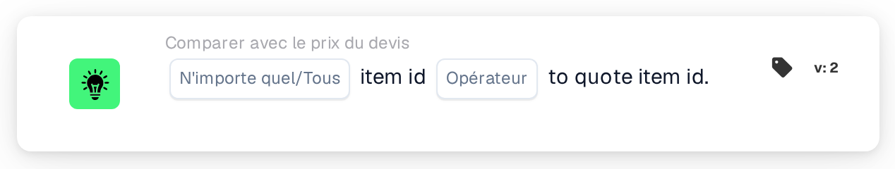

# Comparer le numéro d'article avec le numéro d'article du devis

<figure><figcaption>
Version 2
</figcaption></figure>

## Objectif :

Cette carte de workflow compare le numéro d'article de chaque ligne d'un document au numéro d'article enregistré pour le même article fournisseur dans la table des prix des articles fournisseurs. Elle peut servir à détecter les lignes où le document désigne un autre article que celui auquel se rapportent les données de prix. Selon le résultat, le workflow se poursuit avec la condition vraie ou la condition fausse.

## Composants de la carte :

1. **N'importe quel/Tous**
   * **Description :** définit si une ligne ou chaque ligne comparée du tableau du document devrait remplir la condition.
   * **Options :**
     * **N'importe quel :** la condition est vraie si au moins une ligne comparée remplit la condition.
     * **Tous :** la condition n'est vraie que si chaque ligne comparée remplit la condition.
2. **Opérateur**
   * **Description :** définit la manière dont le numéro d'article de la table des prix des articles fournisseurs est comparé au numéro d'article de la ligne du document.
   * **Options :**
     * **Est :** les numéros d'article sont identiques. Les numéros d'article qui peuvent tous deux être lus comme des nombres sont comparés en tant que nombres (par exemple, « 007 » et « 7 » sont égaux) ; sinon, ils sont comparés en tant que texte, sans distinction entre majuscules et minuscules.
     * **Pas égaux :** les numéros d'article diffèrent. Les numéros d'article qui peuvent tous deux être lus comme des nombres sont comparés en tant que nombres ; sinon, ils sont comparés en tant que texte, et dans ce cas les majuscules et les minuscules sont distinguées.
     * **Supérieur à, Plus grand ou égal, Inférieur à, Inférieur ou égal :** également proposés par la carte. Avec ces opérateurs, les numéros d'article sont toujours comparés en tant que texte, caractère par caractère ; par exemple, « 10 » est alors considéré comme inférieur à « 9 ».

## Fonctionnalité :

* **Évaluation de la condition :** pour chaque ligne du tableau du document, la carte recherche le numéro d'article fournisseur de la ligne (colonne `SUPPLIER_ITEM_NUMBER`) dans la table des prix des articles fournisseurs et compare le numéro d'article qui y est enregistré au numéro d'article de la ligne (colonne `ITEM_NUMBER`). Les résultats de toutes les lignes comparées sont ensuite regroupés selon **N'importe quel** ou **Tous**.
* **Lignes ignorées :** une ligne est exclue de la comparaison si la table des prix des articles fournisseurs ne contient aucune entrée pour son numéro d'article fournisseur, ou si l'entrée ne comporte pas de numéro d'article. Chaque ligne ignorée est signalée dans le journal du workflow.
* **Dates de validité :** si une entrée de la table des prix des articles fournisseurs comporte une date de début ou de fin et que la date du document se situe en dehors de cette période, la carte le signale dans le journal du workflow. Cette remarque ne modifie pas le résultat de la carte.
* **Exécution de l'action :**
  * **Condition vraie :**\
    Les numéros d'article satisfont l'opérateur sélectionné pour l'une ou pour toutes les lignes comparées. Le workflow se poursuit avec la condition vraie.
  * **Condition fausse :**\
    Si la condition n'est pas remplie, le workflow se poursuit avec la condition fausse, par exemple pour soumettre le document à un contrôle manuel. La condition fausse s'applique également si aucune ligne n'a pu être comparée, parce qu'aucune ligne n'avait de numéro d'article dans la table des prix des articles fournisseurs.
* **Données manquantes :** si le document n'a pas de tableau, en a plusieurs, ou si aucune ligne n'a pu être lue dans le tableau, la carte n'évalue pas la condition et signale les données manquantes dans le journal du workflow. Si aucune option **N'importe quel/Tous** n'est définie, la carte le signale dans le journal et utilise **Tous**.

## Mise en place et configuration :

* La carte peut être ajoutée depuis la catégorie **Comparer avec le prix du devis**. Ensuite, **N'importe quel** ou **Tous** et l'opérateur peuvent être sélectionnés. Pour vérifier la concordance des numéros d'article, **Est** ou **Pas égaux** est le choix habituel. Enfin, la condition de poursuite (vraie ou fausse) est définie ; elle détermine l'étape suivante du workflow.
* La carte fonctionne sur les documents comportant exactement un tableau, dont les lignes contiennent le numéro d'article fournisseur et le numéro d'article.

## Conclusion :

La carte de workflow « Item ID to Quote Item ID » permet de s'assurer que les articles d'un document correspondent aux articles auxquels se rapporte la table des prix des articles fournisseurs. Les lignes sans données de prix sont ignorées au lieu d'être comptées comme des écarts ; le résultat ne reflète donc que les lignes réellement comparables.
