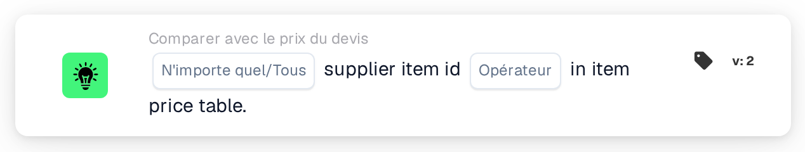

# Numéro d'article fournisseur dans la table des prix des articles

<figure><figcaption>
Version 2
</figcaption></figure>

## Objectif :

Cette carte de workflow vérifie si les numéros d'article fournisseur figurant sur les lignes d'un document se trouvent dans la table des prix des articles fournisseurs. Elle peut servir à déterminer si DocBits dispose de données de prix pour les articles d'un devis, pour le fournisseur du document, avant l'exécution d'autres comparaisons de devis, ou à acheminer les documents comportant des articles inconnus vers un contrôle manuel. Selon le résultat, le workflow se poursuit avec la condition vraie ou la condition fausse.

## Composants de la carte :

1. **N'importe quel/Tous**
   * **Description :** définit si une ligne ou chaque ligne du tableau du document devrait remplir la condition.
   * **Options :**
     * **N'importe quel :** la condition est vraie si au moins une ligne remplit la condition.
     * **Tous :** la condition n'est vraie que si chaque ligne remplit la condition.
2. **Opérateur**
   * **Description :** définit si le numéro d'article fournisseur devrait figurer dans la table des prix des articles fournisseurs ou non.
   * **Options :**
     * **Est :** une ligne remplit la condition si son numéro d'article fournisseur figure dans la table des prix des articles fournisseurs.
     * **N'est pas :** une ligne remplit la condition si son numéro d'article fournisseur ne figure pas dans la table des prix des articles fournisseurs.

## Fonctionnalité :

* **Évaluation de la condition :** la carte lit le numéro d'article fournisseur (colonne `SUPPLIER_ITEM_NUMBER`) de chaque ligne du tableau du document et vérifie si la table des prix des articles fournisseurs contient une entrée correspondante. Les résultats de toutes les lignes sont ensuite regroupés selon **N'importe quel** ou **Tous**.
* **Dates de validité :** si une entrée de la table des prix des articles fournisseurs comporte une date de début ou de fin et que la date du document se situe en dehors de cette période, la carte le signale dans le journal du workflow. Cette remarque ne modifie pas le résultat de la carte.
* **Exécution de l'action :**
  * **Condition vraie :**\
    Avec **Est**, les numéros d'article fournisseur (l'un d'eux ou tous, selon la sélection) figurent dans la table des prix des articles fournisseurs. Avec **N'est pas**, ils n'y figurent pas. Le workflow se poursuit avec la condition vraie, par exemple pour passer à la comparaison des prix.
  * **Condition fausse :**\
    Si la condition n'est pas remplie, le workflow se poursuit avec la condition fausse, par exemple pour soumettre le document à un contrôle manuel.
* **Données manquantes :** si le document n'a pas de tableau, en a plusieurs, si aucune ligne n'a pu être lue dans le tableau ou si le document ne dispose d'aucune donnée de prix d'article fournisseur, la carte n'évalue pas la condition et signale les données manquantes dans le journal du workflow. Si aucune option **N'importe quel/Tous** n'est définie, la carte le signale dans le journal et utilise **Tous**.
* **Erreurs :** la carte se termine par une erreur si une ligne du tableau ne comporte pas de colonne `SUPPLIER_ITEM_NUMBER`. Si aucun opérateur n'est défini, la carte signale une erreur de configuration.

## Mise en place et configuration :

* La carte peut être ajoutée depuis la catégorie **Comparer avec le prix du devis**. Ensuite, **N'importe quel** ou **Tous** et l'opérateur (**Est** ou **N'est pas**) peuvent être sélectionnés. Enfin, la condition de poursuite (vraie ou fausse) est définie ; elle détermine l'étape suivante du workflow.
* La carte fonctionne sur les documents comportant exactement un tableau, dont les lignes contiennent le numéro d'article fournisseur.

## Conclusion :

La carte de workflow « Supplier Item ID in Item Price Table » indique si les articles d'un document sont connus dans la table des prix des articles fournisseurs. Elle peut servir de premier contrôle dans un workflow de devis, afin que les comparaisons ultérieures de prix, de numéro d'article et d'unité de mesure ne s'exécutent que pour les documents dont les articles disposent de données de prix.
