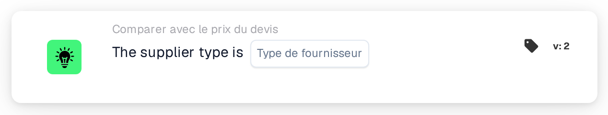

# Type de fournisseur

<figure><figcaption>
Version 2
</figcaption></figure>

## Objectif :

Cette carte de workflow vérifie le type de fournisseur des articles figurant dans les données de prix des articles fournisseurs d'un document, par exemple s'il s'agit d'articles sous contrat ou d'articles gérés. Elle peut servir à appliquer des règles d'approbation différentes selon la manière dont les articles du fournisseur sont gérés. Selon le résultat, le workflow se poursuit avec la condition vraie ou la condition fausse.

## Composants de la carte :

1. **Type de fournisseur**
   * **Description :** le type de fournisseur par rapport auquel le document est vérifié.
   * **Options :**
     * **Contract :** correspond aux entrées dont la classe de gestion est « contract ».
     * **Managed :** correspond aux entrées dont la classe de gestion est « managed ».
     * **NonManaged :** correspond aux entrées dont la classe de gestion est « unmanaged ».

## Fonctionnalité :

* **Évaluation de la condition :** la carte lit le type de fournisseur (classe de gestion) de chaque entrée des données de prix des articles fournisseurs du document et le compare au type de fournisseur sélectionné sur la carte. La comparaison ne distingue pas les majuscules des minuscules.
* **Exécution de l'action :**
  * **Condition vraie :**\
    Chaque entrée des données de prix des articles fournisseurs a le type de fournisseur sélectionné. Le workflow se poursuit avec la condition vraie, par exemple pour appliquer les règles propres à ce type de fournisseur.
  * **Condition fausse :**\
    Si au moins une entrée a un autre type de fournisseur ou aucune classe de gestion, le workflow se poursuit avec la condition fausse.
* **Données manquantes :** si aucun type de fournisseur n'est sélectionné sur la carte, ou si le document n'a pas de données de prix d'article fournisseur, la carte n'évalue pas la condition et signale les données manquantes dans le journal du workflow.

## Mise en place et configuration :

* La carte peut être ajoutée depuis la catégorie **Comparer avec le prix du devis**. Ensuite, le type de fournisseur peut être sélectionné dans le champ **Type de fournisseur**. Enfin, la condition de poursuite (vraie ou fausse) est définie ; elle détermine l'étape suivante du workflow.

## Conclusion :

La carte de workflow « Supplier Type » permet à un workflow de devis de se ramifier selon le type de fournisseur des articles, afin que les articles sous contrat, gérés et non gérés puissent chacun être traités selon leurs propres règles.
