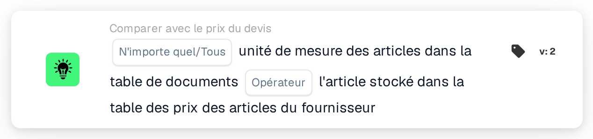
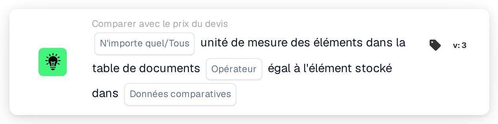

# Unité de mesure

<figure><figcaption>
Version 2
</figcaption></figure>

<figure><figcaption>
Version 3
</figcaption></figure>

## Objectif :

Cette carte de workflow compare l'unité de mesure des articles du tableau du document à l'unité de mesure enregistrée ailleurs pour les mêmes articles. En version 2, la comparaison se fait toujours avec la table des prix des articles fournisseurs. La version 3 permet de choisir entre la table des prix des articles fournisseurs et les postes du bon de commande rapproché. La carte peut servir à détecter les lignes où un article est proposé dans un devis ou facturé dans une autre unité que celle attendue. Selon le résultat, le workflow se poursuit avec la condition vraie ou la condition fausse.

## Composants de la carte :

1. **N'importe quel/Tous**
   * **Description :** définit si une ligne ou chaque ligne comparée du tableau du document devrait remplir la condition.
   * **Options :**
     * **N'importe quel :** la condition est vraie si au moins une ligne comparée remplit la condition.
     * **Tous :** la condition n'est vraie que si chaque ligne comparée remplit la condition.
2. **Opérateur**
   * **Description :** définit si les unités de mesure devraient être identiques ou différentes.
   * **Options :**
     * **Est :** l'unité de mesure de la ligne du document est identique à celle enregistrée.
     * **Pas égaux :** l'unité de mesure de la ligne du document diffère de celle enregistrée.
3. **Données comparatives** (version 3 uniquement)
   * **Description :** la source à laquelle l'unité de mesure du document est comparée.
   * **Options :**
     * **prix de l'article coté par le fournisseur :** l'unité de mesure enregistrée pour l'article fournisseur dans la table des prix des articles fournisseurs, comme en version 2.
     * **ligne de commande :** l'unité de mesure de la ligne de bon de commande rapprochée.

## Fonctionnalité :

* **Évaluation de la condition :** la carte lit l'unité de mesure (colonne `UNIT`) des lignes du premier tableau du document et la compare à la source sélectionnée. La comparaison ne distingue pas les majuscules des minuscules. Les résultats de toutes les lignes comparées sont ensuite regroupés selon **N'importe quel** ou **Tous**.
  * **prix de l'article coté par le fournisseur :** seules les lignes liées à une entrée des données de devis rapprochées sont comparées. Pour chacune de ces lignes, l'unité de mesure enregistrée pour son article fournisseur est utilisée.
  * **ligne de commande** (version 3) : seules les lignes rapprochées d'une ligne de bon de commande sont comparées. L'unité de mesure de la ligne de bon de commande est d'abord convertie à l'aide de la table de correspondance des unités de mesure (de l'unité EDI vers l'unité M3). Des deux côtés, quelques graphies sont considérées comme équivalentes : « each » comme « ea », et « lbs » et « lbp » comme « lb ».
* **Lignes ignorées :** une ligne est exclue de la comparaison si la source ne comporte pas d'unité de mesure pour elle. Chaque ligne ignorée est signalée dans le journal du workflow.
* **Exécution de l'action :**
  * **Condition vraie :**\
    Les unités de mesure satisfont l'opérateur sélectionné pour l'une ou pour toutes les lignes comparées. Le workflow se poursuit avec la condition vraie.
  * **Condition fausse :**\
    Si la condition n'est pas remplie, le workflow se poursuit avec la condition fausse, par exemple pour soumettre le document à un contrôle manuel. La condition fausse s'applique également si aucune ligne n'a pu être liée à la source sélectionnée et, en version 3, si aucune option **Données comparatives** n'est sélectionnée, car aucune ligne n'est alors comparée.
* **Données manquantes :** la carte n'évalue pas la condition et signale les données manquantes dans le journal du workflow si :
  * le document n'a pas de tableau,
  * **prix de l'article coté par le fournisseur** (ou la version 2) est utilisé et le document n'a pas de données de devis rapprochées ou pas de données de prix d'article fournisseur,
  * **ligne de commande** est sélectionné et le document n'a pas de bon de commande rapproché,
  * une ligne comparée a une unité de mesure vide sur le document,
  * aucune des lignes n'a pu être comparée, parce que chaque ligne a été ignorée.

  Si aucune option **N'importe quel/Tous** n'est définie, la carte le signale dans le journal et utilise **Tous**.
* **Erreurs :** avec **ligne de commande**, si une ligne de bon de commande est divisée en sous-lignes portant des unités de mesure différentes, la carte se termine par une erreur.

## Mise en place et configuration :

* La carte peut être ajoutée depuis la catégorie **Comparer avec le prix du devis**. Ensuite, **N'importe quel** ou **Tous** et l'opérateur peuvent être sélectionnés. En version 3, la source de comparaison peut également être sélectionnée dans le champ **Données comparatives**. Enfin, la condition de poursuite (vraie ou fausse) est définie ; elle détermine l'étape suivante du workflow.
* Le tableau du document devrait contenir une colonne `UNIT`. Pour la comparaison avec les postes du bon de commande, la table de correspondance des unités de mesure devrait contenir les correspondances entre les unités utilisées sur les documents et sur les bons de commande.

## Conclusion :

La carte de workflow « Unit of Measure » permet de s'assurer que les articles sont proposés dans les devis ou facturés dans l'unité attendue. Les lignes sans unité de mesure enregistrée sont ignorées au lieu d'être comptées comme des écarts, et la version 3 étend le contrôle de la table des prix des articles fournisseurs aux lignes de bon de commande.
