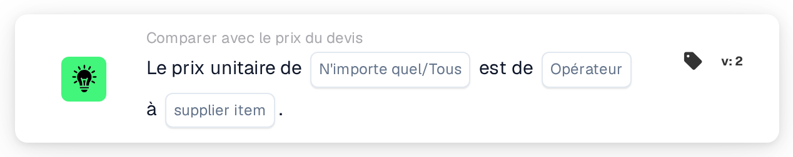

# Prix unitaire et prix de l'article fournisseur

<figure><figcaption>
Version 2
</figcaption></figure>

## Objectif :

Cette carte de workflow compare le prix unitaire de chaque ligne d'un document à un prix de la table des prix des articles fournisseurs, soit le prix géré, soit le dernier prix payé pour le même article fournisseur. Elle peut servir à vérifier si un prix proposé dans un devis correspond au prix connu, le dépasse ou lui reste inférieur avant l'approbation du document. Selon le résultat, le workflow se poursuit avec la condition vraie ou la condition fausse.

## Composants de la carte :

1. **N'importe quel/Tous**
   * **Description :** définit si une ligne ou chaque ligne comparée du tableau du document devrait remplir la condition.
   * **Options :**
     * **N'importe quel :** la condition est vraie si au moins une ligne comparée remplit la condition.
     * **Tous :** la condition n'est vraie que si chaque ligne comparée remplit la condition.
2. **Opérateur**
   * **Description :** définit la manière dont le prix unitaire du document est comparé au prix d'article fournisseur sélectionné.
   * **Options :**
     * **Est :** le prix unitaire est identique au prix d'article fournisseur.
     * **Pas égaux :** le prix unitaire diffère du prix d'article fournisseur.
     * **Supérieur à :** le prix unitaire est supérieur au prix d'article fournisseur.
     * **Plus grand ou égal :** le prix unitaire est supérieur ou égal au prix d'article fournisseur.
     * **Inférieur à :** le prix unitaire est inférieur au prix d'article fournisseur.
     * **Inférieur ou égal :** le prix unitaire est inférieur ou égal au prix d'article fournisseur.
3. **supplier item**
   * **Description :** le prix de la table des prix des articles fournisseurs auquel le prix unitaire est comparé.
   * **Options :**
     * **ManagedPrice :** le prix géré enregistré pour l'article fournisseur.
     * **LastPrice :** le dernier prix payé pour l'article fournisseur.

## Fonctionnalité :

* **Évaluation de la condition :** pour chaque ligne du tableau du document, la carte recherche le numéro d'article fournisseur de la ligne (colonne `SUPPLIER_ITEM_NUMBER`) dans la table des prix des articles fournisseurs et compare le prix unitaire de la ligne (colonne `UNIT_PRICE`) au prix sélectionné. Les deux prix sont comparés en tant que nombres. Les résultats de toutes les lignes comparées sont ensuite regroupés selon **N'importe quel** ou **Tous**.
* **Lignes ignorées :** une ligne est exclue de la comparaison si son prix unitaire est vide ou ne peut pas être lu comme un nombre, ou si aucun prix du type sélectionné n'est enregistré pour son article fournisseur, par exemple parce que l'article fournisseur ne figure pas dans la table des prix des articles fournisseurs. Chaque ligne ignorée est signalée dans le journal du workflow, avec le côté qui n'avait pas de prix.
* **Exécution de l'action :**
  * **Condition vraie :**\
    Les prix unitaires satisfont l'opérateur sélectionné pour l'une ou pour toutes les lignes comparées. Le workflow se poursuit avec la condition vraie, par exemple pour approuver le document.
  * **Condition fausse :**\
    Si la condition n'est pas remplie, le workflow se poursuit avec la condition fausse, par exemple pour soumettre le document à un contrôle des prix.
* **Données manquantes :** la carte n'évalue pas la condition et signale les données manquantes dans le journal du workflow si :
  * aucun prix d'article fournisseur n'est sélectionné sur la carte,
  * le document n'a pas de données de devis rapprochées,
  * le document n'a pas de tableau, en a plusieurs, ou si aucune ligne n'a pu être lue dans le tableau,
  * aucune des lignes n'a pu être comparée, parce que chaque ligne a été ignorée.

  Si aucune option **N'importe quel/Tous** n'est définie, la carte le signale dans le journal et utilise **Tous**.
* **Erreurs :** si une ligne du tableau ne comporte pas de colonne `SUPPLIER_ITEM_NUMBER` ou `UNIT_PRICE`, la carte se termine par une erreur.

## Mise en place et configuration :

* La carte peut être ajoutée depuis la catégorie **Comparer avec le prix du devis**. Ensuite, **N'importe quel** ou **Tous**, l'opérateur et, dans le champ **supplier item**, le prix de comparaison peuvent être sélectionnés. Enfin, la condition de poursuite (vraie ou fausse) est définie ; elle détermine l'étape suivante du workflow.
* La carte fonctionne sur les documents comportant exactement un tableau, dont les lignes contiennent le numéro d'article fournisseur et le prix unitaire.

## Conclusion :

La carte de workflow « Unit Price to Supplier Item Price » vérifie les prix proposés dans les devis par rapport au prix géré ou au dernier prix payé. Les lignes sans prix d'un côté ou de l'autre sont ignorées ; une seule ligne incomplète ne décide donc pas du résultat, et un document sans aucune ligne comparable est signalé comme données manquantes.
