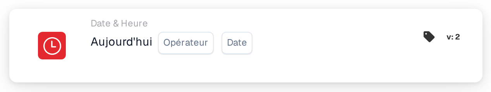

# Aujourd'hui

<figure><figcaption>
Version 2
</figcaption></figure>

## Objectif :

Cette carte de workflow compare la date du jour à une date définie sur la carte. Elle peut servir pour des règles qui ne devraient s'appliquer qu'à partir d'une certaine date ou jusqu'à celle-ci, par exemple un changement de processus à partir d'une date de début prévue.

## Composants de la carte :

1. **Opérateur**
   * **Description :** la manière dont la date du jour est comparée à la date de la carte.
   * **Options :**
     * **Est :** aujourd'hui est la date de la carte.
     * **Pas égaux :** aujourd'hui est n'importe quel autre jour.
     * **Supérieur à :** aujourd'hui est postérieur à la date de la carte.
     * **Plus grand ou égal :** aujourd'hui est la date de la carte ou une date postérieure.
     * **Inférieur à :** aujourd'hui est antérieur à la date de la carte.
     * **Inférieur ou égal :** aujourd'hui est la date de la carte ou une date antérieure.
2. **Date**
   * **Description :** la date à laquelle aujourd'hui est comparé.

## Fonctionnalité :

* **Évaluation de la condition :** lorsque le workflow atteint la carte, celle-ci prend la date actuelle en UTC et la compare à la date de la carte à l'aide de l'opérateur. Seules les dates sont comparées ; les heures de la journée sont ignorées. Les dates du document ne jouent aucun rôle.
* **Exécution de l'action :**
  * **Condition vraie :**\
    Si la comparaison est vraie, le workflow continue avec les cartes suivantes.
  * **Condition fausse :**\
    Si elle n'est pas vraie, le workflow s'arrête avec une condition non remplie.
* **Données manquantes :** si aucune date n'est définie sur la carte, la carte n'évalue pas la condition et signale la saisie manquante dans le journal du workflow.

## Mise en place et configuration :

* La carte peut être ajoutée comme condition And depuis la catégorie **Date & Heure**. Ensuite, un opérateur et une date sont sélectionnés.
* **Exemple :** avec **Plus grand ou égal** et `2026-11-01`, la carte est remplie à partir du 1er novembre 2026 (UTC) et n'est pas remplie le 31 octobre 2026.
* Comme la date est prise en UTC, elle peut différer de la date locale autour de minuit : en Europe, la carte voit encore la veille peu après minuit ; en Amérique, elle voit déjà le lendemain dans la soirée.

## Conclusion :

La carte de workflow « Today » fait de la date du calendrier une condition de workflow. Les règles basées sur une date, comme une date de début ou de fin d'un processus, peuvent être configurées une seule fois et s'appliquent automatiquement.
