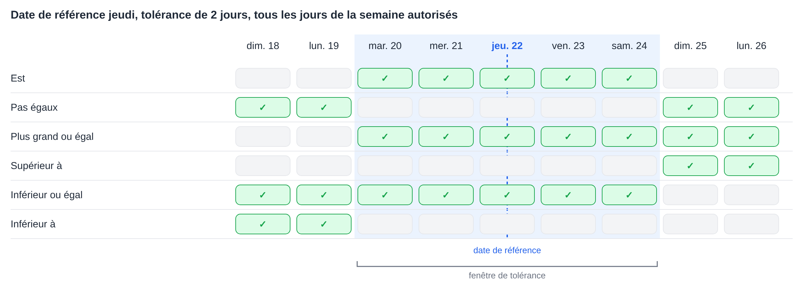
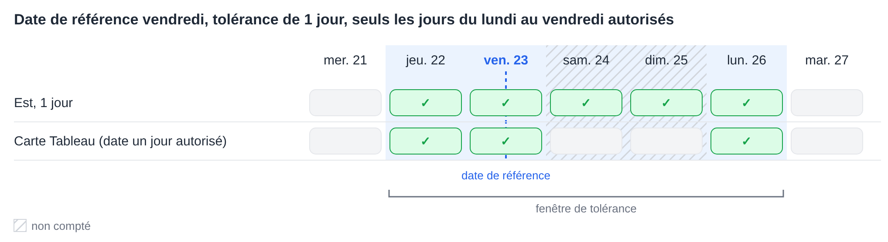
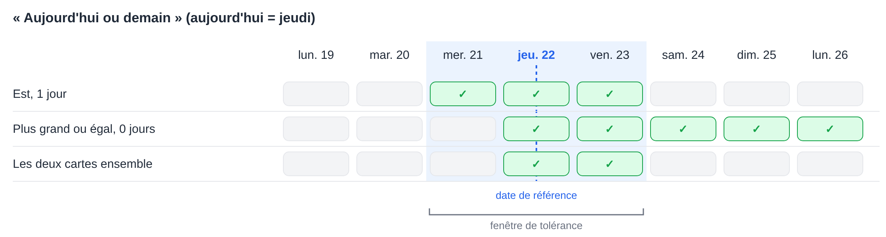

# Tolérances de date

Plusieurs cartes de workflow comparent une date à une date de référence et acceptent une tolérance exprimée en nombre de jours. Elles calculent toutes la tolérance de la même manière. Cette page explique ce calcul, la signification de chaque opérateur, le fonctionnement des **Jours de tolérance autorisés** et la manière de combiner deux cartes pour des plages telles que « aujourd'hui ou demain ».

Les cartes qui utilisent ce calcul :

* [Table Date to Current Date](table/table-date-to-current-date.md) – une date d'un tableau du document comparée à la date du jour.
* [Promised delivery date for line items in table with promised delivery date](compare-with-purchase-order/promised-delivery-date-for-line-items-in-table-with-promised-delivery-date/README.md) – les dates de livraison promises des postes comparées à la date du jour.
* [Promised Delivery Date on Purchase Order](compare-with-purchase-order/promised-delivery-date-on-purchase-order.md) – les dates de livraison des postes comparées à la date de livraison du bon de commande.

## La fenêtre de tolérance

À partir de la date de référence, la tolérance est comptée vers l'arrière et vers l'avant. Le résultat est une **fenêtre de tolérance** : de la date de début à la date de fin, toutes deux incluses.

* Avec une tolérance de **0 jour**, la fenêtre se limite à la date de référence elle-même.
* Avec une tolérance de **2 jours**, la fenêtre s'étend de 2 jours avant à 2 jours après la date de référence.
* La **date du jour** est la date des serveurs DocBits, qui fonctionnent en **UTC**.

Chaque opérateur compare la date à cette fenêtre :

| Opérateur | Vrai lorsque la date est … |
|---|---|
| **Est** | à l'intérieur de la fenêtre |
| **Pas égaux** | en dehors de la fenêtre |
| **Plus grand ou égal** | égale ou postérieure au **début** de la fenêtre |
| **Supérieur à** | postérieure à la **fin** de la fenêtre |
| **Inférieur ou égal** | égale ou antérieure à la **fin** de la fenêtre |
| **Inférieur à** | antérieure au **début** de la fenêtre |

À noter : la tolérance élargit aussi **Plus grand ou égal** et **Inférieur ou égal** : avec 2 jours, **Plus grand ou égal** accepte déjà une date située 2 jours avant la date de référence.

<figure><figcaption>
Date de référence jeudi 22, tolérance de 2 jours : la fenêtre s'étend du mardi 20 au samedi 24.
</figcaption></figure>

## Jours de tolérance autorisés

Les cartes qui proposent **Jours de tolérance autorisés** ne comptent que les jours de la semaine sélectionnés lors du calcul de la fenêtre. Les jours non sélectionnés sont sautés lors du décompte, mais restent à l'intérieur de la fenêtre.

**Exemple :** date de référence vendredi, tolérance de 1 jour, seuls les jours du lundi au vendredi sélectionnés. Le décompte vers l'arrière mène au jeudi. Le décompte vers l'avant saute le samedi et le dimanche et mène au lundi. La fenêtre s'étend **du jeudi au lundi**.

**Table Date to Current Date** ajoute une vérification supplémentaire : la date du tableau doit également tomber sur l'un des jours de la semaine sélectionnés. Un samedi situé dans la fenêtre n'est donc pas accepté par cette carte. Les deux autres cartes ne comportent pas cette vérification supplémentaire.

<figure><figcaption>
Seuls les jours du lundi au vendredi sont comptés : 1 jour après le vendredi correspond donc au lundi.
</figcaption></figure>

## Exemple : aujourd'hui ou demain

Une seule carte ne peut pas accepter exactement « aujourd'hui ou demain », car la fenêtre s'étend toujours du même nombre de jours dans les deux directions. Deux cartes placées l'une après l'autre le permettent :

1. **Est** avec une tolérance de **1 jour** accepte hier, aujourd'hui et demain.
2. **Plus grand ou égal** avec une tolérance de **0 jour** accepte aujourd'hui et tous les jours suivants.

Seules les dates qui passent les deux cartes subsistent : **aujourd'hui et demain**.

<figure><figcaption>
Aujourd'hui, c'est jeudi 22 : ensemble, les deux cartes acceptent le jeudi 22 et le vendredi 23.
</figcaption></figure>

D'autres plages peuvent être construites de la même manière :

| Plage | Première carte | Deuxième carte |
|---|---|---|
| Aujourd'hui ou demain | **Est**, 1 jour | **Plus grand ou égal**, 0 jour |
| Hier ou aujourd'hui | **Est**, 1 jour | **Inférieur ou égal**, 0 jour |
| D'aujourd'hui à 3 jours plus tard | **Est**, 3 jours | **Plus grand ou égal**, 0 jour |
| Pas aujourd'hui | **Pas égaux**, 0 jour | – |
| À partir d'après-demain | **Supérieur à**, 1 jour | – |

Lorsque seuls les jours du lundi au vendredi sont sélectionnés comme **Jours de tolérance autorisés**, « demain » correspond, un vendredi, au lundi suivant.

## Conclusion

Toutes les cartes de date avec tolérance utilisent une même fenêtre autour de la date de référence. Savoir où cette fenêtre commence et se termine permet de comprendre clairement ce que chaque opérateur accepte, et deux cartes combinées peuvent couvrir des plages qu'une seule carte ne peut pas couvrir.
