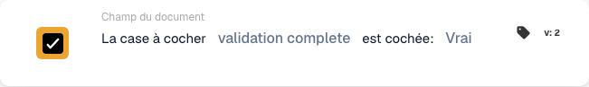

# La case est cochée

## Quand et où utiliser cette carte

Utilisez cette condition lorsqu’une action suivante dépend d’une case à cocher du document. Par exemple, autorisez la poursuite du traitement d’une facture uniquement lorsque son indicateur de contrôle est coché.

Dans l’éditeur de workflow, ajoutez la carte sous **Et… → Champ du document**. La carte compare la valeur du champ lors de l’exécution du workflow ; elle ne surveille pas en continu un champ de l’ERP et ne modifie pas la case.

## Prérequis

Le type de document doit disposer d’un champ booléen pour cette case. Utilisez son identifiant technique exact. Cet exemple utilise `validation_complete` ; remplacez-le par le champ correspondant de votre organisation.

## Configurer la carte

1. Choisissez **La case à cocher … est cochée** dans **Champ du document**.
2. Saisissez `validation_complete` dans **Nom du champ**, puis confirmez la valeur.
3. Sélectionnez **Vrai** dans **Booléen** pour exiger une case cochée. Sélectionnez **Faux** pour vérifier qu’elle n’est pas cochée.

## Exemple pratique : poursuivre après un contrôle

**Quand l’utiliser :** une facture nécessite un contrôle préalable et le processus enregistre sa réalisation dans `validation_complete`.

**Où la placer :** dans les conditions **Et…**, avant l’action de suivi configurée dans **Dans ce cas…**. Configurez séparément cette action et l’événement qui démarre le workflow.

**Configuration de l’exemple :** champ `validation_complete`, comparaison **Vrai** (`true`), carte version 2.

<figure><figcaption>
Configuration de l’exemple, version 2 : validation complete comparé à Vrai.
</figcaption></figure>

Les résultats attendus pour cette configuration sont les suivants :

| Valeur du champ dans le document | Résultat de la condition |
| --- | --- |
| Case existante et cochée (`true`) | La condition est remplie. |
| Case existante et non cochée (`false`) | La condition n’est pas remplie. |
| Case existante avec une valeur vide (`None`) | Interprétée comme non cochée ; la condition n’est pas remplie. |
| Champ absent du document | Résultat `NOT_FOUND_IN_DOCUMENT` ; ce cas diffère d’une case existante non cochée. |

Si vous sélectionnez **Faux**, une case existante non cochée remplit la condition et une case cochée ne la remplit pas. Un champ absent produit toujours un résultat d’erreur distinct.

## Vérifier avant l’activation

Vérifiez que le champ choisi est booléen et correspond au type de document utilisé. Testez un document avec la case cochée, un autre avec la case non cochée, ainsi que le cas d’un champ absent. Contrôlez le résultat de la carte et le parcours suivant du workflow dans chaque cas.

Cette carte vérifie l’état de la case ; le processus précédent doit renseigner l’indicateur de contrôle. Le cocher automatiquement sans effectuer le contrôle ne prouve pas que celui-ci a été réalisé.
