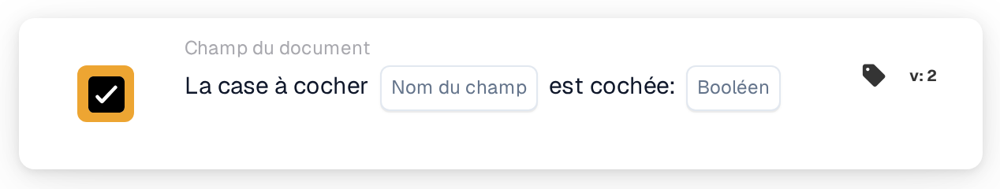

# La case est cochée

<figure><figcaption>
Version 2
</figcaption></figure>

## Objectif :

Cette carte de workflow vérifie si un champ case à cocher du document est coché ou non. Elle peut servir à ne poursuivre un workflow qu'après qu'un indicateur a été défini sur le document, par exemple un indicateur de révision.

## Composants de la carte :

1. **Nom du champ**
   * **Description :** le nom technique du champ case à cocher du document.
   * **Détail :** le champ devrait être un champ case à cocher (booléen) du type de document.
2. **Booléen**
   * **Description :** l'état que la case à cocher devrait avoir.
   * **Options :**
     * **Vrai :** la case à cocher devrait être cochée.
     * **Faux :** la case à cocher devrait être décochée.

## Fonctionnalité :

* **Évaluation de la condition :** lorsque le workflow atteint la carte, celle-ci lit la valeur actuelle du champ sur le document et la compare à **Booléen**. La carte ne surveille pas le champ dans le temps et ne le modifie pas.
  * Une valeur de case à cocher vide est considérée comme décochée.
  * Si aucune valeur **Booléen** n'est sélectionnée, la carte vérifie que la case à cocher est décochée.
  * Si le champ n'est pas un champ case à cocher, la carte le signale dans le journal du workflow et compare tout de même sa valeur.
* **Exécution de l'action :**
  * **Condition vraie :**\
    Si l'état de la case à cocher correspond à **Booléen**, le workflow continue avec les cartes suivantes.
  * **Condition fausse :**\
    S'il ne correspond pas, le workflow s'arrête avec une condition non remplie.
* **Données manquantes :** si le champ n'existe pas sur le document, la carte n'évalue pas la condition. Elle signale que le champ n'a pas été trouvé sur le document, ce qui est un résultat différent d'une case à cocher décochée.

## Mise en place et configuration :

* La carte peut être ajoutée comme condition And depuis la catégorie **Champ du document**. Ensuite, le nom technique du champ case à cocher est saisi dans **Nom du champ** et **Vrai** ou **Faux** est sélectionné.
* **Tester la carte** dans le menu de la carte du Workflow Builder peut être utilisé pour vérifier la configuration sur un document avec la case cochée, un document avec la case décochée et un document sans le champ.

## Conclusion :

La carte de workflow « Checkbox is checked » transforme une case à cocher du document en condition de workflow. Un workflow peut ainsi attendre une étape manuelle, comme une révision terminée, avant que les actions suivantes ne s'exécutent.
