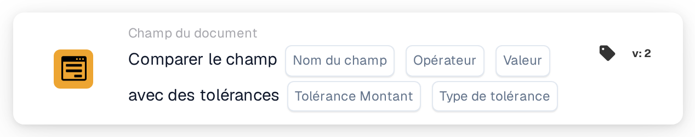

# Comparer le champ avec les tolérances

<figure><figcaption>
Version 2
</figcaption></figure>

## Quand utiliser cette carte

Utilisez cette condition pour comparer un champ numérique du document à une référence fixe, en autorisant un écart défini. Par exemple, un montant total peut être considéré comme correspondant à la référence 100 si l'écart ne dépasse pas 5.

## Où la trouver

Dans le concepteur de workflows standard, ajoutez une carte sous **Et**, ouvrez **Champ du document**, puis sélectionnez la comparaison d'un champ avec une référence et des tolérances. L'exemple suivant utilise la version 2.

## Paramètres

Utilisez un champ numérique configuré dans votre organisation. La valeur du champ, la référence et la tolérance sont évaluées numériquement. Utilisez des unités cohérentes.

| Paramètre | Signification |
| --- | --- |
| Nom du champ | Le champ configuré, par exemple `total_amount`. |
| Opérateur | La comparaison à appliquer : `eq`, `neq`, `gt`, `ge`, `lt` ou `le`. |
| Valeur de référence | Le nombre fixe auquel le champ est comparé. |
| Tolérance | L'écart numérique autorisé. |
| Type de tolérance | **Valeur** (`value`) pour un montant absolu ou **Pour cent** (`percent`) pour un écart relatif. |

Avec une référence positive de 200, une tolérance de 5 pour cent autorise un écart de 10. Une tolérance absolue de 5 autorise un écart de 5. Vérifiez les limites pertinentes pour l'opérateur et les valeurs choisis.

## Effet de la tolérance sur la comparaison

Avec une référence de **100** et une tolérance absolue de **5**, la limite inférieure est **95** et la limite supérieure est **105**.

| Opérateur | La condition est remplie lorsque la valeur du champ… |
| --- | --- |
| `eq` (=) | Est comprise entre 95 et 105, limites incluses. |
| `neq` (≠) | Est inférieure à 95 ou supérieure à 105. |
| `gt` (>) | Est supérieure à 105. |
| `ge` (≥) | Est au moins égale à 95. |
| `lt` (<) | Est inférieure à 95. |
| `le` (≤) | Est au plus égale à 105. |

Cette carte renvoie le résultat d'une condition. Les étapes suivantes dépendent du déclencheur, des autres conditions et des actions configurées dans le workflow.

<!-- workflow-card-complete-example-20261021 condition_docfield_operator_value_tolerances -->

## Exemple pratique

1. Sélectionnez le champ numérique configuré **Montant total** (`total_amount`).
2. Sélectionnez **Est** (`eq`).
3. Saisissez la référence **100** et la tolérance **5**.
4. Sélectionnez le type de tolérance **Valeur** (`value`).

| Valeur du champ | Écart absolu par rapport à 100 | Résultat attendu |
| --- | --- | --- |
| 103 | 3 | Condition remplie. |
| 110 | 10 | Condition non remplie. |
| 95 ou 105 | 5 | Condition remplie : l'égalité inclut les limites de tolérance. |

Il s'agit des résultats de calcul attendus pour une configuration d'exemple. Aucun workflow n'a été exécuté pour cet exemple.

## Avant d'activer la règle

Vérifiez un cas correspondant, un cas non correspondant et les limites avec des données de test appropriées. Examinez séparément les champs manquants, les valeurs non numériques et les erreurs de configuration. Consultez le journal d'exécution pour vérifier les valeurs, l'opérateur, la tolérance et le résultat réellement utilisés.

Si les deux montants proviennent de champs du document, utilisez la carte distincte de [comparaison de deux champs avec tolérance](compare-two-fields-with-tolerance.md).
