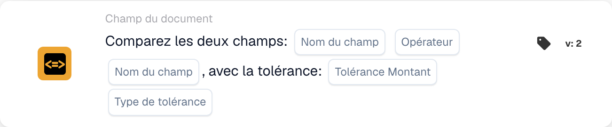

# Comparez deux champs avec tolérance

<figure><figcaption>
Champs de la carte dans la version affichée. Les champs ne sont pas encore renseignés.
</figcaption></figure>

## **Objectif :**

Cette carte de workflow est conçue pour automatiser des actions en comparant les valeurs de deux champs de document spécifiés, avec la possibilité supplémentaire d'appliquer une valeur de tolérance. Cette fonctionnalité permet au système de tenir compte d'une marge d'erreur (tolérance) lors de la comparaison des valeurs de champs, autorisant une prise de décision plus flexible au sein des workflows.

## **Composants de la carte :**

1. **Nom du champ (1)**
   * **Descriptif :** spécifie le premier champ de document à comparer.
   * **Détail :** il doit correspondre à l'identifiant exact du premier champ dans le document.
2. **Opérateur**
   * **Descriptif :** définit le type de comparaison à effectuer entre les deux champs.
   * **Possibilités :**
     * **Est égal à (=) :** vérifie si les valeurs des deux champs sont égales.
     * **Différent (≠) :** s'assure que les valeurs des deux champs sont différentes.
     * **Supérieur à (>) :** confirme que la valeur du premier champ est supérieure à celle du second champ.
     * **Supérieur ou égal à (≥) :** vérifie que la valeur du premier champ est égale ou supérieure à celle du second champ.
     * **Inférieur à (<) :** vérifie si la valeur du premier champ est inférieure à celle du second champ.
     * **Inférieur ou égal à (≤) :** s'assure que la valeur du premier champ est inférieure ou égale à celle du second champ.
3. **Nom du champ (2)**
   * **Descriptif :** spécifie le second champ de document à comparer au premier champ.
   * **Détail :** il doit correspondre à l'identifiant exact du second champ dans le document.
4. **Montant de tolérance**
   * **Descriptif :** définit la marge d'erreur acceptable pour la comparaison.
   * **Détail :** le montant de tolérance est une valeur numérique qui indique l'écart maximal autorisé entre les deux valeurs de champ pour que la comparaison soit considérée comme vraie.
5. **Type de tolérance**
   * **Descriptif :** spécifie l'unité de mesure du montant de tolérance.
   * **Possibilités :**
     * **Valeur :** la tolérance est une valeur absolue, ce qui signifie que les deux champs peuvent différer du montant de tolérance spécifié.
     * **Percent :** la tolérance est calculée en pourcentage de la valeur du second champ, autorisant une marge d'erreur relative.

## **Fonctionnalité :**

* **Évaluation de la condition :** le système évalue si les valeurs des deux champs spécifiés satisfont la condition de comparaison, en tenant compte de la tolérance définie. Si l'écart absolu ou relatif entre les deux champs se situe dans la tolérance, la condition est considérée comme vraie.
* **Exécution de l'action :**
  * **Condition vraie :**\
    Si les valeurs des deux champs, après prise en compte de la tolérance, correspondent à la condition de comparaison, le système déclenche les actions associées. Celles-ci peuvent inclure la progression du workflow, la mise à jour d'enregistrements, le déclenchement d'alertes ou l'activation de certaines opérations.
  * **Condition fausse :**\
    Si les valeurs des deux champs, après prise en compte de la tolérance, ne correspondent pas à la condition spécifiée, des actions alternatives ou aucune action peuvent être exécutées, selon la configuration du workflow.

## **Mise en place et configuration :**

* Les utilisateurs configurent la carte en sélectionnant les deux champs à comparer dans une liste de champs disponibles dans le système. L'opérateur est sélectionné dans une liste déroulante d'options de comparaison disponibles. Les utilisateurs saisissent le montant de tolérance et choisissent le type de tolérance (value ou percent).

## **Conclusion :**

La carte de workflow « Compare Two Fields with Tolerance » est un outil puissant pour comparer des champs de document tout en tenant compte des écarts admissibles dans les données. En appliquant une tolérance aux comparaisons de champs, cette carte apporte de la flexibilité au workflow, lui permettant de gérer les variations de données du monde réel. Elle améliore la prise de décision, facilite la validation des données et renforce l'automatisation globale du workflow.

<!-- workflow-card-practical-example-20261021 -->

## Exemple pratique

**Quand utiliser :** Acceptez une petite différence entre un montant extrait et un montant calculé séparément.

**Configuration :** Sélectionnez les champs numériques `net_total` et `calculated_total`, comparaison d'égalité et une tolérance absolue de `5`. Utilisez les valeurs `103` et `100`.

**Résultat attendu et contre-exemple :** La différence est `3`, elle est donc dans la tolérance. Avec `110` et `100`, la différence est `10` et la condition d'égalité avec tolérance échoue.

Il s’agit d’une configuration illustrative et du résultat attendu. Utilisez les champs, utilisateurs et groupes configurés dans votre organisation de test ; cela ne veut pas dire que cet exemple a été exécuté.
