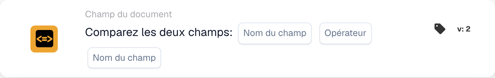

# Comparez deux champs

<figure><figcaption>
Champs de la carte dans la version affichée. Les champs ne sont pas encore renseignés.
</figcaption></figure>

## **Objectif :**

Cette carte de workflow est conçue pour automatiser des actions en comparant les valeurs de deux champs de document spécifiés. Elle permet une prise de décision dynamique basée sur les données des champs et garantit que les workflows s'exécutent en fonction des comparaisons entre différentes valeurs de document.

## **Composants de la carte :**

1. **Nom du champ (1)**
   * **Descriptif :** spécifie le premier champ de document à comparer.
   * **Détail :** il doit correspondre à l'identifiant exact du premier champ dans le document.
2. **Opérateur**
   * **Descriptif :** définit le type de comparaison à effectuer entre les deux champs.
   * **Possibilités :**
     * **Est égal à (=) :** vérifie si les valeurs des deux champs sont égales.
     * **Différent (≠) :** s'assure que les valeurs des deux champs sont différentes.
     * **Supérieur à (>) :** confirme que la valeur du premier champ est supérieure à celle du second champ.
     * **Supérieur ou égal à (≥) :** vérifie que la valeur du premier champ est égale ou supérieure à celle du second champ.
     * **Inférieur à (<) :** vérifie si la valeur du premier champ est inférieure à celle du second champ.
     * **Inférieur ou égal à (≤) :** s'assure que la valeur du premier champ est inférieure ou égale à celle du second champ.
3. **Nom du champ (2)**
   * **Descriptif :** spécifie le second champ de document à comparer au premier champ.
   * **Détail :** il doit correspondre à l'identifiant exact du second champ dans le document.

## **Fonctionnalité :**

**Évaluation de la condition :** le système évalue si les valeurs des deux champs spécifiés satisfont la condition de comparaison définie par l'opérateur.

**Exécution de l'action :**

* **Condition vraie :**\
  Si les valeurs des deux champs correspondent à la condition de comparaison, le système déclenche les actions associées. Celles-ci peuvent inclure la mise à jour d'enregistrements ou le déclenchement d'alertes.
* **Condition fausse :**\
  Si les valeurs des deux champs ne correspondent pas à la condition spécifiée, des actions alternatives ou aucune action peuvent être exécutées, selon la configuration des workflows.

## **Mise en place et configuration :**

* Les utilisateurs configurent la carte en sélectionnant les deux champs à comparer dans une liste de champs disponibles dans le système. L'opérateur est sélectionné dans une liste déroulante d'options de comparaison disponibles.

## **Conclusion :**

La carte de workflow « Compare Two Fields » est un outil essentiel pour comparer les données entre champs au sein de documents. En automatisant des actions en fonction des comparaisons de champs, cette carte aide à optimiser la prise de décision, facilite la validation des données et renforce l'automatisation du workflow.

<!-- workflow-card-practical-example-20261021 -->

## Exemple pratique

**Quand utiliser :** Vérifiez qu'une référence copiée est égale à la référence originale.

**Configuration :** Sélectionnez les champs de texte `purchase_order_number` et `confirmed_order_number` et l'opérateur égal.

**Résultat attendu et contre-exemple :** Les valeurs `PO-DEMO-001` et `PO-DEMO-001` sont réussies. Une deuxième valeur de `PO-DEMO-002` échoue.

Il s’agit d’une configuration illustrative et du résultat attendu. Utilisez les champs, utilisateurs et groupes configurés dans votre organisation de test ; cela ne veut pas dire que cet exemple a été exécuté.
