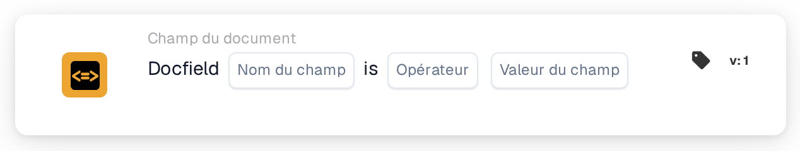
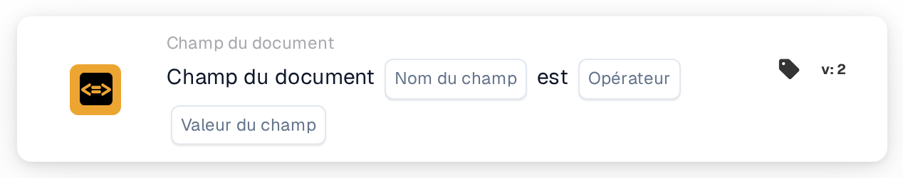

# Comparer un champ de document à une valeur de référence

<figure><figcaption>
Version 1
</figcaption></figure>

<figure><figcaption>
Version 2
</figcaption></figure>

## **Objectif :**

Cette carte de workflow est conçue pour automatiser des actions en comparant la valeur d'un champ de document spécifié à une valeur ou condition de référence. Elle garantit une prise de décision dynamique et précise dans les workflows, fondée sur la validation des données du document.

## **Composants de la carte :**

1. **Nom du champ**
   * **Descriptif :** spécifie le nom du champ de document à évaluer.
   * **Détail :** il doit correspondre à l'identifiant exact du champ dans le document.
2. **Opérateurs**
   * **Descriptif :** définit le type de comparaison à effectuer entre la valeur du champ et la valeur de référence.
   * **Possibilités :**
     * **Est égal à (=) :** vérifie si la valeur du champ correspond à la valeur de référence.
     * **Différent (≠) :** s'assure que la valeur du champ diffère de la valeur de référence.
     * **Supérieur à (>) :** confirme que la valeur du champ est supérieure à la valeur de référence.
     * **Supérieur ou égal à (≥) :** vérifie que la valeur du champ est égale ou supérieure à la valeur de référence.
     * **Inférieur à (<) :** vérifie si la valeur du champ est inférieure à la valeur de référence.
     * **Inférieur ou égal à (≤) :** s'assure que la valeur du champ est inférieure ou égale à la valeur de référence.

## **Fonctionnalité :**

* **Évaluation de la condition :** le système vérifie si la valeur du champ de document, par rapport à sa colonne associée, satisfait la condition de comparaison spécifiée par l'opérateur et la valeur de référence.
* **Exécution de l'action :**
  * **Condition vraie :**\
    Si la valeur du champ de document satisfait la condition spécifiée (par ex. égale la valeur de référence), le système déclenche les actions associées. Celles-ci peuvent inclure la mise à jour d'enregistrements, la progression du workflow ou la génération de notifications.
  * **Condition fausse :**\
    Si la valeur du champ de document ne satisfait pas la condition spécifiée, des actions alternatives ou aucune action sont exécutées, selon la configuration du workflow.

## **Mise en place et configuration :**

* L'utilisateur sélectionne le nom du champ du document concerné et choisit l'opérateur dans le menu déroulant. L'utilisateur spécifie ensuite la valeur de champ de référence pour finaliser la configuration.

## **Conclusion :**

La carte de workflow « DocField Comparison Validation » est un outil robuste pour le traitement dynamique des documents. En automatisant des actions en fonction des comparaisons de champs, cette carte rationalise les workflows, améliore la précision et facilite la prise de décision fondée sur les données.

<!-- workflow-card-practical-example-20261021 -->

## Exemple pratique

**Quand utiliser :** Examinez les factures supérieures à un montant défini.

**Configuration :** Sélectionnez le champ numérique `total_amount`, l'opérateur `>` et la valeur de référence `1000`.

**Résultat attendu et contre-exemple :** Une valeur de `1200` satisfait la condition. Les valeurs `1000` et `900` ne la satisfont pas : l’opérateur `>` exige une valeur strictement supérieure à `1000`.

Il s’agit d’une configuration illustrative et du résultat attendu. Utilisez les champs, utilisateurs et groupes configurés dans votre organisation de test ; cela ne veut pas dire que cet exemple a été exécuté.
