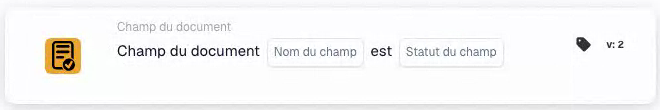

# Vérifier la présence et le contenu d’un champ

<figure><figcaption>
Champs de la carte dans la version affichée. Les champs ne sont pas encore renseignés. Certains libellés de cette version de la carte ont encore une traduction incomplète ou incorrecte dans l’interface. Les explications de cette page emploient les termes corrects.
</figcaption></figure>

## Quand l’utiliser

Utilisez cette carte pour vérifier si un champ du document est vide ou absent, par exemple lorsqu’une facture sans numéro nécessite un contrôle supplémentaire. Il s’agit d’une condition ; configurez séparément l’action suivante.

**Emplacement :** Workflow standard → conditions supplémentaires (AND) → Champ du document.

## Configuration — version 2

| Paramètre | Valeur de l’exemple |
| --- | --- |
| Champ | `invoice_id` — numéro de facture |
| État du champ | Vide ou absent (`field_empty`) |

Sélectionnez un champ réellement configuré dans votre organisation. L’option `field_not_empty` vérifie si le champ contient une valeur.

<!-- workflow-card-practical-example-20261021 -->

## Exemple pratique

| Valeur de l’exemple | Résultat attendu pour `field_empty` |
| --- | --- |
| Champ vide ou absent | Condition satisfaite |
| `DEMO-001` | Condition non satisfaite |
| Numéro présent mais incorrect | Condition non satisfaite — le champ contient toujours une valeur |

Ces exemples présentent les résultats attendus. Pour vérifier la validité du numéro lui-même, ajoutez une condition adaptée à son contenu ; cette carte vérifie l’état du champ. Dans la version 2, les espaces en début et en fin de texte sont supprimés avant de vérifier si le champ est vide.

## Vidéo d’exemple avec un administrateur

Quand j’utilise cette carte, où la trouver et comment repérer les numéros de facture manquants. L’administrateur, le bureau et la voix sont synthétiques ; la démonstration présente la véritable interface DocBits d’un compte de test. Les exemples présentent les résultats attendus.



[Ouvrir la vidéo avec les sous-titres français](https://docbits-videos.fra1.cdn.digitaloceanspaces.com/settings-assistant/workflow-card-field-status-admin/v1/fr.html)

[Lire la transcription](https://docbits-videos.fra1.cdn.digitaloceanspaces.com/settings-assistant/workflow-card-field-status-admin/v1/fr.txt)
