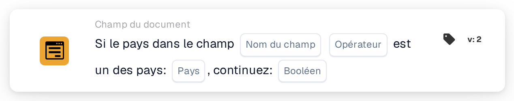

# Si le pays dans le champ est l'un des

<figure><figcaption>
Version 2
</figcaption></figure>

Utilisez cette condition lorsqu’une étape de traitement supplémentaire doit s’appliquer aux documents de certains pays, par exemple l’Allemagne et la France. La carte compare le pays lu dans un champ du document à une liste de pays configurée.

**Emplacement :** Workflow standard → conditions supplémentaires (AND) → Champ du document. Configurez séparément l’action suivante dans THEN.

## Configuration — version 2

| Paramètre | Valeur |
| --- | --- |
| Champ | Un champ de texte existant contenant le nom du pays |
| Opérateur | `is` |
| Pays | `Germany, France` |
| Valeur de continuation | `true` |

<!-- workflow-card-practical-example-20261021 -->

## Exemple pratique

| Valeur du pays dans le champ | Condition attendue |
| --- | --- |
| `Germany` | Satisfaite |
| `France` | Satisfaite |
| `United States` | Non satisfaite |

Les noms de pays affichés en code sont les valeurs de saisie fixes de cet exemple.

## Limites et vérifications

`false` n’inverse pas la comparaison. Avec ce réglage, même un pays correspondant ne produit pas de condition positive. Pour vérifier la condition opposée, sélectionnez `isnot` avec `true`.

Traitez séparément les champs absents et les valeurs de pays vides ; ils peuvent produire un résultat de données manquantes plutôt qu’une absence normale de correspondance.

L’examen du code source de la version de développement du 22 octobre 2026 révèle une erreur de conversion pour les entrées ISO telles que `DE` et `DEU`. Ces exemples utilisent donc les noms de pays complets. Vérifiez séparément le traitement des codes ISO dans votre version installée.
