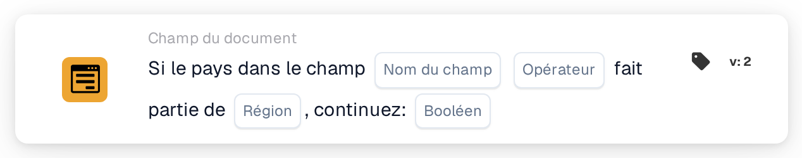

# Si pays dans le champ

<figure><figcaption>
Version 2
</figcaption></figure>

Utilisation prévue : une étape de traitement supplémentaire dépend d’un groupe de pays. L’exemple ci-dessous décrit une règle d’appartenance à l’Union européenne.

## Limitation actuelle — code source vérifié le 22 octobre 2026

Les tests locaux du code source utilisant le type natif de la sélection de région échouent avant la comparaison du pays et renvoient `missing_variable` ou `error`. Les noms de pays complets ne contournent pas ce problème. Une exécution réussie sur le backend déployé n’a pas été vérifiée pour cette version.

**Emplacement :** Workflow standard → conditions supplémentaires (AND) → Champ du document. Configurez séparément l’action suivante dans THEN.

## Configuration — version 2

| Paramètre | Valeur |
| --- | --- |
| Champ | Un champ de texte existant contenant le nom du pays |
| Opérateur | `is` |
| Région | Union européenne (UE) |
| Valeur de continuation | `true` |

<!-- workflow-card-practical-example-20261021 -->

## Exemple prévu — vérifier le correctif avant utilisation

Vérifiez le correctif et les deux cas de l’exemple dans votre version installée avant d’activer cette règle. Le tableau décrit la règle métier prévue, pas une exécution réussie confirmée.

| Valeur du pays dans le champ | Regroupement de pays prévu |
| --- | --- |
| `Germany` | Dans l’UE |
| `United States` | Hors de l’UE |

Les noms de pays affichés en code sont les valeurs de saisie fixes de cet exemple.

## Limites et vérifications

`false` n’inverse pas la comparaison. Avec ce réglage, même un pays correspondant ne produit pas de condition positive. Pour vérifier la condition opposée, sélectionnez `isnot` avec `true`.

Traitez séparément les champs absents et les valeurs de pays vides ; ils peuvent produire un résultat de données manquantes plutôt qu’une absence normale de correspondance.

Le problème de conversion ISO pour les valeurs telles que `DE` et `DEU` est distinct. Remplacer les codes ISO par les noms de pays complets ne résout pas l’erreur de sélection de région.

Les groupes proposés, notamment UE, Schengen et NAFTA, proviennent de l’implémentation de la carte. Vérifiez les pays inclus dans votre version avant d’utiliser un groupe dans une règle métier.
