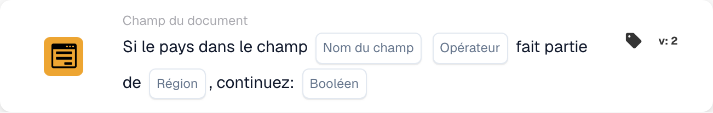

# Si pays dans le champ

<figure><figcaption>
Champs de la carte dans la version affichée. Les champs ne sont pas encore renseignés.
</figcaption></figure>

Utilisez cette condition lorsqu’une étape de traitement supplémentaire doit dépendre d’un groupe de pays. L’exemple vérifie si le pays lu dans un champ du document appartient à l’Union européenne.

**Emplacement :** Workflow standard → conditions supplémentaires (AND) → Champ du document. Configurez séparément l’action suivante dans THEN.

## Configuration — version 2

| Paramètre | Valeur |
| --- | --- |
| Champ | Un champ de texte existant contenant le nom du pays |
| Opérateur | `is` |
| Région | Union européenne (UE) |
| Valeur de continuation | `true` |

<!-- workflow-card-practical-example-20261021 -->

## Exemple pratique

| Valeur du pays dans le champ | Condition attendue |
| --- | --- |
| `Germany` | Satisfaite |
| `United States` | Non satisfaite |

Les noms de pays affichés en code sont les valeurs de saisie fixes de cet exemple.

## Limites et vérifications

`false` n’inverse pas la comparaison. Avec ce réglage, même un pays correspondant ne produit pas de condition positive. Pour vérifier la condition opposée, sélectionnez `isnot` avec `true`.

Traitez séparément les champs absents et les valeurs de pays vides ; ils peuvent produire un résultat de données manquantes plutôt qu’une absence normale de correspondance.

L’examen du code source de la version de développement du 22 octobre 2026 révèle une erreur de conversion pour les entrées ISO telles que `DE` et `DEU`. Ces exemples utilisent donc les noms de pays complets. Vérifiez séparément le traitement des codes ISO dans votre version installée.

Les groupes proposés, notamment UE, Schengen et NAFTA, proviennent de l’implémentation de la carte. Vérifiez les pays inclus dans votre version avant d’utiliser un groupe dans une règle métier.
