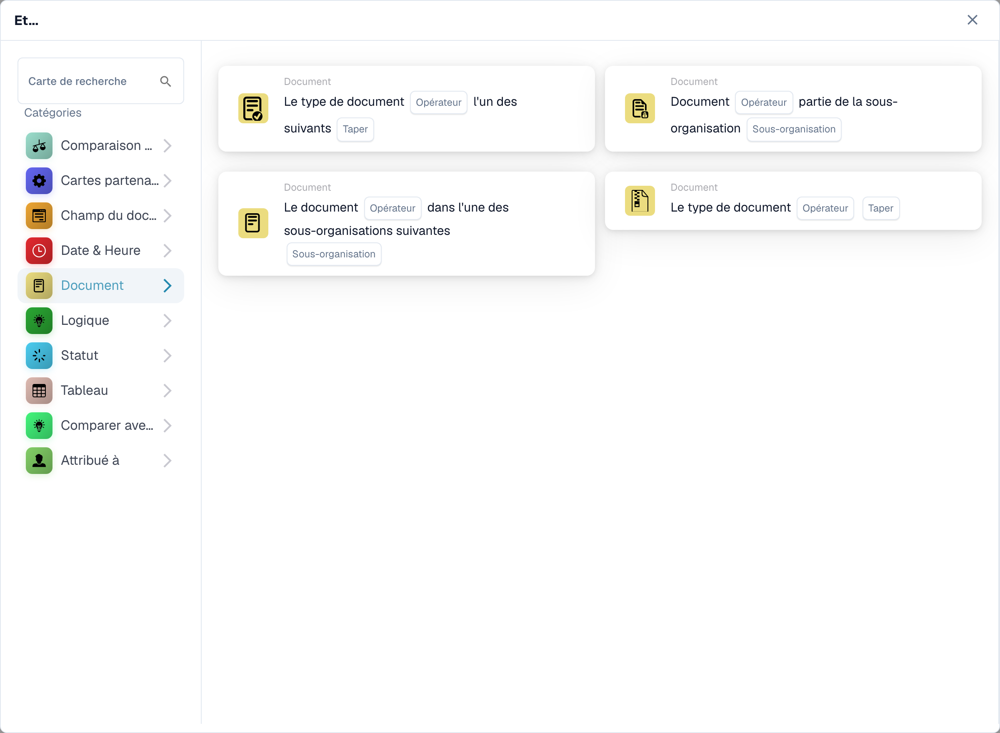
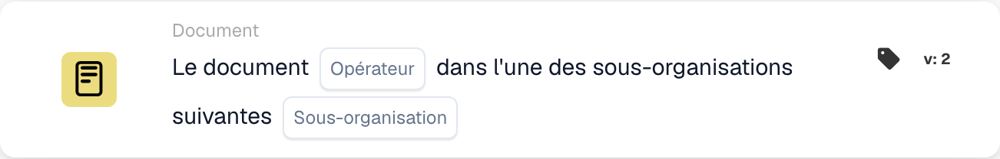

# Document

Les cartes de cette catégorie dans le sélecteur **Ajouter une carte** du Workflow Builder :

<figure><figcaption>
Cartes disponibles dans la catégorie sélectionnée. Renseignez les champs avant utilisation. Certains libellés de cette version de la carte ont encore une traduction incomplète ou incorrecte dans l’interface. Les explications de cette page emploient les termes corrects.
</figcaption></figure>

<!-- workflow-card-example-condition_sub_org_is_isnot_in_list-20261021 -->

### Document dans l'une des nombreuses sous-organisations

<figure><figcaption>
Champs de la carte dans la version affichée. Les champs ne sont pas encore renseignés.
</figcaption></figure>

`CONDITION_SUB_ORG_IS_ISNOT_IN_LIST` · version 2

Sélectionnez l'une des sous-organisations configurées `Demo North` et `Demo South`. Un document appartenant à l'une ou l'autre des unités sélectionnées est accepté ; `Demo Default` échoue. Cela vérifie la sous-organisation du document ; cela ne le change pas.
