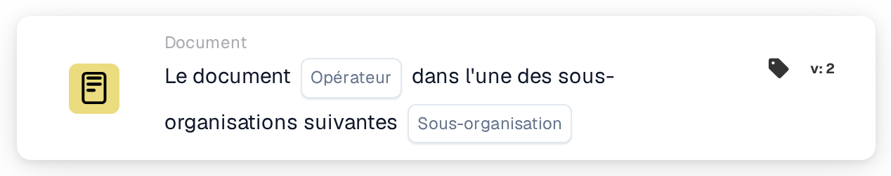

# Opérateur de documents pour les sous-organisations un des

<figure><figcaption>
Version 2
</figcaption></figure>

## Objectif :

Cette carte de workflow vérifie si un document appartient à l'une de plusieurs sous-organisations. Au lieu de comparer le document à une seule sous-organisation, elle le compare à une liste : une seule carte couvre ainsi tout un groupe de sous-organisations qui doivent être traitées de la même manière. Selon le résultat, le workflow se poursuit avec la condition vraie ou la condition fausse.

Pour comparer avec une seule sous-organisation, la carte **Document Operator for Sub-Organizations** peut être utilisée.

## Composants de la carte :

1. **Operator**
   * **Description :** définit si le document devrait appartenir à l'une des sous-organisations indiquées ou à aucune d'entre elles.
   * **Options :**
     * **Is :** la condition est vraie si la sous-organisation du document est l'une des sous-organisations indiquées.
     * **Is Not :** la condition est vraie si la sous-organisation du document ne figure pas dans la liste.
2. **Sub-org**
   * **Description :** la liste des sous-organisations auxquelles le document est comparé.
   * **Détail :** une ou plusieurs sous-organisations de l'organisation peuvent être sélectionnées. La comparaison porte sur la sous-organisation à laquelle le document est affecté.

## Fonctionnalité :

* **Évaluation de la condition :** le système lit la sous-organisation du document et vérifie si elle fait partie des sous-organisations sélectionnées sur la carte.
* **Exécution de l'action :**
  * **Condition vraie :**\
    Avec **Is**, la sous-organisation du document figure dans la liste ; avec **Is Not**, elle n'y figure pas. Le workflow se poursuit avec la condition vraie, par exemple pour transmettre le document à l'équipe responsable de ces sous-organisations ou appliquer des règles qui ne concernent qu'elles.
  * **Condition fausse :**\
    Si la condition n'est pas remplie, le workflow se poursuit avec la condition fausse, par exemple pour appliquer des règles générales ou transmettre le document ailleurs.
* **Données manquantes :** si le document n'est affecté à aucune sous-organisation, ou si aucune sous-organisation n'est sélectionnée sur la carte, la carte n'évalue pas la condition. Elle signale les données manquantes dans le journal du workflow au lieu de poursuivre avec la condition fausse.

## Mise en place et configuration :

* La carte peut être ajoutée depuis la catégorie **Document**. Ensuite, l'opérateur (**Is** ou **Is Not**) et, dans le champ **Sub-org**, les sous-organisations à vérifier peuvent être choisis. Enfin, la condition de poursuite (vraie ou fausse) est définie ; elle détermine l'étape suivante du workflow.

## Conclusion :

La carte de workflow « Document Operator for Sub-Organizations one of » permet à une seule condition de couvrir plusieurs sous-organisations à la fois. Les workflows restent ainsi courts lorsque plusieurs sous-organisations partagent les mêmes règles de traitement, et les documents sont traités dans le bon contexte organisationnel.
