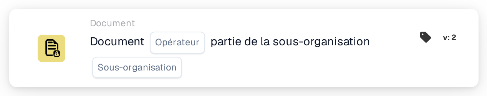

# Opérateur de documents pour les sous-organisations

<figure><figcaption>
Version 2
</figcaption></figure>

## Objectif :

Cette carte de workflow évalue si un document fait partie d'une sous-organisation spécifique. Selon cette évaluation, le workflow peut se poursuivre ou déclencher différentes actions selon que le document est associé ou non à la sous-organisation spécifiée.

## Composants de la carte :

1. **Opérateur**
   * **Descriptif :** définit si le document doit ou non faire partie de la sous-organisation spécifiée.
   * **Possibilités :**
     * **Is :** le document doit faire partie de la sous-organisation spécifiée pour que la condition soit vraie.
     * **N'est-ce pas :** le document ne doit pas faire partie de la sous-organisation spécifiée pour que la condition soit vraie.
2. **Sous-org**
   * **Descriptif :** spécifie la sous-organisation à laquelle le document doit être comparé.
   * **Détail :** elle doit correspondre à l'identifiant de la sous-organisation. La comparaison vérifie si le document appartient à la sous-organisation spécifiée.

## Fonctionnalité :

* **Évaluation de la condition :** le système évalue si le document fait partie de la sous-organisation spécifiée. Cette évaluation vérifie la sous-organisation du document par rapport à celle fournie par l'utilisateur.
* **Exécution de l'action :**
  * **Condition vraie :**\
    Si le document fait partie de la sous-organisation spécifiée, le workflow se poursuit avec la condition vraie. Cela peut déclencher des actions supplémentaires, comme l'acheminement du document vers un service spécifique, l'application de règles propres à la sous-organisation ou l'activation de fonctionnalités adaptées à cette sous-organisation.
  * **Condition fausse :**\
    Si le document ne fait pas partie de la sous-organisation spécifiée, le workflow se poursuit avec la condition fausse. Cela permet d'exécuter des actions alternatives, comme l'envoi de notifications, l'arrêt du workflow ou l'application de règles générales en dehors du périmètre de la sous-organisation.

## Mise en place et configuration :

* Les utilisateurs configurent la carte en sélectionnant le champ de document contenant le document et en spécifiant la sous-organisation à vérifier. L'opérateur est ensuite choisi dans une liste déroulante pour définir si le document doit ou non faire partie de la sous-organisation spécifiée. Enfin, les utilisateurs définissent la condition de poursuite (vraie ou fausse), qui dicte l'étape suivante du workflow.

## Conclusion :

La carte de workflow « Document in Sub-organization » est un outil utile pour automatiser des actions selon qu'un document appartient ou non à une sous-organisation particulière. En garantissant que les documents sont traités selon des règles propres à la sous-organisation, cette carte améliore l'efficacité du workflow et garantit que les actions sont exécutées dans le bon contexte organisationnel.

<!-- workflow-card-practical-example-20261021 -->

## Exemple pratique

**Quand utiliser :** Acheminer les documents appartenant à une unité commerciale.

**Configuration :** Sélectionnez la sous-organisation `Demo North` et l'opérateur égal.

**Résultat attendu et contre-exemple :** Un document en `Demo North` est réussi. Un document dans `Demo South` échoue.

Il s’agit d’une configuration illustrative et du résultat attendu. Utilisez les champs, utilisateurs et groupes configurés dans votre organisation de test ; cela ne veut pas dire que cet exemple a été exécuté.
