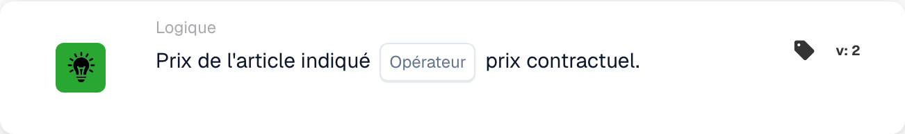

# Prix de l'article proposé

<figure><figcaption>
Champs de la carte dans la version affichée. Les champs ne sont pas encore renseignés.
</figcaption></figure>

## **Objectif :**

Cette carte DocBits compare le prix indiqué d'un article à son prix contractuel, permettant aux flux de travail de déclencher des actions selon que les deux valeurs correspondent ou diffèrent. Il permet de garantir la cohérence des prix et le respect des termes du contrat.

## **Fonctionnalité :**

* **Comparaison des prix :** Cette carte évalue si le prix de l'article proposé répond à la condition spécifiée par rapport au prix contractuel.
* **Opérateurs :** Les conditions suivantes peuvent être appliquées :
  * **Est égal à (=) :** Vérifie si le prix proposé correspond au prix contracté.
  * **Pas égal à (≠) :** Garantit que le prix proposé est différent du prix contracté.

## **Utilisation :**

Cette carte est particulièrement utile dans les flux de travail d'approvisionnement, de vente ou de gestion des contrats, où il est crucial de valider que les prix proposés correspondent aux conditions contractuelles convenues avant de procéder aux approbations ou au traitement des commandes.

## **Exemple de scénario :**

* Un utilisateur configure la carte pour vérifier si le **prix indiqué est égal à (=)** le **prix contracté**. Si les prix correspondent, le flux de travail passe à l'approbation ; sinon, il déclenche une notification pour examen manuel afin de résoudre l'écart.

En utilisant la carte « Prix de l'article proposé par rapport au prix contractuel », les organisations peuvent appliquer des politiques de tarification, maintenir la conformité des contrats et réduire les erreurs dans les transactions financières.

## Version 3 : Tout ou partie

La version 3 ajoute `match_any` et `match_all`. Tout nécessite au moins une ligne comparable réussie ; Tout nécessite que chaque ligne comparée satisfasse l'opérateur sélectionné. La version 2 conserve Tout. Une sélection non définie sur la version 3 est définie par défaut sur Tout et est enregistrée. Aucune ligne comparable ne manque de données, pas de correspondance réussie. Voir [Citer les cartes de comparaison](../../cards-overview/quote-comparison-guide.md) pour des résultats mitigés, des lignes sautées et des tests.
