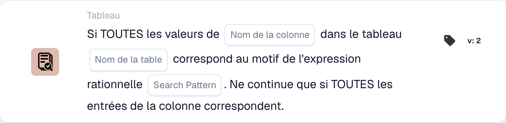

# Toute la valeur de

<figure><figcaption>
Champs de la carte dans la version affichée. Les champs ne sont pas encore renseignés. Certains libellés de cette version de la carte ont encore une traduction incomplète ou incorrecte dans l’interface. Les explications de cette page emploient les termes corrects.
</figcaption></figure>

## **Objectif :**

Cette carte DocBits sert à valider si **toutes les valeurs** d'une colonne spécifique d'un tableau correspondent à un motif regex fourni. Pour que le workflow se poursuive, chaque entrée de la colonne doit satisfaire la condition, ce qui rend cette carte idéale pour garantir la cohérence et l'intégrité des données sur l'ensemble des entrées.

## **Fonctionnalité :**

* **Validation par motif regex :** cette carte vérifie que **toutes les valeurs** d'une colonne spécifiée d'un tableau correspondent au motif d'expression régulière fourni. Le workflow ne se poursuit que si chaque entrée de la colonne satisfait la condition.
* **Opérateur :** les utilisateurs définissent la colonne et spécifient le motif regex. La condition disponible inclut :
  * **Matches Regex Pattern :** vérifie que chaque valeur de la colonne spécifiée correspond au motif regex.
* **Sélection de la table et de la colonne :** les utilisateurs spécifient la table et la colonne qu'ils souhaitent vérifier pour des correspondances complètes au motif regex.

## **Utilisation :**

Cette carte est idéale pour les cas où l'uniformité des données est requise, comme garantir que tous les numéros de téléphone, identifiants de produit ou autres entrées de champ respectent un format spécifique. Elle garantit que les workflows ne se poursuivent que lorsque chaque entrée pertinente est cohérente avec le motif.

## **Scénario d'exemple :**

* Un utilisateur configure la carte pour vérifier la colonne « Phone Number » de la table « Contacts », à l'aide d'un motif regex pour valider les formats de numéros de téléphone. Si chaque entrée de numéro de téléphone de la colonne correspond au motif, la carte déclenche l'étape suivante du workflow, confirmant un formatage uniforme des données.

En utilisant la carte « All Values Regex Pattern Matching », les organisations peuvent appliquer des normes de données strictes et améliorer l'exactitude du workflow, garantissant que chaque entrée d'une colonne spécifiée satisfait le format requis avant de poursuivre.
