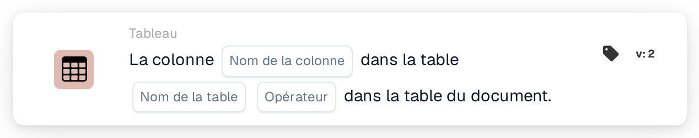

# La colonne existe dans le tableau

<figure><figcaption>
Version 2
</figcaption></figure>

## Objectif :

Cette carte de workflow vérifie si un tableau du document contient une colonne spécifique. Elle peut servir à n'exécuter les cartes suivantes que pour les documents dont le tableau contient les données nécessaires, par exemple une colonne de date de livraison ou de numéro d'article, ou à acheminer ailleurs les documents dont la structure de tableau est différente. Selon le résultat, le workflow se poursuit avec la condition vraie ou la condition fausse.

## Composants de la carte :

1. **Nom de la colonne**
   * **Description :** le nom de la colonne recherchée par la carte.
   * **Détail :** le nom de la colonne est comparé sans distinction entre majuscules et minuscules.
2. **Nom de la table**
   * **Description :** le nom du tableau du document qui est vérifié.
   * **Détail :** le nom de la table est comparé sans distinction entre majuscules et minuscules.
3. **Opérateur**
   * **Description :** définit si la colonne devrait être présente dans le tableau ou non.
   * **Options :**
     * **Est :** la condition est vraie si le tableau contient la colonne.
     * **N'est pas :** la condition est vraie si le tableau ne contient pas la colonne.

## Fonctionnalité :

* **Évaluation de la condition :** la carte recherche le tableau du document portant le nom indiqué et vérifie si la première ligne de ce tableau comporte une colonne portant le nom indiqué. La colonne trouvée, ou les colonnes présentes à sa place, sont consignées dans le journal du workflow.
* **Exécution de l'action :**
  * **Condition vraie :**\
    Avec **Est**, la colonne figure dans le tableau. Avec **N'est pas**, elle n'y figure pas. Le workflow se poursuit avec la condition vraie, par exemple pour effectuer une comparaison sur cette colonne.
  * **Condition fausse :**\
    Si la condition n'est pas remplie, le workflow se poursuit avec la condition fausse.
* **Données manquantes :** la carte n'évalue pas la condition et signale les données manquantes dans le journal du workflow si aucun nom de colonne ou aucun nom de table n'est défini sur la carte, si le document n'a pas de tableau portant le nom indiqué, ou si ce tableau n'a pas de lignes ou que sa première ligne n'a pas de colonnes.
* **Erreurs :** si aucun opérateur n'est défini, ou si un opérateur autre que **Est** ou **N'est pas** est défini, la carte signale une erreur de configuration.

## Mise en place et configuration :

* La carte peut être ajoutée depuis la catégorie **Tableau**. Ensuite, le nom de la colonne, le nom de la table et l'opérateur (**Est** ou **N'est pas**) peuvent être définis. Enfin, la condition de poursuite (vraie ou fausse) est définie ; elle détermine l'étape suivante du workflow.

## Conclusion :

La carte de workflow « Column Exists in Table » vérifie la structure d'un tableau du document avant que ses données ne soient utilisées. Placée avant d'autres cartes de tableau, elle permet de s'assurer que ces cartes ne s'exécutent que sur les documents comportant la colonne attendue.
