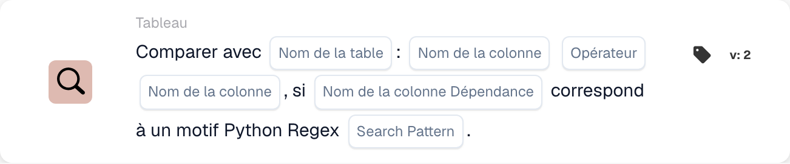

# Comparer dans

<figure><figcaption>
Champs de la carte dans la version affichée. Les champs ne sont pas encore renseignés. Certains libellés de cette version de la carte ont encore une traduction incomplète ou incorrecte dans l’interface. Les explications de cette page emploient les termes corrects.
</figcaption></figure>

## **Objectif :**

Cette carte DocBits effectue une comparaison entre deux colonnes d'un tableau spécifié, permettant aux utilisateurs de définir des conditions basées sur les valeurs de chaque colonne. De plus, cette carte inclut une fonctionnalité de dépendance, où la comparaison n'a lieu que si la valeur d'une troisième colonne correspond à un motif regex Python spécifié. Cette configuration est utile pour les contrôles conditionnels qui dépendent de plusieurs points de données au sein d'un ensemble de données.

## **Fonctionnalité :**

* **Comparaison de colonnes avec dépendance :** cette carte compare les valeurs de deux colonnes spécifiées selon une condition définie, qui n'est appliquée que si la valeur d'une troisième colonne « de dépendance » correspond à un motif regex Python défini.
* **Opérateurs :** les utilisateurs peuvent choisir les opérateurs suivants pour la comparaison de colonnes :
  * **Est égal à (=) :** vérifie si les valeurs des deux colonnes sont exactement égales.
  * **Différent (≠) :** s'assure que les valeurs des deux colonnes ne sont pas égales.
  * **Supérieur à (>) :** confirme que les valeurs de la première colonne sont supérieures à celles de la seconde colonne.
  * **Supérieur ou égal à (≥) :** s'assure que les valeurs de la première colonne sont supérieures ou égales à celles de la seconde colonne.
  * **Inférieur à (<) :** vérifie si les valeurs de la première colonne sont inférieures à celles de la seconde colonne.
  * **Inférieur ou égal à (≤) :** s'assure que les valeurs de la première colonne sont inférieures ou égales à celles de la seconde colonne.
* **Dépendance regex :** cette carte inclut une fonctionnalité de dépendance qui permet aux utilisateurs de définir un motif regex pour une troisième colonne. La condition de comparaison n'est appliquée que si au moins une valeur de la colonne de dépendance correspond au motif regex.

## **Utilisation :**

Cette carte est particulièrement utile dans les scénarios nécessitant une logique conditionnelle complexe, comme les contrôles qualité qui dépendent des relations entre points de données, avec des conditions supplémentaires basées sur le formatage des données ou des motifs spécifiques.

***

## **Scénario d'exemple :**

* Un utilisateur configure la carte pour comparer les colonnes « Quantity » et « Threshold » d'une table « Stock » avec la condition **Quantité ≥ Seuil**. Cette comparaison n'a lieu que si la colonne « Item Code » correspond au motif regex pour des formats de code spécifiques, comme **^A\d{3}$** (indiquant un code d'article commençant par « A » suivi de trois chiffres).

En utilisant la carte « Conditional Column Comparison », les organisations peuvent créer des comparaisons avancées dépendantes de motifs au sein des ensembles de données, permettant un traitement fin des données et une précision accrue dans les workflows conditionnels.
