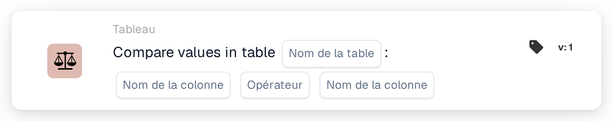
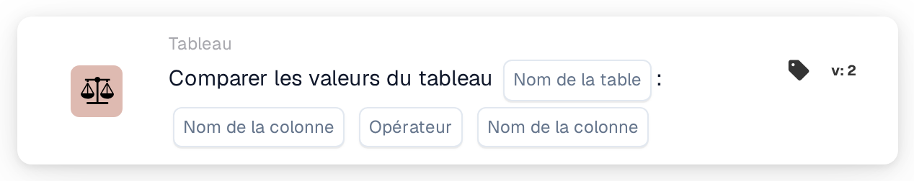

# Comparer les valeurs dans le tableau

<figure><figcaption>
Version 1
</figcaption></figure>

<figure><figcaption>
Version 2
</figcaption></figure>

## **Objectif :**

Cette carte DocBits effectue une comparaison entre les valeurs de deux colonnes spécifiées au sein d'un tableau, en fonction d'une condition choisie. Elle est utile pour les scénarios qui nécessitent de valider les relations entre points de données, comme le contrôle qualité, les contrôles de cohérence des données ou la vérification de conformité.

## **Fonctionnalité :**

* **Comparaison de colonnes :** cette carte permet aux utilisateurs de définir des conditions pour comparer les valeurs entre deux colonnes du même tableau.
* **Opérateurs :** les opérateurs suivants sont disponibles pour définir la comparaison :
  * **Est égal à (=) :** vérifie si les valeurs des deux colonnes sont exactement égales.
  * **Différent (≠) :** s'assure que les valeurs des deux colonnes ne sont pas égales.
  * **Supérieur à (>) :** confirme que les valeurs de la première colonne sont supérieures à celles de la seconde colonne.
  * **Supérieur ou égal à (≥) :** s'assure que les valeurs de la première colonne sont supérieures ou égales à celles de la seconde colonne.
  * **Inférieur à (<) :** vérifie si les valeurs de la première colonne sont inférieures à celles de la seconde colonne.
  * **Inférieur ou égal à (≤) :** s'assure que les valeurs de la première colonne sont inférieures ou égales à celles de la seconde colonne.
* **Sélection de la table et des colonnes :** les utilisateurs spécifient la table et les deux colonnes qu'ils souhaitent comparer.

## **Utilisation :**

Cette carte est idéale pour les analystes de données, les équipes de contrôle qualité ou les responsables de la conformité qui doivent garantir que les valeurs d'une colonne sont liées aux valeurs d'une autre selon des règles spécifiques, permettant une validation avancée des données.

## **Scénario d'exemple :**

* Un utilisateur configure la carte pour vérifier si les valeurs de la colonne « Current Stock » sont **supérieures ou égales à (≥)** aux valeurs de la colonne « Minimum Stock Level » dans la table « Inventory ». Si toutes les valeurs satisfont cette condition, le workflow se poursuit, confirmant que les niveaux de stock sont adéquats.

En utilisant la carte « Column Value Comparison », les organisations peuvent garantir la cohérence des données, maintenir des normes de qualité et valider les relations entre données au sein des tableaux.
