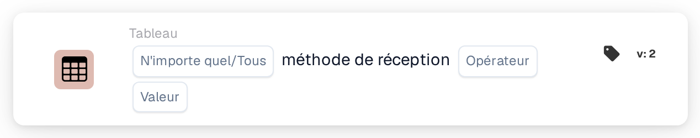

# Méthode de réception des articles

<figure><figcaption>
Version 2
</figcaption></figure>

## **Objectif :**

Cette carte DocBits vérifie si les articles d'un ensemble de données disposent d'une méthode de réception spécifiée. Les utilisateurs peuvent choisir de valider **un quelconque** article ou **tous** les articles de l'ensemble de données en fonction d'une condition sélectionnée, ce qui la rend adaptée aux scénarios où les workflows dépendent des méthodes de réception des articles, comme la gestion de la chaîne d'approvisionnement ou le suivi des stocks.

## **Fonctionnalité :**

* **Validation de la méthode de réception :** cette carte vérifie la méthode de réception des articles par rapport à une condition spécifiée. Les utilisateurs peuvent choisir entre **un quelconque** article ou **tous** les articles de l'ensemble de données et définir la condition comme **equals** ou **pas égal**.
* **Sélection des articles :** les utilisateurs peuvent spécifier :
  * **Any Item :** la carte se déclenche si au moins un article satisfait la condition de méthode de réception spécifiée.
  * **Tous les articles :** la carte ne se déclenche que si tous les articles satisfont la condition de méthode de réception spécifiée.
* **Opérateurs :** les opérateurs suivants sont disponibles pour définir la condition :
  * **Est égal à (=) :** vérifie si la méthode de réception correspond à la valeur spécifiée.
  * **Différent (≠) :** s'assure que la méthode de réception ne correspond pas à la valeur spécifiée.

## **Utilisation :**

Cette carte est idéale pour les responsables d'entrepôt, les coordinateurs de stock ou le personnel logistique qui doivent valider les méthodes de réception des articles avant d'autoriser des actions supplémentaires, comme le traitement, le stockage ou l'expédition.

## **Scénario d'exemple :**

* Un utilisateur configure la carte pour vérifier si **tous les articles** ont la méthode de réception **égale à « Direct Delivery »**. Si chaque article satisfait cette condition, le workflow se poursuit, confirmant que tous les articles sont destinés à une livraison directe.

En utilisant la carte « Receiving Method Validation », les organisations peuvent garantir le respect des protocoles de réception, améliorer les workflows logistiques et maintenir l'exactitude du traitement des articles selon des méthodes de réception spécifiques.
