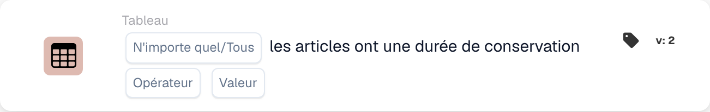

# Les articles ont une durée de conservation

<figure><figcaption>
Champs de la carte dans la version affichée. Les champs ne sont pas encore renseignés.
</figcaption></figure>

## **Objectif :**

Cette carte DocBits vérifie si les articles d'un ensemble de données satisfont des conditions spécifiées en fonction de leur durée de conservation. La carte permet aux utilisateurs de choisir entre « any » ou « all » articles pour la validation et prend en charge divers opérateurs de comparaison. C'est idéal pour les scénarios où les décisions du workflow dépendent de la durée de conservation des articles, comme le contrôle qualité, la gestion des stocks ou les contrôles de conformité.

## **Fonctionnalité :**

* **Validation de la durée de conservation :** cette carte vérifie la durée de conservation des articles par rapport à une condition spécifiée. Les utilisateurs peuvent choisir de valider **un quelconque** article ou **tous** les articles de l'ensemble de données et d'appliquer divers opérateurs de comparaison pour définir la condition.
* **Sélection des articles :** les utilisateurs peuvent choisir entre :
  * **Any Item :** la carte se déclenche si au moins un article satisfait la condition de durée de conservation spécifiée.
  * **Tous les articles :** la carte ne se déclenche que si tous les articles satisfont la condition de durée de conservation spécifiée.
* **Opérateurs :** les opérateurs suivants sont disponibles pour définir la condition de durée de conservation :
  * **Est égal à (=) :** vérifie si la durée de conservation est exactement égale à la valeur spécifiée.
  * **Différent (≠) :** s'assure que la durée de conservation n'est pas égale à la valeur spécifiée.
  * **Supérieur à (>) :** confirme que la durée de conservation est supérieure à la valeur spécifiée.
  * **Supérieur ou égal à (≥) :** s'assure que la durée de conservation est supérieure ou égale à la valeur spécifiée.
  * **Less Than (<) :** vérifie si la durée de conservation est inférieure à la valeur spécifiée.
  * **Inférieur ou égal à (≤) :** s'assure que la durée de conservation est inférieure ou égale à la valeur spécifiée.

## **Utilisation :**

Cette carte convient aux équipes de contrôle qualité, aux gestionnaires de stock ou aux responsables de la conformité qui doivent garantir que les articles satisfont des exigences spécifiques de durée de conservation avant de poursuivre des actions ou des workflows complémentaires.

## **Scénario d'exemple :**

* Un utilisateur configure la carte pour vérifier si **tous les articles** ont une durée de conservation **supérieure ou égale à 30 jours**. Si chaque article satisfait cette condition, le workflow se poursuit, confirmant que tous les articles ont une durée de conservation suffisante pour la vente ou la distribution.

En utilisant la carte « Shelf Life Validation », les organisations peuvent appliquer des normes de durée de conservation, maintenir la qualité des produits et garantir l'exactitude du workflow en fonction des conditions de durée de conservation des articles.
