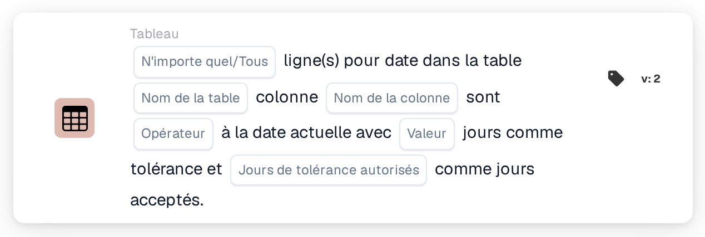

# Date du tableau et date du jour

<figure><figcaption>
Version 2
</figcaption></figure>

Le calcul de la fenêtre de tolérance, avec des exemples tels que « aujourd'hui ou demain », est expliqué sur la page [Date Tolerances](../date-tolerances.md).

## Objectif :

Cette carte de workflow compare une date figurant dans chaque ligne d'un tableau du document, par exemple une date de livraison, à la date du jour. Une tolérance en jours peut être définie, et les jours de la semaine pris en compte peuvent être choisis, de sorte que, par exemple, seuls les jours ouvrés soient utilisés. Elle peut servir à vérifier si les dates d'un document sont passées, correspondent à aujourd'hui, se situent dans les prochains jours ou sont futures. Selon le résultat, le workflow se poursuit avec la condition vraie ou la condition fausse.

## Composants de la carte :

1. **N'importe quel/Tous**
   * **Description :** définit si une ligne ou chaque ligne du tableau devrait remplir la condition.
   * **Options :**
     * **N'importe quel :** la condition est vraie si au moins une ligne remplit la condition.
     * **Tous :** la condition n'est vraie que si chaque ligne remplit la condition.
2. **Nom de la table**
   * **Description :** le nom du tableau du document qui contient les dates.
3. **Nom de la colonne**
   * **Description :** la colonne du tableau qui contient la date.
4. **Opérateur**
   * **Description :** définit la manière dont la date du tableau est comparée à la date du jour, compte tenu de la tolérance.
   * **Options :**
     * **Est :** la date se situe dans la plage de tolérance autour de la date du jour.
     * **Pas égaux :** la date se situe en dehors de la plage de tolérance.
     * **Supérieur à :** la date se situe après la plage de tolérance.
     * **Plus grand ou égal :** la date se situe dans la plage de tolérance ou après.
     * **Inférieur à :** la date se situe avant la plage de tolérance.
     * **Inférieur ou égal :** la date se situe dans la plage de tolérance ou avant.
5. **Valeur**
   * **Description :** la tolérance en jours.
   * **Détail :** la plage de tolérance s'étend sur ce nombre de jours avant et après la date du jour. Seuls les jours sélectionnés sous **Jours de tolérance autorisés** sont comptés. Si aucune valeur n'est définie, une tolérance de 0 jour est utilisée ; la plage se limite alors à la date du jour.
6. **Jours de tolérance autorisés**
   * **Description :** les jours de la semaine considérés comme jours acceptés.
   * **Options :** du lundi au dimanche ; plusieurs jours peuvent être sélectionnés.

## Fonctionnalité :

* **Évaluation de la condition :** la carte lit la date de la colonne sélectionnée pour chaque ligne du premier tableau portant le nom indiqué et la compare à la date du jour (la date en UTC). La plage de tolérance est calculée en comptant le nombre de jours indiqué vers l'avant et vers l'arrière à partir de la date du jour. Les jours de la semaine non sélectionnés ne sont pas comptés : la plage s'étend donc au-delà de ces jours, qui restent à l'intérieur de la plage. Par exemple, avec une tolérance de 2 jours, seuls les jours du lundi au vendredi sélectionnés et un vendredi comme date du jour, la plage s'étend du mercredi au mardi suivant.
* **Jours acceptés :** en plus de la comparaison, la date de chaque ligne devrait tomber sur l'un des jours de la semaine sélectionnés. Une ligne ne remplit la condition que si les deux vérifications sont concluantes. Les résultats de toutes les lignes sont ensuite regroupés selon **N'importe quel** ou **Tous**.
* **Exécution de l'action :**
  * **Condition vraie :**\
    Les dates satisfont l'opérateur sélectionné et tombent sur des jours acceptés, pour l'une ou pour toutes les lignes. Le workflow se poursuit avec la condition vraie.
  * **Condition fausse :**\
    Si la condition n'est pas remplie, le workflow se poursuit avec la condition fausse, par exemple pour soumettre le document à un contrôle manuel.
* **Données manquantes :** la carte n'évalue pas la condition et signale les données manquantes dans le journal du workflow si aucun nom de table, aucun nom de colonne ou aucun jour accepté n'est défini sur la carte, si le document n'a pas de tableau portant le nom indiqué, si une ligne du tableau ne comporte pas la colonne, ou si le tableau n'a pas de lignes. Si aucune option **N'importe quel/Tous** n'est définie, la carte le signale dans le journal et utilise **Tous**.
* **Erreurs :** si une valeur de la colonne de date ne peut pas être lue comme une date, la carte se termine par une erreur.

## Mise en place et configuration :

* La carte peut être ajoutée depuis la catégorie **Tableau**. Ensuite, **N'importe quel** ou **Tous**, le nom de la table, le nom de la colonne, l'opérateur, la tolérance en jours et les jours de la semaine acceptés peuvent être définis. Enfin, la condition de poursuite (vraie ou fausse) est définie ; elle détermine l'étape suivante du workflow.

## Conclusion :

La carte de workflow « Table Date to Current Date » vérifie les dates des postes par rapport à la date du jour, avec une tolérance qui peut être limitée aux jours ouvrés ou à toute autre sélection de jours de la semaine. Elle permet de repérer les documents dont les dates sont trop précoces, trop tardives ou tombent sur des jours non acceptés.
