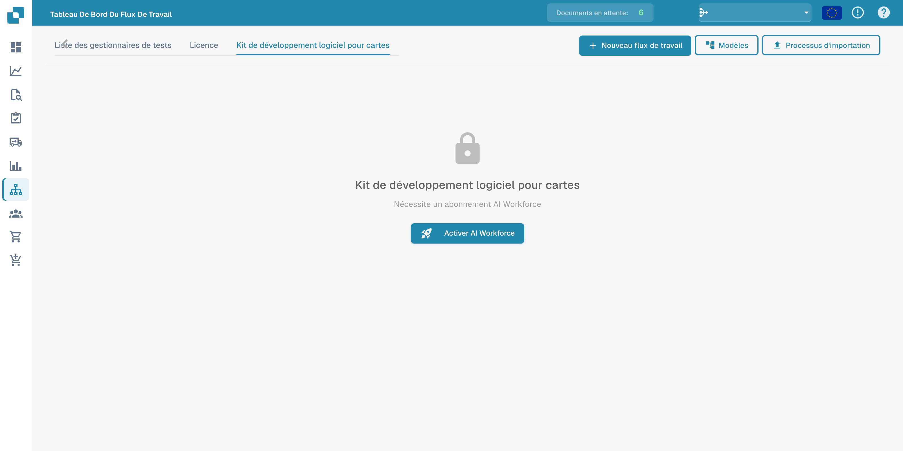

# Card SDK

Le **Kit de développement logiciel pour cartes** permet aux partenaires et aux développeurs de créer des cartes de workflow personnalisées pour DocFlow. Vous empaquetez une carte sous forme d'application partenaire et la téléversez, ou vous l'importez directement depuis GitHub.

<figure><figcaption>
Onglet Card SDK avec l’avis d’abonnement AI Workforce requis.
</figcaption></figure>

## Comment ça fonctionne

- **Télécharger le modèle SDK** — partez du modèle officiel qui contient la structure attendue.
- **Téléverser un fichier ZIP** — le ZIP doit contenir `app.json` et un dossier `.docflowcompose/flow/` avec les définitions de cartes (max 10 Mo). Upload &#x26; Validate vérifie le paquet avant qu'il ne soit accepté.
- **Importer GitHub** — importez une définition de carte directement depuis un dépôt GitHub.
- **Soumissions** — suivez le statut des cartes que vous avez soumises.

Une fois validées et acceptées, vos cartes personnalisées apparaissent dans la bibliothèque **Ajouter une carte** aux côtés des cartes intégrées.
