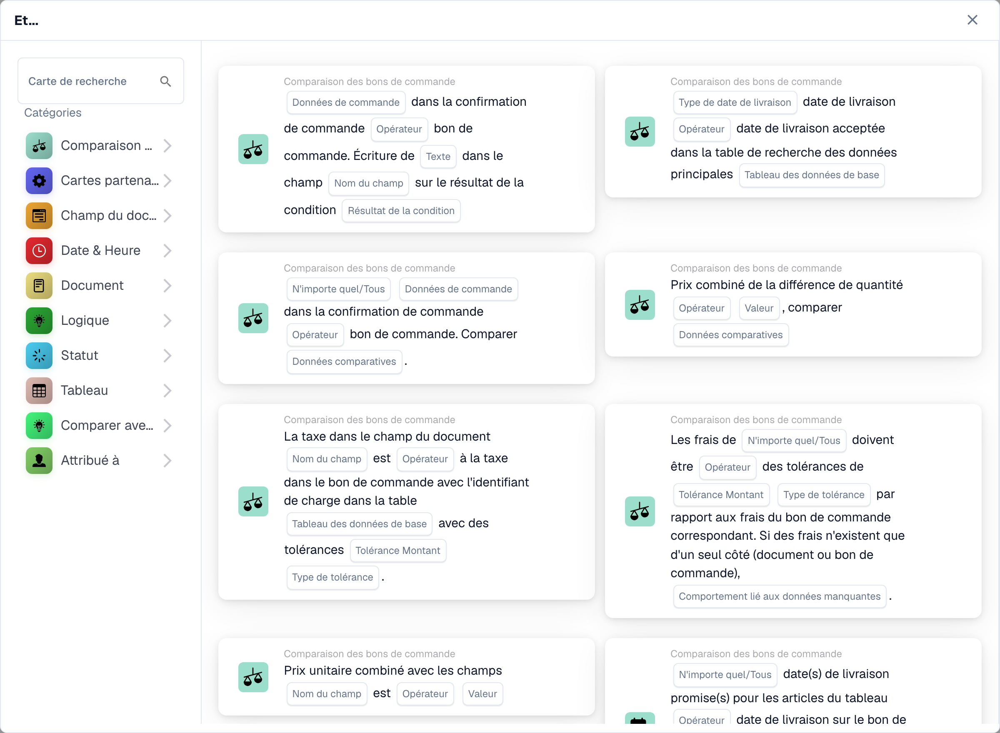

# Cartes

Les cartes sont les éléments constitutifs de chaque flux de travail. Vous les combinez dans les groupes **Quand / Et / Alors** pour décrire quand un workflow s'exécute et ce qu'il fait. Cette section explique les cartes disponibles et ce que chacune fait.

<figure><figcaption>
Cartes disponibles dans la catégorie sélectionnée. Renseignez les champs avant utilisation. Certains libellés de cette version de la carte ont encore une traduction incomplète ou incorrecte dans l’interface. Les explications de cette page emploient les termes corrects.
</figcaption></figure>

## Groupes de cartes

* **Quand** — les cartes de déclenchement qui démarrent un flux de travail (par exemple, type de document, type de document l'un des).
* **Et** — cartes de condition qui doivent également être vraies avant l'exécution des actions. Ceux-ci incluent _Comparer avec le bon de commande_ (correspondance de bon de commande), les comparaisons de _Document Field_, _Date & Time_, _Logic_, _Status_, _Table_ et _Assignee_ conditions.
* **Alors** — cartes d'action qui font le travail : définir les champs, approuver/rejeter, modifier le statut, exporter, créer des tâches, attribuer des documents, manipuler des tables et exécuter des actions (Appeler l'API, Envoyer une requête HTTPS, Exécuter un workflow, Calculs IA).

## Guides de référence des cartes

Pour une référence complète de chaque carte et de ses options, consultez les pages du _guide complet_ dans cette section (cartes de condition, cartes de correspondance de bon de commande, cartes d'affectation et d'utilisateur, cartes de tâches, cartes de terrain et de table et cartes d'action).

## Combiner des cartes

Pour voir des combinaisons éprouvées de cartes qui résolvent des scénarios commerciaux courants, consultez les **Guides des modèles de flux de travail**.

[Cartes logiques : référence complète](cards-overview/logic-cards-guide.md).
