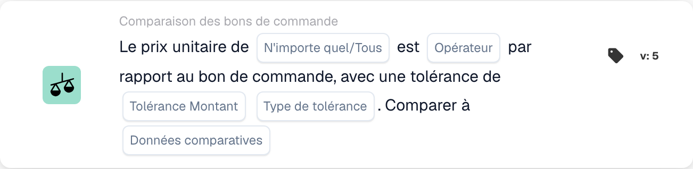

# Versions et disponibilité des cartes

<figure><figcaption>
Champs de la carte dans la version affichée. Les champs ne sont pas encore renseignés.
</figcaption></figure>

Une carte dans un flux de travail enregistré conserve son ID de carte et sa version. Un modèle plus récent peut ajouter des champs ou modifier le comportement sans modifier tous les flux de travail précédemment enregistrés. Vérifiez la version sur la carte réelle avant d'appliquer les instructions pour une version plus récente.

## Avant de modifier une carte enregistrée

1. Enregistrez ses champs et le résultat actuel sur des données de test représentatives.
2. Comparez sa version avec la référence, y compris les valeurs par défaut et le comportement des données manquantes.
3. Mettez à niveau ou remplacez la carte uniquement via l'action du constructeur prise en charge et vérifiez à nouveau ses paramètres.
4. Validez le graphique et testez les cas de réussite, d’échec et de données manquantes avant d’activer le flux de travail modifié.

Ne modifiez pas un type de fiche technique stocké simplement pour corriger son orthographe. Les workflows existants peuvent dépendre de cet identifiant. Une version non prise en charge est une erreur d’exécution et non une fausse condition commerciale.

## En cas d'absence de carte documentée

Vérifiez le groupe Quand, Et ou Alors sélectionné, la catégorie, le générateur Standard ou Avancé, les modules activés, les autorisations et la version déployée avec votre administrateur. Une carte mentionnée dans une intégration technique ou une référence plus récente n'est pas nécessairement activée pour votre organisation. Ne créez pas et n'importez pas une définition de carte devinée pour contourner un modèle manquant.

Les conditions de calendrier supplémentaires décrites dans certains documents de développement ne constituent pas un ensemble sélectionnable confirmé dans chaque version. Le setter Document-variable est également implémenté sans modèle d'interface utilisateur généralement prédéfini. Utilisez les cartes réellement disponibles dans votre environnement et demandez des éclaircissements avant de dépendre d'une carte indisponible.

## Références qui dépendent de la version

- [Cartes d'exportation](export-cards-guide.md) : statut du résultat et exportation immédiate ou en file d'attente.
- [Cartes de comparaison PO](po-comparison-versions-guide.md) : sens de comparaison et base de tolérance.
- [Cartes de comparaison de devis](quote-comparison-guide.md) : Tout/Tous et prix comparables manquants.
- [Cartes logiques](logic-cards-guide.md) : tags, variables d'organisation et types d'entrées.

Utilisez [Workflow Logs](../workflow-logs.md) pour distinguer le succès, une fausse condition, des données manquantes, une erreur de configuration et une carte ignorée. Enregistrez l'état du document et les paramètres de la carte avec un résultat de test ; une capture d'écran du sélecteur de cartes à elle seule n'établit pas le comportement d'exécution.
