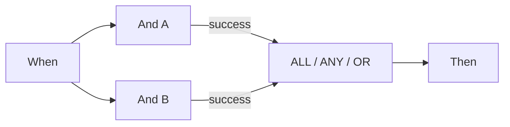

# P0 : connecter correctement Wait ALL, Wait ANY et OR

ALL exige une sortie connectée correspondante de **chaque source distincte**. ANY et OR exigent au moins une source correspondante. Relier le vert et l’orange d’une même source ne la compte qu’une fois. OR ne crée pas de branche exclusive et n’annule pas les autres actions. ANY ne garantit pas que la branche la plus rapide gagne.

L’ordonnanceur examiné attend d’abord tous les prédécesseurs entrants. Si une branche non choisie rend un prédécesseur inaccessible, l’exécution normale ignore la jonction bloquée. Le mode test peut l’évaluer avec les résultats disponibles. **Un test partiel vert ne prouve donc pas qu’une exécution documentaire poursuivra ce même graphe.**

Pour deux contrôles obligatoires, exécutez les deux et reliez leurs sorties requises à ALL. Pour les chemins alternatifs de cette version, utilisez la carte Then finale commune du cas v2. Cette convergence concerne des chemins mutuellement exclusifs ; elle n’est pas une barrière pour plusieurs actions simultanées.

Contrôlez séparément source, sortie connectée, sortie choisie et accessibilité réelle. Une source en Error conserve l’erreur globale même si ANY/OR réussit ensuite. Dans le code examiné, un ALL non satisfait porte également un détail d’erreur ; sa couleur orange ne suffit pas.

## Cartes et paramètres d’exemple

Ces valeurs décrivent des paramètres de cartes, pas un workflow complet importable. Remplacez YOUR_* par vos choix de test. Le concepteur gère l’ID caché de l’appelant. Catalogue : Dev, DocFlow 2.10.38, 21 octobre 2026 ; contrôlez versions et droits de votre organisation.

`node_type`: `all`, `any`, `or`

## Cas de test métier

| Cas | Entrée / configuration | Résultat attendu |
| --- | --- | --- |
| MERGE-01 | A=success; B=success | ALL/ANY/OR: join=success |
| MERGE-02 | A=success; B=failed_condition; B→failed_condition: — | ALL: join=failed_condition, workflow=error; ANY/OR: join=success, workflow=failed_condition |
| MERGE-03 | A=success; B=error | ANY/OR: join=success; workflow=error |
| MERGE-04 | A=success; B=non atteint | test : évaluer ; ordonnanceur : ignorer |
| MERGE-05 | A→success + A→failed_condition; B→success | sources=2 |

## Preuves et limites

Des résultats sélectionnés de cartes et de nœuds ont été vérifiés avec des données synthétiques dans Advanced Test. Les réponses sont dans le kit. Les actions documentaires sont simulées ; elles ne prouvent ni exécution persistante ni livraison externe.

[Poursuivre l’apprentissage](../workflow-learning-path.md) · [Kit de formation](../workflow-training-kit.md)
