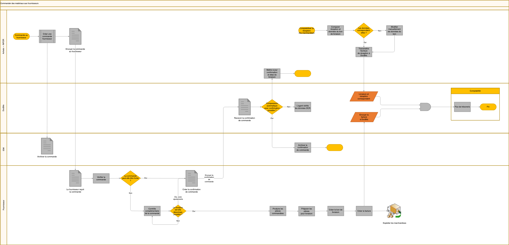

# Flux de travail de commande et de traitement du matériel

Le schéma illustre les échanges entre **les achats dans INFOR**, **DocBits**, **IDM**, **le fournisseur** et **la comptabilité**. Il s’agit d’un exemple d’intégration ; les contrôles, les documents et les connexions doivent être adaptés à votre configuration.

## Commande et confirmation

Les achats créent une commande dans INFOR et la transmettent au fournisseur. La commande et la confirmation suivent les chemins d’archivage vers **IDM** indiqués dans le schéma. La confirmation reçue passe par la capture et les contrôles de DocBits ; les données reconnues doivent être vérifiées et corrigées si nécessaire.

## Réception des marchandises

À la livraison, les équipes concernées contrôlent les marchandises et enregistrent la réception dans INFOR. Les informations de commande et de réception sont ensuite disponibles pour le rapprochement prévu par l’intégration. Une réception physique ou une reconnaissance OCR ne prouve pas à elle seule que les données sont correctes.

## Facture et rapprochement

La facture du fournisseur est capturée dans DocBits, puis rapprochée des données de commande et de réception. Les écarts nécessitent un examen et, si nécessaire, une correction avant de poursuivre le circuit configuré. Les contrôles de quantité, de prix et d’identité du fournisseur doivent refléter les règles de votre organisation.

## Archivage et comptabilité

**IDM** assure l’archivage illustré ; **DocBits** intervient dans la capture, le contrôle et le rapprochement. Le chemin vers la comptabilité représente la transmission prévue des informations validées. Vérifiez séparément l’archivage et le résultat comptable dans les systèmes cibles. Ce schéma ne prouve aucune exportation réussie ni aucun paiement.

<figure><figcaption>
Exemple de traitement des commandes de matériaux, confirmations, réceptions et factures entre fournisseur, achats, IDM, DocBits et comptabilité. Adaptez les contrôles et les connexions à votre configuration.
</figcaption></figure>
