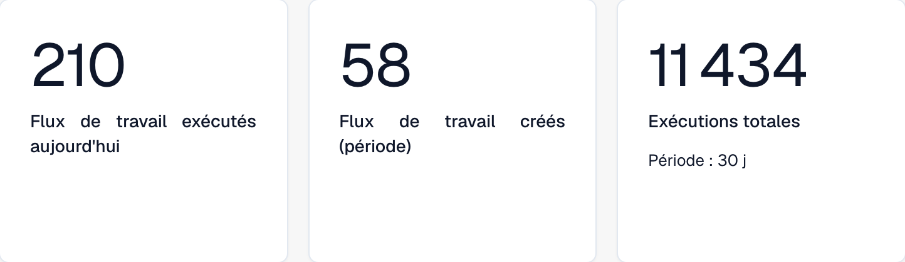
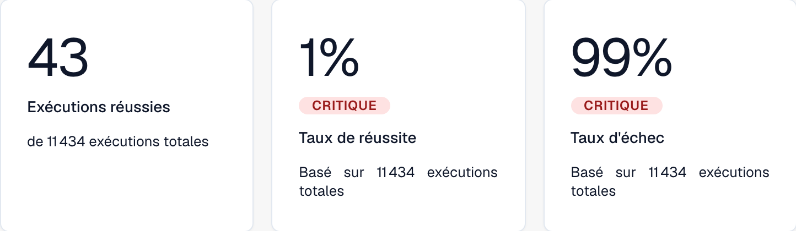
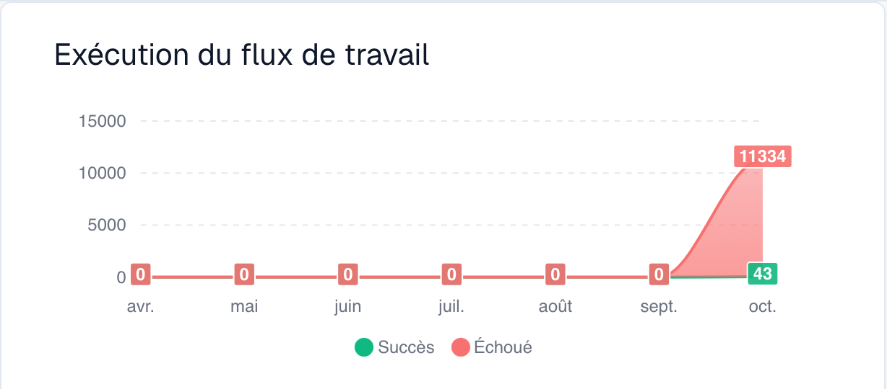
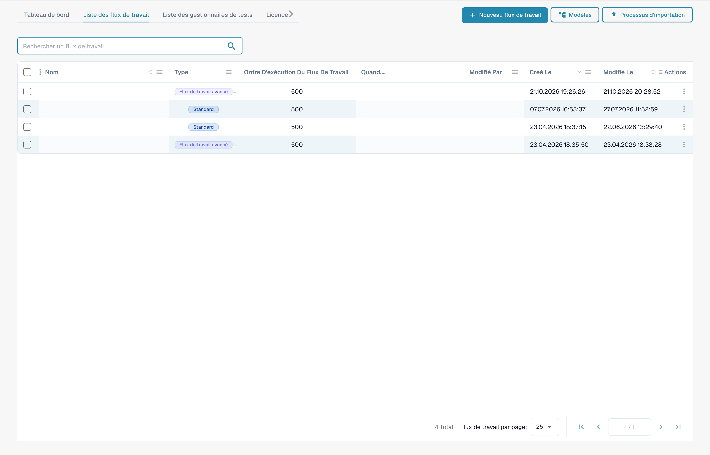

# Guides des modèles de flux de travail

**Version :** 1.0 **Dernière mise à jour :** 23 octobre 2025

***

## Aperçu

Ce répertoire contient des guides complets sur les modèles de flux de travail qui montrent comment combiner plusieurs cartes de flux de travail pour résoudre des scénarios commerciaux courants. Chaque modèle fournit des instructions de mise en œuvre étape par étape, des exemples complets et des bonnes pratiques.

**Que sont les modèles de flux de travail ?**

Les modèles de flux de travail sont des solutions éprouvées et réutilisables aux défis courants du traitement de la documentation. Au lieu de repartir de zéro, vous pouvez utiliser ces modèles comme modèles et les adapter à vos besoins spécifiques.

***

## Le Workflow Builder en un coup d'œil

Chaque modèle de cette page est assemblé dans le **Générateur de flux de travail**. Le tableau de bord permet de suivre le volume et les résultats des exécutions. Les trois vues partielles ci-dessous présentent les indicateurs de volume, les résultats d’exécution et le graphique mensuel.

<figure><figcaption><p>Indicateurs de volume : workflows exécutés aujourd’hui, workflows créés et exécutions totales sur la période sélectionnée.</p></figcaption></figure>

<figure><figcaption><p>Résultats d’exécution : exécutions réussies, taux de réussite et taux d’échec.</p></figcaption></figure>

<figure><figcaption><p>Graphique des exécutions : séries de réussite et d’échec sur les sept mois affichés en français.</p></figcaption></figure>

L'onglet **Liste des flux de travail** répertorie chaque workflow avec son type, son ordre d'exécution et son déclencheur. Utilisez **Ajouter un workflow** pour en créer un nouveau, ou cliquez sur un workflow pour l'ouvrir dans le générateur :

<figure><figcaption><p>La Workflow List — chaque ligne est un workflow que vous pouvez ouvrir, activer/désactiver ou modifier. Les noms et références de documents confidentiels sont masqués.</p></figcaption></figure>

Un workflow comprend trois groupes de cartes : **Quand** (déclencheur), **Et** (conditions supplémentaires) et **Alors** (actions). Cet exemple non enregistré illustre cette structure. Le type de document, la sous-organisation et l’utilisateur restent à sélectionner :

<figure><figcaption><p>Exemple non enregistré avec les cartes Quand, Et et Alors. Renseignez tous les champs avant exécution.</p></figcaption></figure>

Cliquez sur **Ajouter une carte** dans n'importe quel groupe pour ouvrir la bibliothèque de cartes. Les cartes sont organisées par catégorie (Comparer avec le bon de commande, les cartes partenaires, le champ du document, la date et l'heure, le document, la logique, le statut, la table, le destinataire, …) afin que vous puissiez trouver l'élément de base requis par chaque modèle :

<figure><figcaption><p>Cartes disponibles dans la catégorie sélectionnée. Renseignez les champs avant utilisation. Certains libellés de cette version de la carte ont encore une traduction incomplète ou incorrecte dans l’interface. Les explications de cette page emploient les termes corrects.</p></figcaption></figure>

***

## Modèles disponibles

### 1. [Modèle d'intégration API](api-integration-pattern.md)

**Complexité :** Moyen | **Temps d'installation :** 45-60 minutes

Découvrez comment intégrer DocBits à des API externes pour récupérer, valider et stocker des données à partir de systèmes externes.

**Cas d'utilisation :**

* Récupérez les prix en temps réel à partir de systèmes externes
* Valider les informations des fournisseurs par rapport aux bases de données principales
* Rechercher les détails des produits à partir des systèmes de catalogue
* Obtenez les taux de change des services de change
* Vérifier les adresses avec les services de géocodage

**Cartes utilisées :** CALL\_API, CONDITION\_HTTPS\_REQUEST\_STATUS, ACTION\_SET\_FIELD\_TO\_TEXT, CONDITION\_COMPARE\_TWO\_DOCFIELD\_VALUES

[**Afficher le modèle complet →**](api-integration-pattern.md)

***

### 2. [Modèle de gestion des tâches](task-management-pattern.md)

**Complexité :** Faible-Moyenne | **Temps d'installation :** 30-45 minutes

Maîtrisez l'art de créer, d'attribuer, de suivre et de gérer des tâches dans les flux de travail DocBits pour les processus d'approbation et de révision.

**Cas d'utilisation :**

* Créer des workflows d'approbation
* Attribuer des tâches de révision aux utilisateurs
* Gérer les exceptions nécessitant une intervention humaine
* Faire remonter les problèmes aux managers
* Créer des chaînes d'approbation à plusieurs niveaux
* Suivre l’achèvement des tâches et les délais

**Cartes utilisées :** tasks\_create, ACTION\_ASSIGN\_TO\_USER, ACTION\_SEND\_EMAIL\_TO\_GROUPS, CONDITION\_TASK\_STATUS

[**Afficher le modèle complet →**](task-management-pattern.md)

***

### 3. [Modèle de correspondance PO](po-matching-pattern.md)

**Complexité :** Moyen-Élevé | **Temps d'installation :** 60-90 minutes

Mettez en œuvre des workflows complets de rapprochement des bons de commande pour valider les factures par rapport aux bons de commande avec un routage basé sur les tolérances.

**Cas d'utilisation :**

* Valider les factures par rapport aux bons de commande
* Détecter les erreurs de prix avant le paiement
* Identifier les écarts de quantité
* Appliquer les contrôles d’approvisionnement
* Évitez les paiements en double
* Automatisez la correspondance à trois

**Cartes utilisées :** PURCHASE\_ORDER\_FULL\_MATCH, CONDITION\_DOC\_TO\_PO\_UNIT\_PRICE, CONDITION\_DOC\_TO\_PO\_QUANTITY, CONDITION\_DOC\_TO\_PO\_TAX\_LINES

[**Afficher le modèle complet →**](po-matching-pattern.md)

***

### 4. [Modèle logique de décision](decision-logic-pattern.md)

**Complexité :** Moyen | **Temps d'installation :** 30-45 minutes

Implémentez des arbres de décision complexes et une logique de routage conditionnel pour traiter les documents via différents chemins basés sur des règles métier.

**Cas d'utilisation :**

* Acheminer les documents par seuils de montant
* Appliquer différentes règles pour différents types de documents
* Implémenter une logique d’approbation à plusieurs niveaux
* Gérer des politiques commerciales complexes
* Créer un routage dynamique basé sur plusieurs critères
* Mettre en œuvre des matrices d’approbation

**Cartes utilisées :** CONDITION\_DOC\_FIELD\_AMOUNT, CONDITION\_DOC\_TYPE\_IS\_ISNOT, CONDITION\_SUPPLIER\_STATUS\_IS\_ISNOT, ACTION\_ASSIGN\_TO\_USER

[**Afficher le modèle complet →**](decision-logic-pattern.md)

***

### 5. [Modèle de transformation des données](data-transformation-pattern.md)

**Complexité :** Moyen | **Temps d'installation :** 30-45 minutes

Transformez, calculez, formatez et enrichissez les données du document pour préparer l'exportation, effectuer des calculs et standardiser les formats.

**Cas d'utilisation :**

* Calculer les totaux, sous-totaux, taxes
* Convertir des devises ou des unités
* Formater les dates, les nombres, le texte
* Dériver des valeurs à partir de champs existants
* Enrichir les données provenant de sources externes
* Standardiser les formats de données
* Valider les calculs

**Cartes utilisées :** ACTION\_CALCULATE\_FIELD, ACTION\_SET\_FIELD\_TO\_TEXT, ACTION\_COPY\_FIELD\_VALUE, CALL\_API, CONDITION\_COMPARE\_TWO\_DOCFIELD\_VALUES

[**Afficher le modèle complet →**](data-transformation-pattern.md)

***

## Guide de sélection des motifs

### Par complexité

| Complexité      | Modèles                                                                                                                                                                                      | Idéal pour                               |
| --------------- | --------------------------------------------------------------------------------------------------------------------------------------------------------------------------------------------- | -------------------------------------- |
| **Faible-Moyen**  | [Gestion des tâches](task-management-pattern.md)                                                                                                                                                 | Débutants, flux de travail simples            |
| **Moyen**      | <p><a href="api-integration-pattern.md">Intégration API</a><br><a href="decision-logic-pattern.md">Logique de décision</a><br><a href="data-transformation-pattern.md">Transformation des données</a></p> | Utilisateurs intermédiaires, workflows standards |
| **Moyen-Élevé** | [Correspondance PO](po-matching-pattern.md)                                                                                                                                                         | Utilisateurs avancés, validation complexe     |

***

### Par cas d'utilisation

| J'ai besoin de...                     | Utilisez ce modèle                                              |
| -------------------------------- | ------------------------------------------------------------- |
| Intégration avec des systèmes externes  | [Modèle d'intégration API](api-integration-pattern.md)         |
| Créer des workflows d'approbation        | [Modèle de gestion des tâches](task-management-pattern.md)         |
| Valider par rapport aux bons de commande | [Modèle de correspondance PO](po-matching-pattern.md)                 |
| Itinéraire selon conditions        | [Modèle logique de décision](decision-logic-pattern.md)           |
| Calculer et transformer des données     | [Modèle de transformation des données](data-transformation-pattern.md) |

***

### Par industrie/département

| Industrie/Département    | Modèles recommandés                                                                                                                        |
| ---------------------- | ------------------------------------------------------------------------------------------------------------------------------------------- |
| **Finance/Comptabilité** | [Correspondance de PO](po-matching-pattern.md), [Gestion des tâches](task-management-pattern.md), [Transformation des données](data-transformation-pattern.md) |
| **Approvisionnement**        | [Correspondance de PO](po-matching-pattern.md), [Logique de décision](decision-logic-pattern.md), [Intégration API](api-integration-pattern.md)           |
| **Opérations**         | [Gestion des tâches](task-management-pattern.md), [Logique de décision](decision-logic-pattern.md)                                                  |
| **IT/Intégration**     | [Intégration API](api-integration-pattern.md), [Transformation des données](data-transformation-pattern.md)                                        |
| **Tous les départements**    | [Logique de décision](decision-logic-pattern.md), [Gestion des tâches](task-management-pattern.md)                                                  |

***

## Comment utiliser ces modèles

### Étape 1 : Choisissez un modèle

1. Consultez les descriptions des modèles ci-dessus
2. Identifiez quel modèle correspond à votre cas d'utilisation
3. Vérifiez la complexité et le temps de configuration estimé
4. Consultez la section « Quand utiliser » dans le guide des modèles.

### Étape 2 : Vérifier les conditions préalables

Chaque guide de modèles répertorie :

* Connaissances requises
* Guides connexes à lire en premier
* Cartes qui seront utilisées
* Exigences de configuration

### Étape 3 : suivez les instructions étape par étape

Chaque modèle fournit :

* Exemple de flux de travail complet
* Guide de mise en œuvre étape par étape
* Modèles de configuration
* Exemples concrets
* Conseils de dépannage

### Étape 4 : Personnalisez selon vos besoins

* Adaptez l'exemple à vos règles métier
* Ajuster les seuils et les tolérances
* Modifier la logique de routage
* Ajouter/supprimer des étapes selon vos besoins
* Testez minutieusement avant utilisation en production

### Étape 5 : Surveiller et optimiser

* Suivre les performances du flux de travail
* Surveiller les taux de réussite
* Recueillir les commentaires des utilisateurs
* Affiner la configuration
* Personnalisations de documents

***

## Combinaisons de motifs

De nombreux scénarios du monde réel nécessitent de combiner plusieurs modèles :

### Exemple 1 : Terminer le traitement des factures

```
1. API Integration Pattern → Fetch current pricing
2. Data Transformation Pattern → Calculate totals
3. PO Matching Pattern → Validate against PO
4. Decision Logic Pattern → Route based on variance
5. Task Management Pattern → Create approval tasks
```

### Exemple 2 : Approbation de factures de grande valeur

```
1. Data Transformation Pattern → Calculate amounts
2. Decision Logic Pattern → Check thresholds
3. Task Management Pattern → Multi-level approval
4. API Integration Pattern → Notify external systems
```

### Exemple 3 : gestion des exceptions

```
1. PO Matching Pattern → Detect variances
2. Decision Logic Pattern → Classify exception severity
3. Task Management Pattern → Create review tasks
4. Data Transformation Pattern → Calculate impact
```

***

## Modèles de modèles

Chaque modèle comprend ces sections standardisées :

1. **Aperçu** - Que fait le modèle
2. **Quand utiliser** - Cas d'utilisation appropriés
3. **Exemple complet** - Scénario du monde réel
4. **Pas à pas** - Instructions de mise en œuvre
5. **Configuration** - Modèles de configuration de carte
6. **Schéma de workflow** - Représentation visuelle
7. **Variations avancées** - Implémentations alternatives
8. **Gestion des erreurs** - Problèmes courants et solutions
9. **Liste de contrôle des tests** - Étapes de validation
10. **Modèles associés** - Modèles complémentaires
11. **Guides associés** - Documentation de référence

***

## Obtenir de l'aide

### Ressources de support de modèle

**Documentation :**

* [Index complet du guide de flux de travail](..)
* [Guides de cartes individuelles](../then/action)
* [Référence des cartes de condition](../and/condition-cards-complete-guide.md)
* [Carte de liaison du flux de travail](https://github.com/Fellow-Consulting-AG/docbits/tree/main/WORKFLOW_LINKING_MAP.md)

**Ressources supplémentaires :**

* [Guide de référence rapide](https://github.com/Fellow-Consulting-AG/docbits/tree/main/WORKFLOW_LINKING_QUICK_REFERENCE.md)
* [Notes de version d'octobre 2025](https://github.com/Fellow-Consulting-AG/docbits/tree/main/readme/administration-and-setup/workflow/changelog/2025-10-october.md)
* [Référence de version de carte](../cards-overview/po-comparison-versions-guide.md)

**Contacter :**

* Commentaires sur les modèles : docs@docbits.com
* Support technique : support@docbits.com
* Aide à la mise en œuvre : consulting@docbits.com

***

## Statistiques de modèles

| Métrique                      | Valeur               |
| --------------------------- | ------------------- |
| **Modèles totaux**          | 5                   |
| **Total des cartes couvertes**     | 30+                 |
| **Documentation combinée**  | \~1 200 lignes       |
| **Exemples de scénarios**       | 25+                 |
| **Modèles de configuration** | 15+                 |
| **Diagrammes de flux de travail**       | 5 schémas complets |
| **Références croisées**        | 87+ liens internes  |

***

## Contribuer aux modèles

Vous disposez d'un modèle de flux de travail qui pourrait profiter à d'autres ?

**Directives de contribution aux modèles :**

1. **Documentez votre flux de travail**
   * Scénario commercial clair
   * Mise en œuvre étape par étape
   * Exemples de configuration de travail
   * Résultats des tests en situation réelle
2. **Modèle de modèle de suivi**
   * Utiliser la structure de section standard
   * Inclure tous les éléments requis
   * Fournir des diagrammes/exemples
   * Ajouter un guide de dépannage
3. **Soumettre pour examen**
   * Envoyez un e-mail à : docs@docbits.com
   * Inclure : description du modèle, cas d'utilisation, guide de mise en œuvre
   * Nous examinerons et éventuellement ajouterons à la documentation officielle

**Avantages :**

* Aidez les autres utilisateurs de DocBits
* Soyez reconnu dans la documentation
* Améliorer la base de connaissances globale des produits
* Recevez des commentaires sur votre mise en œuvre

***

## Journal des modifications

### Version 1.0 (23 octobre 2025)

* Version initiale de 5 modèles de flux de travail complets
* Modèle d'intégration d'API ajouté
* Modèle de gestion des tâches ajouté
* Modèle de correspondance de bon de commande ajouté
* Modèle logique de décision ajouté
* Modèle de transformation de données ajouté
* Mise en place de liens de références croisées (87 liens)
* Création d'un guide de sélection de motifs

***

## Prochaines étapes

**Nouveau dans les modèles de flux de travail ?**

1. Commencez par [Task Management Pattern](task-management-pattern.md) - le plus simple à comprendre
2. Examinez [Modèle logique de décision](decision-logic-pattern.md) - fondateur pour tous les flux de travail
3. Explorez [Modèle d'intégration API](api-integration-pattern.md) - besoin d'intégration courant

**Prêt à mettre en œuvre ?**

1. Choisissez votre modèle dans la liste ci-dessus
2. Lire le guide complet des modèles
3. Examiner les conditions préalables et les guides associés
4. Suivez les instructions étape par étape
5. Testez avec des exemples de documents
6. Déployer en production
7. Surveiller et optimiser

**Besoin d'aide supplémentaire ?**

* Consultez [Présentation de la documentation sur le workflow](..)
* Consultez le [Guide de référence rapide](https://github.com/Fellow-Consulting-AG/docbits/tree/main/WORKFLOW_LINKING_QUICK_REFERENCE.md)
* Contacter l'équipe d'assistance

***

**Dernière mise à jour :** 23 octobre 2025 **Maintenu par :** Équipe de documentation **Version :** 1.0
