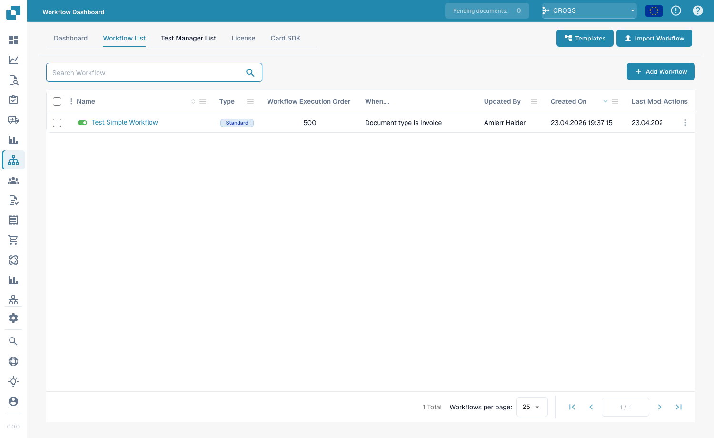
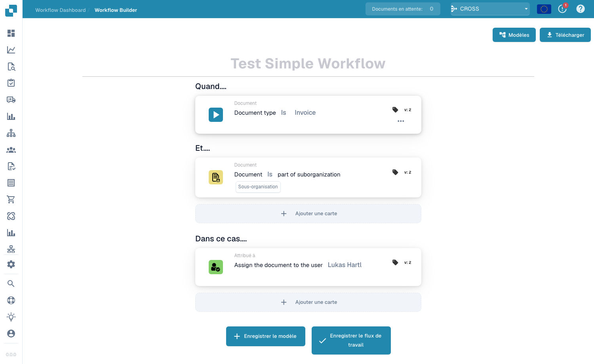

# Guides des modèles de workflow

**Version :** 1.0
**Dernière mise à jour :** 23 octobre 2025

---

## Vue d'ensemble

Ce répertoire contient des guides complets de modèles de workflow qui montrent comment combiner plusieurs cartes de workflow pour résoudre des scénarios métier courants. Chaque modèle fournit des instructions de mise en œuvre étape par étape, des exemples complets et des bonnes pratiques.

**Que sont les modèles de workflow ?**

Les modèles de workflow sont des solutions éprouvées et réutilisables pour les défis courants du traitement documentaire. Au lieu de partir de zéro, vous pouvez utiliser ces modèles comme gabarits et les adapter à vos besoins spécifiques.

---

## Le Workflow Builder en un coup d'œil

Chaque modèle de cette page est assemblé dans le **Workflow Builder**. Vous y accédez via **Workflow Dashboard → Workflow List → Add Workflow** (ou en ouvrant un workflow existant). Le tableau de bord vous donne l'historique des exécutions ainsi que les taux de réussite/échec de tous vos workflows :

<figure><figcaption><p>Le Workflow Dashboard — totaux d'exécutions, taux de réussite/échec et activité récente pour chaque workflow.</p></figcaption></figure>

L'onglet **Workflow List** liste chaque workflow avec son type, son ordre d'exécution et son déclencheur. Utilisez **Add Workflow** pour en créer un nouveau, ou cliquez sur un workflow pour l'ouvrir dans le builder :

<figure><figcaption><p>La Workflow List — chaque ligne est un workflow que vous pouvez ouvrir, activer/désactiver ou modifier.</p></figcaption></figure>

Un workflow est construit à partir de trois groupes de cartes — **When** (le déclencheur), **And** (conditions supplémentaires) et **Then** (les actions à exécuter). L'exemple ci-dessous se déclenche sur les factures appartenant à une sous-organisation et les affecte à un utilisateur :

<figure><figcaption><p>Le canevas du Workflow Builder. Chaque modèle ci-dessous n'est qu'une combinaison différente de cartes When / And / Then.</p></figcaption></figure>

Cliquez sur **Add Card** dans n'importe quel groupe pour ouvrir la bibliothèque de cartes. Les cartes sont organisées par catégorie (Compare with Purchase Order, Partner Cards, Document Field, Date &#x26; Time, Document, Logic, Status, Table, Assignee, …) afin que vous trouviez le bloc de construction dont chaque modèle a besoin :

<figure><figcaption><p>La bibliothèque <strong>Add Card</strong> — chaque carte référencée dans les modèles ci-dessous est sélectionnée ici.</p></figcaption></figure>

---

## Modèles disponibles

### 1. [Modèle d'intégration d'API](api-integration-pattern.md)

**Complexité :** Moyenne | **Temps de mise en place :** 45-60 minutes

Apprenez à intégrer DocBits à des API externes pour récupérer, valider et stocker des données provenant de systèmes externes.

**Cas d'usage :**
- Récupérer des tarifs en temps réel depuis des systèmes externes
- Valider les informations fournisseur par rapport à des bases de données de référence
- Rechercher des détails produit dans des systèmes de catalogue
- Obtenir des taux de change auprès de services de devises
- Vérifier des adresses avec des services de géocodage

**Cartes utilisées :** CALL_API, CONDITION_HTTPS_REQUEST_STATUS, ACTION_SET_FIELD_TO_TEXT, CONDITION_COMPARE_TWO_DOCFIELD_VALUES

**[Voir le modèle complet →](api-integration-pattern.md)**

---

### 2. [Modèle de gestion des tâches](task-management-pattern.md)

**Complexité :** Faible-Moyenne | **Temps de mise en place :** 30-45 minutes

Maîtrisez l'art de créer, affecter, suivre et gérer des tâches dans les workflows DocBits pour les processus d'approbation et de révision.

**Cas d'usage :**
- Créer des workflows d'approbation
- Affecter des tâches de révision aux utilisateurs
- Traiter les exceptions nécessitant une intervention humaine
- Escalader les problèmes vers les responsables
- Créer des chaînes d'approbation à plusieurs niveaux
- Suivre l'achèvement des tâches et les échéances

**Cartes utilisées :** tasks_create, ACTION_ASSIGN_TO_USER, ACTION_SEND_EMAIL_TO_GROUPS, CONDITION_TASK_STATUS

**[Voir le modèle complet →](task-management-pattern.md)**

---

### 3. [Modèle de rapprochement de commandes (PO Matching)](po-matching-pattern.md)

**Complexité :** Moyenne-Élevée | **Temps de mise en place :** 60-90 minutes

Mettez en place des workflows complets de rapprochement de commandes (PO Matching) pour valider les factures par rapport aux commandes avec un routage basé sur la tolérance.

**Cas d'usage :**
- Valider les factures par rapport aux commandes
- Détecter les erreurs de prix avant le paiement
- Identifier les écarts de quantité
- Faire respecter les contrôles d'approvisionnement
- Empêcher les paiements en double
- Automatiser le rapprochement à trois voies

**Cartes utilisées :** PURCHASE_ORDER_FULL_MATCH, CONDITION_DOC_TO_PO_UNIT_PRICE, CONDITION_DOC_TO_PO_QUANTITY, CONDITION_DOC_TO_PO_TAX_LINES

**[Voir le modèle complet →](po-matching-pattern.md)**

---

### 4. [Modèle de logique de décision](decision-logic-pattern.md)

**Complexité :** Moyenne | **Temps de mise en place :** 30-45 minutes

Mettez en place des arbres de décision complexes et une logique de routage conditionnel pour traiter les documents selon différents chemins en fonction des règles métier.

**Cas d'usage :**
- Router les documents par seuils de montant
- Appliquer des règles différentes selon les types de documents
- Mettre en place une logique d'approbation à plusieurs niveaux
- Gérer des politiques métier complexes
- Créer un routage dynamique basé sur plusieurs critères
- Mettre en place des matrices d'approbation

**Cartes utilisées :** CONDITION_DOC_FIELD_AMOUNT, CONDITION_DOC_TYPE_IS_ISNOT, CONDITION_SUPPLIER_STATUS_IS_ISNOT, ACTION_ASSIGN_TO_USER

**[Voir le modèle complet →](decision-logic-pattern.md)**

---

### 5. [Modèle de transformation des données](data-transformation-pattern.md)

**Complexité :** Moyenne | **Temps de mise en place :** 30-45 minutes

Transformez, calculez, formatez et enrichissez les données des documents pour préparer l'export, effectuer des calculs et standardiser les formats.

**Cas d'usage :**
- Calculer des totaux, sous-totaux, taxes
- Convertir des devises ou des unités
- Formater des dates, des nombres, du texte
- Dériver des valeurs à partir de champs existants
- Enrichir les données à partir de sources externes
- Standardiser les formats de données
- Valider les calculs

**Cartes utilisées :** ACTION_CALCULATE_FIELD, ACTION_SET_FIELD_TO_TEXT, ACTION_COPY_FIELD_VALUE, CALL_API, CONDITION_COMPARE_TWO_DOCFIELD_VALUES

**[Voir le modèle complet →](data-transformation-pattern.md)**

---

## Aide au choix du modèle

### Par complexité

| Complexité | Modèles | Idéal pour |
|------------|----------|----------|
| **Faible-Moyenne** | [Gestion des tâches](task-management-pattern.md) | Débutants, workflows simples |
| **Moyenne** | [Intégration d'API](api-integration-pattern.md)<br>[Logique de décision](decision-logic-pattern.md)<br>[Transformation des données](data-transformation-pattern.md) | Utilisateurs intermédiaires, workflows standard |
| **Moyenne-Élevée** | [PO Matching](po-matching-pattern.md) | Utilisateurs avancés, validation complexe |

---

### Par cas d'usage

| J'ai besoin de… | Utiliser ce modèle |
|--------------|------------------|
| Intégrer des systèmes externes | [Modèle d'intégration d'API](api-integration-pattern.md) |
| Créer des workflows d'approbation | [Modèle de gestion des tâches](task-management-pattern.md) |
| Valider par rapport aux commandes | [Modèle de rapprochement de commandes (PO Matching)](po-matching-pattern.md) |
| Router en fonction de conditions | [Modèle de logique de décision](decision-logic-pattern.md) |
| Calculer et transformer des données | [Modèle de transformation des données](data-transformation-pattern.md) |

---

### Par secteur/service

| Secteur/Service | Modèles recommandés |
|---------------------|---------------------|
| **Finance/Comptabilité** | [PO Matching](po-matching-pattern.md), [Gestion des tâches](task-management-pattern.md), [Transformation des données](data-transformation-pattern.md) |
| **Achats** | [PO Matching](po-matching-pattern.md), [Logique de décision](decision-logic-pattern.md), [Intégration d'API](api-integration-pattern.md) |
| **Opérations** | [Gestion des tâches](task-management-pattern.md), [Logique de décision](decision-logic-pattern.md) |
| **IT/Intégration** | [Intégration d'API](api-integration-pattern.md), [Transformation des données](data-transformation-pattern.md) |
| **Tous les services** | [Logique de décision](decision-logic-pattern.md), [Gestion des tâches](task-management-pattern.md) |

---

## Comment utiliser ces modèles

### Étape 1 : Choisir un modèle

1. Passez en revue les descriptions des modèles ci-dessus
2. Identifiez le modèle qui correspond à votre cas d'usage
3. Vérifiez la complexité et le temps de mise en place estimé
4. Lisez la section « Quand l'utiliser » du guide du modèle

### Étape 2 : Vérifier les prérequis

Chaque guide de modèle liste :
- Les connaissances requises
- Les guides connexes à lire en premier
- Les cartes qui seront utilisées
- Les exigences de configuration

### Étape 3 : Suivre les instructions étape par étape

Chaque modèle fournit :
- Un exemple de workflow complet
- Un guide de mise en œuvre étape par étape
- Des modèles de configuration
- Des exemples concrets
- Des conseils de dépannage

### Étape 4 : Adapter à vos besoins

- Adaptez l'exemple à vos règles métier
- Ajustez les seuils et les tolérances
- Modifiez la logique de routage
- Ajoutez ou supprimez des étapes selon vos besoins
- Testez minutieusement avant la mise en production

### Étape 5 : Surveiller et optimiser

- Suivez les performances du workflow
- Surveillez les taux de réussite
- Recueillez les retours des utilisateurs
- Affinez la configuration
- Documentez les personnalisations

---

## Combinaisons de modèles

De nombreux scénarios réels nécessitent la combinaison de plusieurs modèles :

### Exemple 1 : Traitement complet des factures

```
1. API Integration Pattern → Fetch current pricing
2. Data Transformation Pattern → Calculate totals
3. PO Matching Pattern → Validate against PO
4. Decision Logic Pattern → Route based on variance
5. Task Management Pattern → Create approval tasks
```

### Exemple 2 : Approbation de factures de montant élevé

```
1. Data Transformation Pattern → Calculate amounts
2. Decision Logic Pattern → Check thresholds
3. Task Management Pattern → Multi-level approval
4. API Integration Pattern → Notify external systems
```

### Exemple 3 : Gestion des exceptions

```
1. PO Matching Pattern → Detect variances
2. Decision Logic Pattern → Classify exception severity
3. Task Management Pattern → Create review tasks
4. Data Transformation Pattern → Calculate impact
```

---

## Gabarits de modèles

Chaque modèle contient ces sections standardisées :

1. **Vue d'ensemble** - Ce que fait le modèle
2. **Quand l'utiliser** - Cas d'usage appropriés
3. **Exemple complet** - Scénario réel
4. **Étape par étape** - Instructions de mise en œuvre
5. **Configuration** - Gabarits de configuration des cartes
6. **Diagramme de workflow** - Représentation visuelle
7. **Variantes avancées** - Mises en œuvre alternatives
8. **Gestion des erreurs** - Problèmes courants et solutions
9. **Liste de vérification de test** - Étapes de validation
10. **Modèles connexes** - Modèles complémentaires
11. **Guides connexes** - Documentation de référence

---

## Obtenir de l'aide

### Ressources de support pour les modèles

**Documentation :**
- [Index complet des guides de workflow](../README.md)
- [Guides de cartes individuels](../then/action/)
- [Référence des cartes de condition](../and/condition-cards-complete-guide.md)
- [Carte des liens du workflow](../../../../WORKFLOW_LINKING_MAP.md)

**Ressources complémentaires :**
- [Guide de référence rapide](../../../../WORKFLOW_LINKING_QUICK_REFERENCE.md)
- [Notes de version d'octobre 2025](../changelog/2025-10-october.md)
- [Référence du versionnage des cartes](../../../docs/card_version.md)

**Contact :**
- Retours sur les modèles : docs@docbits.com
- Support technique : support@docbits.com
- Aide à la mise en œuvre : consulting@docbits.com

---

## Statistiques des modèles

| Indicateur | Valeur |
|--------|-------|
| **Nombre total de modèles** | 5 |
| **Nombre total de cartes couvertes** | 30+ |
| **Documentation combinée** | ~1 200 lignes |
| **Scénarios d'exemple** | 25+ |
| **Gabarits de configuration** | 15+ |
| **Diagrammes de workflow** | 5 diagrammes complets |
| **Références croisées** | 87+ liens internes |

---

## Contribuer aux modèles

Vous avez un modèle de workflow qui pourrait profiter à d'autres ?

**Consignes de contribution :**

1. **Documentez votre workflow**
   - Scénario métier clair
   - Mise en œuvre étape par étape
   - Exemples de configuration fonctionnels
   - Résultats de tests en conditions réelles

2. **Suivez le gabarit de modèle**
   - Utilisez la structure de sections standard
   - Incluez tous les éléments requis
   - Fournissez des diagrammes/exemples
   - Ajoutez un guide de dépannage

3. **Soumettez pour relecture**
   - Envoyez un e-mail à : docs@docbits.com
   - Joignez : description du modèle, cas d'usage, guide de mise en œuvre
   - Nous l'examinerons et l'ajouterons éventuellement à la documentation officielle

**Avantages :**
- Aidez les autres utilisateurs de DocBits
- Soyez reconnu dans la documentation
- Améliorez la base de connaissances globale du produit
- Recevez des retours sur votre mise en œuvre

---

## Journal des modifications

### Version 1.0 (23 octobre 2025)
- Première publication de 5 modèles de workflow complets
- Ajout du modèle d'intégration d'API
- Ajout du modèle de gestion des tâches
- Ajout du modèle de rapprochement de commandes (PO Matching)
- Ajout du modèle de logique de décision
- Ajout du modèle de transformation des données
- Mise en place des liens de références croisées (87 liens)
- Création de l'aide au choix du modèle

---

## Prochaines étapes

**Nouveau dans les modèles de workflow ?**
1. Commencez par le [Modèle de gestion des tâches](task-management-pattern.md) - le plus facile à comprendre
2. Consultez le [Modèle de logique de décision](decision-logic-pattern.md) - fondamental pour tous les workflows
3. Explorez le [Modèle d'intégration d'API](api-integration-pattern.md) - besoin d'intégration fréquent

**Prêt à mettre en œuvre ?**
1. Choisissez votre modèle dans la liste ci-dessus
2. Lisez le guide complet du modèle
3. Vérifiez les prérequis et les guides connexes
4. Suivez les instructions étape par étape
5. Testez avec des documents d'exemple
6. Passez en production
7. Surveillez et optimisez

**Besoin d'aide supplémentaire ?**
- Consultez la [Vue d'ensemble de la documentation des workflows](../README.md)
- Consultez le [Guide de référence rapide](../../../../WORKFLOW_LINKING_QUICK_REFERENCE.md)
- Contactez l'équipe de support

---

**Dernière mise à jour :** 23 octobre 2025
**Maintenu par :** Équipe Documentation
**Version :** 1.0
